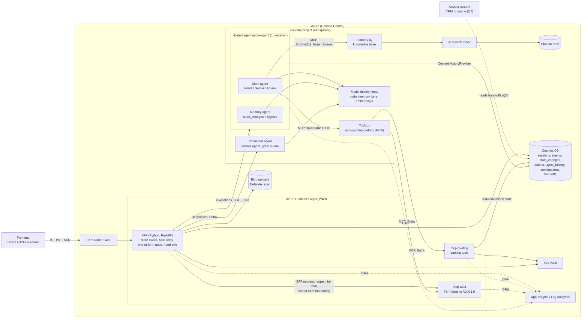
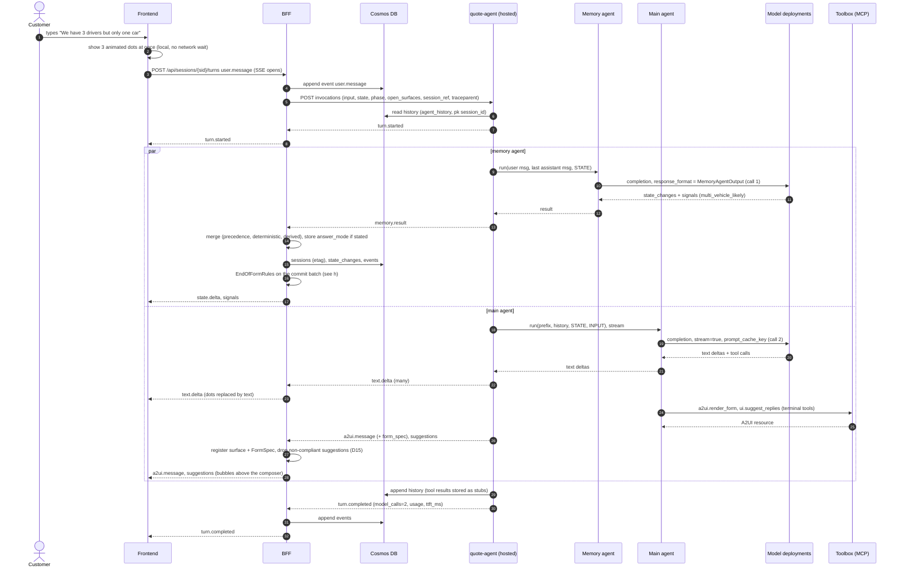
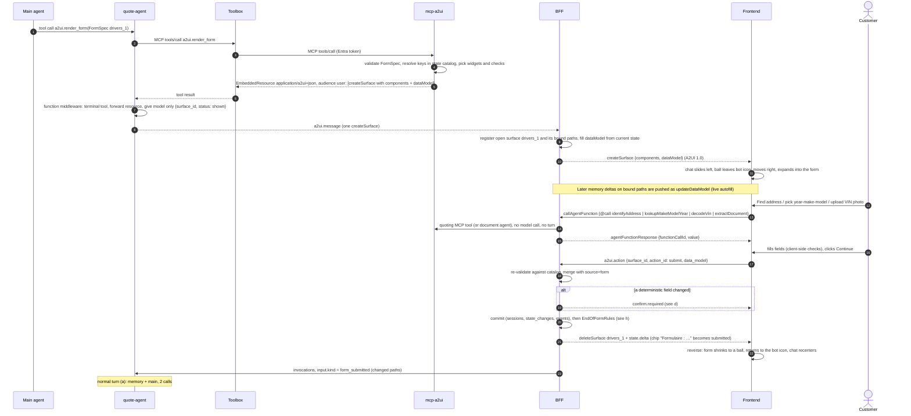
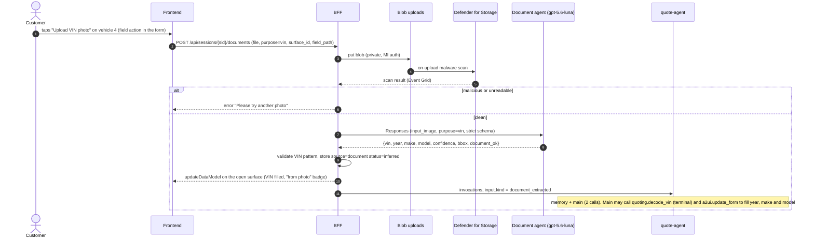
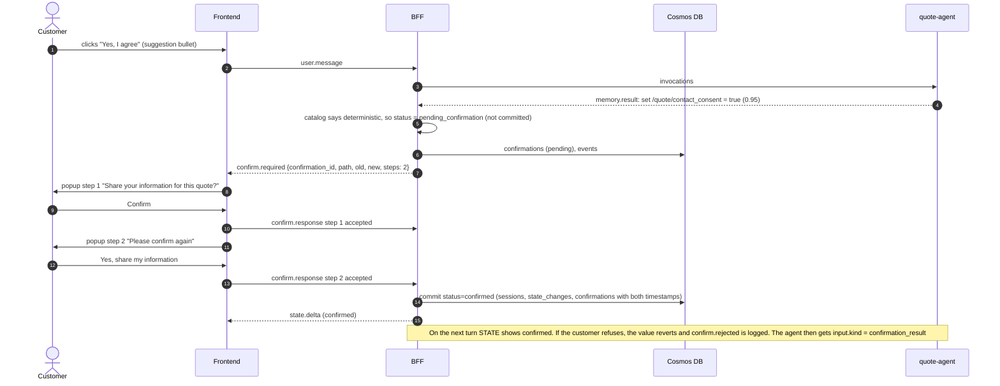
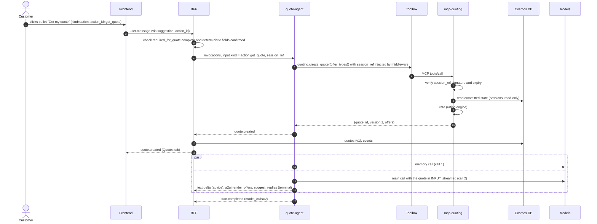
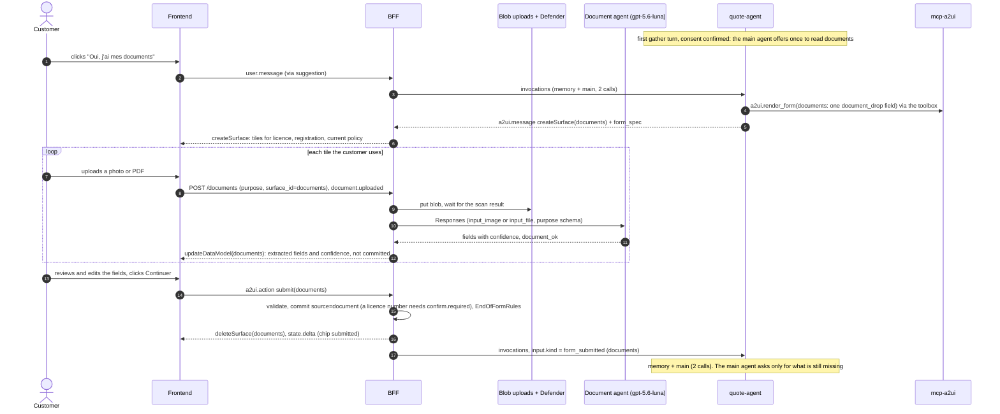
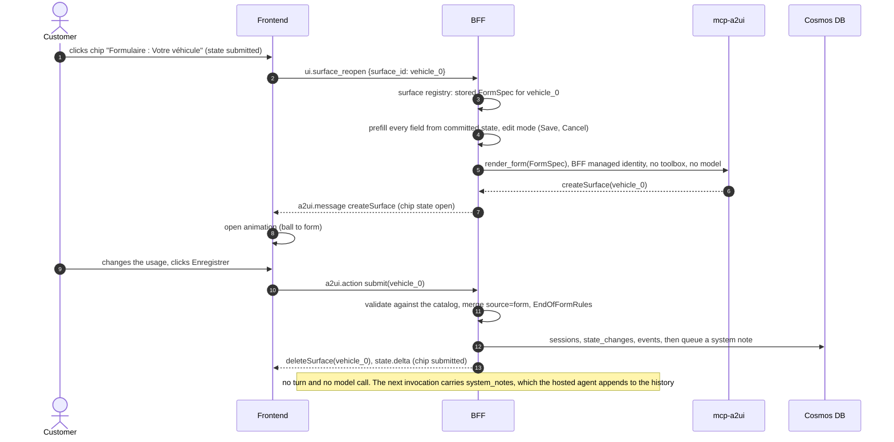
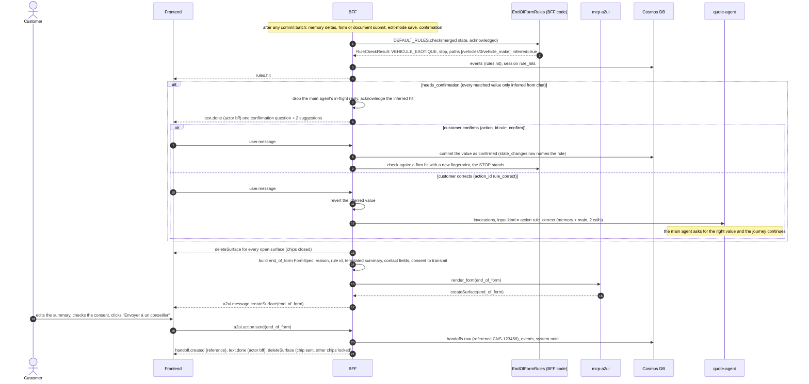

# Architecture: auto insurance quoting agent on Azure AI Foundry

Status: design only. Nothing is deployed. Last updated: 2026-11-24.
Read with: [`README.md`](README.md) (decisions D1–D20), [`contracts/`](contracts/) and [`prompts/`](prompts/).
This document follows those contracts. If it disagrees with one, the contract wins and this file is wrong.

Items marked **[UNVERIFIED]** were not confirmed in current documentation. [Verify before build](#18-verify-before-build) lists them.

---

## 1. Context and scope

A customer gets a personal auto insurance quote by chatting with an advisor agent in a web app. The agent:

- works through three phases, **Intent → Gather → Advise**, with one prompt;
- asks in chat first, offers once to read the customer's documents to pre-fill, and opens small forms it generates at runtime (**A2UI**) only for clusters of structured fields (D13, D18);
- calls quoting tools (address, vehicle, quote creation and changes) through an **MCP toolbox**;
- explains coverage from a grounded knowledge base (**Foundry IQ**).

A **memory agent** reads every turn. It extracts state changes and *signals*, for example "3 drivers and 1 car: the household probably has another vehicle", plus the customer's answer-mode preference (D14). The **BFF** owns the session state. It merges changes, asks the customer to double-confirm sensitive fields, runs the end-of-form rules after every commit (D19), and logs every event. When a rule stops the online quote, the BFF hands the file to an advisor.

**In scope:** the quoting journey from first message to a priced quote with versions, plus document upload (VIN plate, licence, registration, current policy declaration page) and the advisor hand-off when a rule stops the online quote.
**Out of scope:** binding the policy, payment, claims and policy servicing.

Market assumption, from `state-catalog.json`: Canada with Quebec as the home province, CAD, kilometres, French first (fr-CA) and English. The client demo UI is for Desjardins Assurances (D12, §7.5).

### 1.1 Constraints from the brief

| Constraint | Where it is met |
|---|---|
| Azure Foundry and Azure services. Azure agent SDK for agent development | §2, §3. Microsoft Agent Framework (Python) inside a Foundry hosted agent |
| Exactly 1 hosted agent container, in Foundry | `quote-agent` (§2, D1). The document agent is a *prompt* agent, not a container |
| 2 model calls per user response: main quoter + memory agent | §8 |
| Document AI model on `gpt-5.6-luna` | Document prompt agent (§4.3) |
| Hosted agent session persisted in Cosmos DB | `agent_history` container via `CosmosHistoryProvider` (§6) |
| BFF receives memory output and updates Cosmos DB and its own state | §6 merge rules, §10 session cache |
| A2UI forms through an MCP server connected to the toolbox | §7 |
| Dots, streaming, conversation cache, prompt + tools < 30k tokens | §9, §10, [`prompts/token-budget.md`](prompts/token-budget.md) |
| Deterministic fields → double-confirm popup | §5 (d), §6 |
| Everything logged; traces and tool usage in an observability pipeline | §13, §15 |
| Guardrails keep the agent on quoting | §14 |
| Client decisions D12–D20 (UI shell, text-first gathering, preferences, suggestions, form chips, AssignmentBoard, DocumentDrop, end-of-form rules, full-form mode) | §5 (f)–(h), §6.4, §7.2, §7.4, §7.5, §14 |

---

## 2. Components

Region: **Canada Central** is primary and **Canada East** is disaster recovery (D11). Hosted agents are offered in both ([limits and regions](https://learn.microsoft.com/en-us/azure/foundry/agents/concepts/limits-quotas-regions)). Model availability per region is **[UNVERIFIED]** (README Q2).

| # | Component | Azure service | Suggested SKU / tier | Purpose |
|---|---|---|---|---|
| 1 | Foundry resource | Microsoft Foundry (`Microsoft.CognitiveServices/accounts`, kind AIServices) | S0. **Standard agent setup** (bring your own Cosmos DB, Storage, AI Search). Public network disabled; private endpoint | Hosts model deployments, agents, toolbox, guardrails, tracing |
| 2 | Foundry project | Foundry project `auto-quoting` | — | Project endpoint `https://<resource>.services.ai.azure.com/api/projects/auto-quoting`. Owns agents, toolbox, connections and evaluations |
| 3 | **Hosted agent `quote-agent`** | Foundry Agent Service, hosted agent (GA) | **1 vCPU / 2 GiB per session**. Idle timeout 15 min. Invocations protocol. Source-zip deploy (`runtime python_3_13`, `remote_build`) | The only container. Runs the **main agent** and the **memory agent** (Microsoft Agent Framework). Streams events to the BFF |
| 4 | **Document agent** | Foundry Agent Service, prompt agent | Model deployment `gpt-5.6-luna` | Extracts fields from uploaded images and PDFs with strict JSON output. Called by the BFF only |
| 5 | Model deployments | Foundry models | `MAIN_MODEL_DEPLOYMENT`: GPT-5.6 family, Data Zone Standard, PTU later. `MEMORY_MODEL_DEPLOYMENT`: small, fast model with structured outputs. `gpt-5.6-luna`: vision. An embedding model for Foundry IQ. Each has a guardrail attached | Inference. Names are placeholders until Q2 is answered |
| 6 | **Toolbox `auto-quoting-toolbox`** | Foundry toolbox | One version, promoted to default | One MCP endpoint (`{project}/toolboxes/auto-quoting-toolbox/mcp?api-version=v1`) in front of `mcp-quoting` and `mcp-a2ui`. Entra auth. Tool names are namespaced (`quoting.*`, `a2ui.*`) ([toolbox overview](https://learn.microsoft.com/en-us/azure/foundry/agents/concepts/toolbox-overview)) |
| 7 | **Foundry IQ knowledge base** `auto-quoting-kb` | Foundry IQ (Azure AI Search) | Knowledge base with one blob knowledge source. Reached through its MCP endpoint (`knowledge_base_retrieve`) | Coverage definitions, underwriting rules, discounts, FAQ. Answers come with citations ([Foundry IQ connect](https://learn.microsoft.com/en-us/azure/foundry/agents/how-to/foundry-iq-connect)) |
| 8 | Azure AI Search | Azure AI Search | **Standard S1, 2 replicas** (read SLA), semantic ranker on, private endpoint | Index behind the knowledge base |
| 9 | Knowledge documents | Blob Storage, container `kb-docs` | StorageV2, ZRS, private endpoint | Source documents indexed by Search. This is the draft's "Index in a blob storage" |
| 10 | Azure Container Apps environment | Azure Container Apps | Workload-profiles environment, VNet-integrated, internal | Hosts `mcp-quoting`, `mcp-a2ui` and `bff` |
| 11 | `mcp-quoting` | Container App (Python, MCP streamable HTTP) | Min 1, max 10 replicas. Internal ingress | Tools `identify_address`, `identify_vehicle_type`, `lookup_make_model_year`, `decode_vin`, `create_quote`, `modify_quote`. Wraps the rating engine (Q3) |
| 12 | `mcp-a2ui` | Container App (Python, MCP streamable HTTP) | Min 1, max 10. Internal ingress. Stateless | Compiles **FormSpec → A2UI 1.0** messages using the state catalog, including `AssignmentBoard` and `DocumentDrop`. Tools `render_form`, `update_form`, `close_form`, `render_offers`. The BFF also calls `render_form` directly for reopened chips, full-form mode and the end-of-form surface |
| 13 | **BFF** | Container App (Python, FastAPI) | Min 2, max 20. **Session affinity on**. Ingress through Front Door Private Link only | Owns session state, merge rules, deterministic confirmations, SSE relay, logging. Runs the end-of-form rules (`EndOfFormRules`, `bff/rules/end_of_form.py`) after every commit and creates advisor hand-offs (D19). Filters suggested replies (D15). Keeps the surface registry and renders reopened chips, full-form mode and the end-of-form surface through `mcp-a2ui` with no model call (D16, D20). Calls the hosted agent and the document agent |
| 14 | **Cosmos DB** | Azure Cosmos DB for NoSQL | Autoscale. Database `quoting`. Multi-region: Canada Central write, Canada East read with service-managed failover. Private endpoint. Separate from the Foundry standard-setup database | Session state, full event log, audit trail, quotes, agent history, confirmations, advisor hand-offs (§6.3) |
| 15 | Uploads | Blob Storage, container `uploads` | StorageV2, ZRS, private, lifecycle delete after 30 days. **Microsoft Defender for Storage** with on-upload malware scanning | Customer documents for the document agent |
| 16 | Key Vault | Azure Key Vault | Standard, RBAC mode, private endpoint | `session_ref` signing key and the External ID client certificate. No keys in code or environment variables |
| 17 | Observability | Application Insights (workspace-based) + Log Analytics | Connected to the Foundry project | OTel traces, metrics and logs from every tier. Foundry tracing view |
| 18 | Edge | Azure Front Door Premium + WAF | Managed rules, bot protection, rate limiting, Private Link to Container Apps | TLS, WAF and global entry for the web app and `/api` |
| 19 | Frontend | Azure Static Web Apps Standard, behind Front Door | — | React + TypeScript app with the A2UI renderer and custom catalog, in the Variation C shell for Desjardins Assurances (D12, §7.5): French first, form chips, "Votre dossier" panel, full-form toggle, phone layout at 600 px and below. Outside the core Azure box in the draft |
| 20 | Customer identity | Microsoft Entra External ID (CIAM tenant) | — | Optional sign-in. The journey starts as an anonymous session (Q4) |
| 21 | Container registry | Azure Container Registry | Premium, private endpoint | Images for `mcp-quoting`, `mcp-a2ui` and `bff`. The hosted agent uses source-zip deploy, so it needs no image |
| 22 | Network | VNet with subnets: `aca-infra`, `private-endpoints`, `agent-egress` (hosted agent BYO VNet). Private DNS zones | — | Private data plane (§12) |

---

## 3. Architecture diagram

The draw.io version, in the draft's layout, is [`architecture.drawio`](architecture.drawio).



What changed from the draft:

- **Model deployments** are shown inside Foundry.
- **Uploads, Key Vault, App Insights and Front Door** are added.
- **`mcp-quoting` reads committed state from Cosmos DB.** This keeps quote inputs model-free (§8.4).
- **Foundry IQ** keeps its own edge from the main agent, as in the draft. It can also be added as a toolbox entry; see §4.4.
- **The BFF calls `mcp-a2ui` directly** for surfaces it renders itself: reopened chips, full-form mode and the end-of-form surface (D16, D19, D20). These need no model, so they do not go through the toolbox.
- **Advisor hand-offs** are written to Cosmos `handoffs`. How the advisor system receives them is open question Q7.

---

## 4. Agents

### 4.1 Hosted agent `quote-agent` (the one container)

- **Runtime.** Python 3.13 with Microsoft Agent Framework. The Foundry hosting adapter is `agent-framework-foundry-hosting` with `InvocationsHostServer`, which is Beta **[UNVERIFIED version]**. The fallback is the framework-agnostic `azure-ai-agentserver-invocations`. The container contract ([hosted agent contract](https://learn.microsoft.com/en-us/azure/foundry/agents/concepts/hosted-agent-contract)) requires:
  - port 8088;
  - `GET /readiness`;
  - `POST /invocations` with SSE.
  - Session affinity comes from `agent_session_id`.
- **Two agents in one process:**
  - `main` (quoter): `MAIN_MODEL_DEPLOYMENT`, system prompt [`prompts/main-agent.md`](prompts/main-agent.md), and tools from `contracts/tools.json`:
    - the toolbox MCP endpoint, through `MCPStreamableHTTPTool`;
    - the Foundry IQ MCP endpoint;
    - local functions `ui.suggest_replies` and `ui.set_phase`.
  - `memory`: `MEMORY_MODEL_DEPLOYMENT`, system prompt [`prompts/memory-agent.md`](prompts/memory-agent.md), `response_format` = `memory-output.schema.json` in strict mode, and **no tools**.
- **Per turn** (§5 a):
  1. Load history from Cosmos `agent_history` (`CosmosHistoryProvider`, partition key `/session_id`). Append the BFF's `system_notes` (changes made between turns with no model call, such as a reopened-form save, a full-form save, a rule hit or a hand-off) as system messages, before the new input.
  2. Run `memory` and `main` concurrently (`asyncio.gather`).
  3. Stream main-agent text as `text.delta`.
  4. Forward A2UI resources as `a2ui.message`. A `createSurface` from `a2ui.render_form` also carries the FormSpec the model sent (`form_spec`), so the BFF can reopen the form later (D16).
  5. Emit `memory.result` as soon as the memory agent returns.
  6. Save history.
  7. Emit `turn.completed` with `model_calls` and `usage`.
- **History hygiene.** Tool results are stored in history as short stubs, for example `{surface_id, status: shown}`, not full A2UI payloads. History is compacted above 12k tokens ([`prompts/token-budget.md`](prompts/token-budget.md)).
- **Identity.** Foundry creates a dedicated **Entra agent identity** at deploy. It is used for model calls, the toolbox, Foundry IQ and Cosmos `agent_history` (§11).
- **Deploy.** `project.agents.create_version_from_code(...)` with `HostedAgentDefinition(cpu="1", memory="2Gi", code_configuration=CodeConfiguration(runtime="python_3_13", entry_point=["python","main.py"], dependency_resolution="remote_build"), protocol_versions=[ProtocolVersionRecord(protocol="invocations", version=...)])` ([deploy from code](https://learn.microsoft.com/en-us/azure/foundry/agents/how-to/deploy-hosted-agent-code)). The invocations protocol version string is **[UNVERIFIED]**.
- **Configuration.** Through environment variables:
  - `MAIN_MODEL_DEPLOYMENT`, `MEMORY_MODEL_DEPLOYMENT`;
  - `TOOLBOX_MCP_URL`, `KB_MCP_URL`;
  - `COSMOS_ENDPOINT`, `COSMOS_DATABASE=quoting`, `COSMOS_CONTAINER=agent_history`;
  - `PROMPT_VERSION`, `PYTHONNOUSERSITE=1`.

  It needs no secrets. Every call uses the agent identity.

### 4.2 Main agent and memory agent responsibilities

| | Main agent | Memory agent |
|---|---|---|
| Input | Static prefix, history (with system notes), then STATE, SIGNALS, CONFLICTS, OPEN_SURFACES, PREFERENCES, RULES, INPUT | Static prefix, then the last assistant message, the user input (or a text rendering of a structured input) and STATE |
| Output | Streamed text plus tool calls | `MemoryAgentOutput` JSON only: `state_changes`, `signals`, `conflicts`, `intent`, `session_preferences` |
| Writes state? | No. It proposes through tools (forms) and its text | No. It proposes `state_changes`; the BFF decides |
| Tools | 13 (`contracts/tools.json`) | None |
| Model | `MAIN_MODEL_DEPLOYMENT` | `MEMORY_MODEL_DEPLOYMENT` (small, fast) |

The memory agent runs on **every** turn, including form submissions, button actions and document extractions. On a structured input it gets a compact text rendering, for example `FORM drivers-1 submitted: 3 drivers, 1 vehicle`. It is expected to add signals and conflicts, not field values, because the BFF already holds those values from the form. This keeps "main + memory per user response" true for every response.

**Gathering style (D13, D14).** The main agent asks in chat by default, one question per turn. It opens a small subject form (one subject, at most about 5 fields: Vous, Véhicule, Conducteurs, Antécédents) only when the subject still has several structured fields or the customer asks for forms. Right after consent is confirmed it offers once to read documents (§5 f). It never asks the customer to choose between text and forms; it says once that both work. When the customer states a preference ("je préfère écrire", "montrez-moi un formulaire"), the memory agent returns `session_preferences.answer_mode`, the BFF stores it in the session document and emits `session.preferences`, and the main agent follows it from the next turn as PREFERENCES: `text` means no forms except the driver-vehicle board, `forms` means subject forms.

### 4.3 Document agent

- Foundry **prompt agent** `document-agent` on `gpt-5.6-luna`, with prompt [`prompts/document-agent.md`](prompts/document-agent.md). It has a strict JSON schema per purpose: `vin`, `licence`, `registration` or `declaration`.
- Invoked by the BFF through the agent endpoint (Responses protocol) with the file as `input_image` or `input_file`. It is never a tool of the main agent (D7). So a document never adds a model call to a chat turn, and untrusted document text only reaches the main agent as schema-validated field values.
- Output: field values with `confidence` and `page/bbox`, plus `document_ok` and a reason. The BFF puts values into state with `source=document` and status `inferred` until the customer reviews them in the form (events.md, rule 1).
- **DocumentDrop (D18).** The documents form has one `document_drop` field with three tiles: driver's licence (`licence`), registration certificate (`registration`) and current policy (`declaration`). Each upload goes through the same scan-then-extract path. The extracted fields go back to that surface with their confidence and are **not** committed: the customer reviews and edits them, then submits, and only then does the BFF commit them with `source=document` (§5 f). A licence number still goes through the double confirmation (FR-DOC-7).

### 4.4 Toolbox and Foundry IQ

- The **toolbox** `auto-quoting-toolbox` has two MCP entries: `quoting` → `mcp-quoting` and `a2ui` → `mcp-a2ui`. Each uses a `RemoteTool` project connection with Entra auth, set to `require_approval="never"`. Hosted agents get platform tools only through a toolbox MCP endpoint ([toolbox](https://learn.microsoft.com/en-us/azure/foundry/agents/how-to/tools/toolbox)). Whether the GA label covers the toolbox itself is **[UNVERIFIED]**.
- **Foundry IQ.** The knowledge base `auto-quoting-kb` has one knowledge source: blob container `kb-docs`, indexed by AI Search.
  - The main agent calls `knowledge_base_retrieve` on `{search_endpoint}/knowledgebases/auto-quoting-kb/mcp?api-version=2026-11-01-preview`. That API version is preview **[UNVERIFIED GA date]**.
  - The draft draws a separate edge to Foundry IQ, and this design keeps it. Adding the knowledge base as a third toolbox entry is equivalent. It would give one MCP connection instead of two and is a valid simplification.

---

## 5. Sequence diagrams

### (a) Chat turn: memory and main concurrently, streaming, state merge



### (b) A2UI form: open, submit, close



If server-side validation fails, the BFF does not send `deleteSurface`. It sends an `updateDataModel` with errors under a reserved `/_errors` path, and the form stays open.

### (c) Document upload → document agent → autofill



### (d) Deterministic field: double confirmation



The main agent's reply in the same turn does not ask for consent again. The prompt says the system handles confirmation.

### (e) Get-quote button: create_quote runs before the model



`modify_quote` follows the same path when it starts from the offers surface's adjust panel (`a2ui.action` → `input.kind=action`).

### (f) Document offer and DocumentDrop review (D13, D18)



"Je ne les ai pas" (a suggestion) or "Continuer sans documents" (a form action) skips the documents. The agent does not offer them again and gathers through chat and subject forms. A tile that fails the scan or returns `document_ok=false` shows "Please try another photo" and the other tiles stay usable.

### (g) Form chip reopen and full-form mode (D16, D20)



Full-form mode uses the same path with the reserved `surface_id: full_form`. The BFF builds that FormSpec from the catalog, not with a model: one section per entity, a repeater for vehicles and drivers, every known value prefilled, system flags left out and derived fields read-only. Saving commits with `source=form` and runs the rule check, like any form submit. "Conversation" in the header toggle closes the surface and returns to the chat; unsaved edits are not committed.

### (h) End-of-form rules and advisor hand-off (D19)



A `FLAG` hit (for example `JEUNE_CONDUCTEUR_PRINCIPAL`) only adds an advisor signal and the journey continues. The header button "Parler à un conseiller" opens the same end-of-form surface with the reason "customer request" and no rule id. §6.4 has the rule details.

---

## 6. State model and merge rules

### 6.1 Shape

One state document per session in Cosmos `sessions` (id = `session_id`, partition key `/session_id`):

```json
{
  "session_id": "s_8f2c", "phase": "gather", "prompt_version": "main:v12",
  "quote":        { "first_name": { "value": "Marie", "source": "form", "confidence": 1, "status": "confirmed", "turn": 4, "updated_at": "..." } },
  "vehicles":     [ { "vehicle_year": { "value": 2019, "source": "chat", "confidence": 0.95, "status": "inferred", "turn": 2 } } ],
  "drivers":      [ { } ],
  "underwriting": { },
  "household":    { "driver_vehicle_assignments": { "value": [ ], "source": "form", "status": "confirmed" } },
  "signals": [ ], "conflicts": [ ], "open_surfaces": ["drivers-1"],
  "session_preferences": { "answer_mode": "text" },
  "surfaces": { "vehicle_0": { "title": "Votre véhicule", "origin": "agent", "status": "submitted", "form_spec": { }, "bound_paths": ["/vehicles/0/usage_type"] } },
  "rule_hits": [ ], "acknowledged": [ ], "advisor_signals": [ ], "system_notes": [ ], "handoff": null, "_etag": "..."
}
```

- `session_preferences.answer_mode` is a session setting (D14), not a catalog field.
- `surfaces` is the surface registry behind the form chips (D16): title, who rendered it (`agent` or `bff`), chip status (`open`, `submitted`, `closed`, `sent`), the FormSpec and the bound paths.
- `rule_hits`, `acknowledged` (fingerprints of hits already handled) and `advisor_signals` come from the end-of-form rules (§6.4). `system_notes` wait here until the next invocation carries them. `handoff` points to the `handoffs` row once one exists.

Field keys, types, enums, patterns and `deterministic` flags come from [`contracts/state-catalog.json`](contracts/state-catalog.json). Paths are JSON Pointers, for example `/vehicles/0/vehicle_year`. A2UI data bindings use the same pointers.

### 6.2 Merge rules (summary of `contracts/events.md`)

The BFF is the **only writer** (D4).

1. **Precedence**, from highest to lowest: `form`, then `document` (after review), then `lookup`, then `chat` (memory agent), then `system`. A lower source never overwrites a `confirmed` value. It creates a conflict, and the main agent asks about it on the next turn.
2. **Deterministic fields** are every catalog field with `deterministic: true`. Today that is `contact_consent`, `driver_license_number`, `has_claims`, `has_convictions_in_past_three_years` and `was_denied_or_cancelled`. They never commit directly. They go through `pending_confirmation`, then `confirm.required`, then a two-step popup, then `confirmed`. A refusal reverts the value and logs `confirm.rejected`. Pending changes expire after 900 s.
3. **Memory changes with confidence < 0.6** are stored as `inferred` with a dotted underline in the UI. They can prefill forms but never reach `create_quote` until confirmed.
4. **Derived fields** (`years_licensed`, `years_as_principal_driver`) are computed by the BFF, never by a model.
5. **Every commit writes** the state document (optimistic concurrency on `_etag`), a `state_changes` row and the event, in that order. On an etag conflict the BFF reloads and reapplies the merge.
6. **The end-of-form rules run after every commit batch**, whatever the source (§6.4).
7. **The answer-mode preference** from the memory agent replaces the stored value when it is not null. It is a setting, so precedence and confirmation do not apply.

### 6.3 Cosmos DB containers

All containers are in database `quoting`, partition key **`/session_id`**. The TTLs are proposals and need compliance review (Law 25 minimization).

| Container | Content | Writer | TTL (proposed) |
|---|---|---|---|
| `sessions` | One state document per session | BFF | 90 days after last activity |
| `events` | Every inbound and outbound event: the full conversation log | BFF | 365 days |
| `state_changes` | Append-only audit: path, old, new, source, status, turn, actor, trace_id | BFF | 365 days, plus export (§15) |
| `quotes` | Every quote version with offers and input snapshot hash | BFF (from `quote.*` events) | 3 years (to confirm) |
| `agent_history` | Agent Framework history for the hosted agent's session | quote-agent identity | 30 days (matches hosted session retention) |
| `confirmations` | Deterministic confirmations: text shown, both step timestamps, result | BFF | 3 years (proof of consent, to confirm) |
| `handoffs` | Advisor hand-offs (D19): reference (`CNS-123456`), reason, rule id, the summary as the customer edited it, contact details, consent-to-transmit timestamp, status. The advisor system reads it (Q7) | BFF | 3 years (to confirm) |

The Foundry standard-setup database, which Foundry creates for its own run state, stays separate. The app never writes there.

### 6.4 End-of-form rules and advisor hand-off (D19)

**Where the check runs.** `EndOfFormRules` in `bff/rules/end_of_form.py` is plain BFF code: each rule is a pure predicate over the merged state, with a severity and a customer-facing reason in French and English. The commit function calls `DEFAULT_RULES.check(state, acknowledged)` synchronously after every commit batch, once per batch, whatever the source: memory-agent deltas, form submits, document reviews, reopened-form and full-form saves, and confirmations. A commit batch is everything one atomic state write contains. Rules read the whole merged state, never only the delta, so they do not depend on the order in which values arrive, and a hit missed because of a crash is found again at the next commit.

For a form, document or confirmation input, the batch commits before the BFF invokes the agent. A STOP or a confirmation question then means the agent is not invoked at all, and a FLAG reaches the main agent in the same turn. Memory-agent deltas commit while the main agent of that turn is already streaming. On a STOP or a confirmation question, the BFF drops the main agent's in-flight reply instead of forwarding it; a FLAG reaches the main agent on the next turn, as signals do.

**Why the commit and not a callback on the memory agent's response.** Forms, documents and full-form edits never pass through the memory agent. Every source passes through the commit, so it is the single choke point. The check is deterministic, auditable and costs no model call.

**Rules.** `check` returns a `RuleCheckResult` whose hits are ordered STOP first. Each `RuleHit` has the rule id, the severity, the matched paths, a copy of the matched values, `inferred` (true when every matched value has status `inferred`, that is, guessed from chat), a fingerprint and the reasons. `needs_confirmation` is true when the first STOP hit is inferred. The table shows the example rules. The module is the source of truth, and underwriting owns the list and its thresholds (Q8).

| Rule | Severity | Condition (catalog paths) |
|---|---|---|
| `VEHICULE_EXOTIQUE` | STOP | `/vehicles/N/vehicle_make` is on the exotic list in the module (Lamborghini, Ferrari, McLaren, Bugatti, Rolls-Royce, Bentley, Aston Martin) |
| `VEHICULE_MODIFIE_PERFORMANCE` | STOP | `/vehicles/N/modified_for_performance` is true |
| `USAGE_AGRICOLE` | STOP | `/vehicles/N/usage_type` is `farm` |
| `REFUS_OU_RESILIATION` | STOP | `/underwriting/was_denied_or_cancelled` is true **and** confirmed. The field is deterministic, so a value still pending the double confirmation never matches |
| `JEUNE_CONDUCTEUR_PRINCIPAL` | FLAG | A driver younger than 25 holds the `principal` role in `/household/driver_vehicle_assignments` (age from `driver_date_of_birth`, or `/quote/date_of_birth` for the policyholder) |

**Acknowledged hits.** After handling a hit, the BFF stores its fingerprint in the session (`acknowledged`), so the same match is not reported at every later commit. The fingerprint hashes the rule id, the paths, the values and `inferred`, so a corrected value or a value that firms up (inferred, then confirmed) produces a new hit. That is how one inferred STOP leads to one question and, after a "yes", to the end-of-form surface.

**Effects.**
- `FLAG`: the hit goes to `advisor_signals`, the trace drawer, the quote record and any later hand-off. The customer sees nothing, and the journey continues.
- `STOP` with `needs_confirmation`: the BFF asks one templated confirmation question (`text.done`, `actor: "bff"`) with two suggestions. `rule_confirm` commits the value as `confirmed`; the next check finds a firm hit, and the STOP stands. `rule_correct` reverts the value and invokes the agent with `input.kind=action`, so the main agent asks for the right value. Typing an answer instead also works: the next commit runs the rules again.
- `STOP` that stands: the BFF sends `deleteSurface` for every open surface (their chips become `closed`), blocks `get_quote`, and renders the `end_of_form` surface through `mcp-a2ui`. It acknowledges every hit of the result: the hand-off covers them all.
- Every new hit is written to `events` as `rules.hit` (without the matched values, which can be PII), kept in `rule_hits`, and added to `system_notes`. The main agent sees active hits as RULES and, after a STOP, gathers nothing more.

**The end-of-form surface.** The BFF builds the FormSpec itself, with no model call:
- the reason and the rule id;
- a short summary of the conversation, built from a template over committed state and signals, which the customer can edit (catalog field `/quote/handoff_summary`, a `textarea`);
- contact fields (first name, last name, phone, email), bound to their catalog paths and prefilled;
- a consent-to-transmit checkbox (catalog field `/quote/handoff_consent`). It is required to send.

Edits on this surface commit with `source=form` like any form. **Envoyer à un conseiller** validates the contact fields and the consent, writes a `handoffs` row with a reference such as `CNS-123456`, emits `handoff.created`, and shows a templated confirmation with the reference. The chip becomes `sent`, and the other chips lock. **Modifier mes réponses** closes the surface so the customer can reopen a chip. A commit that clears the hit lifts the STOP; earlier hits stay in `events` (`rules.hit`) for audit.

**Customer request.** The header button "Parler à un conseiller" opens the same surface with the reason "customer request" and no rule id.

---

## 7. A2UI design

**Version.** The design targets **A2UI 1.0**, the current stable spec ([v1.0](https://a2ui.org/specification/v1.0-a2ui/): "Status: Current"; v0.9.1 is "Closed" and tells new projects to target 1.0). Google announced 1.0 on 2026-11-11 ([blog](https://developers.googleblog.com/a2ui-10-build-delightful-fast-reliable-agentic-experiences/)). What 1.0 changes for this design:

| Topic | A2UI 1.0 rule | How the design uses it |
|---|---|---|
| Envelope | Every message carries `"version": "1.0"` | Compiler and BFF emit only 1.0; the renderer rejects anything else |
| Opening a form | `createSurface` may embed `components` and `dataModel` (data model applied first); `catalogId` is optional; `theme` is invalid | One message opens a form, so the open animation never waits for a second message |
| IDs | Component ids are identifiers (`user_card`, not `user-card`) | Surface ids and component ids use underscores (`drivers_1`, `textfield_3`) |
| Binding | `{"@path": "/x"}`; relative `{"@path": "x"}` inside a template scope | Fields bind to state pointers; repeater rows use relative paths (`vin` inside `/vehicles/3`) |
| Validation | `"@checks"`: CheckRules `{condition: {"@call": ...}, message}` | Catalog rules become checks (`required`, `regex`, `email` and the insurance functions `numericRange`, `ageBetween`, `dateWithin`, `vinCheckDigit`, `ymmValid`, `onePrincipalPerVehicle`) |
| Text | Markdown in `text`; variants are only `body` and `caption` | Titles are `## Title`, sections `### …` |
| Buttons | `child` (a Text id) and `action.event.name`; variants `primary`, `borderless` | Form actions |
| Data model updates | `updateDataModel.value` is required; `null` deletes the key | Live autofill; provenance under `/_provenance/<escaped pointer>`; server errors under `/_errors` |
| Function calls | `callAgentFunction` / `agentFunctionResponse` (renderer ↔ agent) and `callRendererFunction` / `rendererFunctionResponse` | Field lookups (address, YMM, VIN decode) and document reads go renderer → BFF → quoting MCP or document agent, with no model call |

Field-level details still marked **[UNVERIFIED]**: the exact names of the basic catalog's validation functions, and whether the chosen React/web renderer already supports 1.0. The blog says some platform renderers are still on 0.9.1 with 1.0 "coming soon", and Gemini still supports 0.9.1 (V11).

### 7.1 Pipeline

```
Main agent --FormSpec--> a2ui.render_form (toolbox) --> mcp-a2ui compiler --> A2UI 1.0 createSurface
   (intent level, ~100-400 tokens)                        uses state-catalog.json   (EmbeddedResource,
                                                                                     application/a2ui+json)
quote-agent middleware --a2ui.message events--> BFF --SSE--> React A2UI renderer (insurance catalog, 1.0)
React renderer --callAgentFunction--> BFF --MCP--> mcp-quoting / document agent --agentFunctionResponse--> renderer
```

1. **FormSpec** ([`contracts/form-spec.schema.json`](contracts/form-spec.schema.json)). The agent describes the form at intent level: `form_id`, `title`, `intro`, `entity`, `layout`, and `fields` (each with `key`, `widget`, `label`, `hint`, `prefill` + `note`, `required`, `options`, `repeat`, `field_actions`, `visible_if`, `computed`), plus `actions`. It never writes raw A2UI.
2. **Compiler (`mcp-a2ui`).** It resolves each `key` to a JSON Pointer using `entity`. It takes type, label, enum, pattern, min/max and `deterministic` from the catalog, picks a component, adds checks, and expands `repeat`. It emits one `createSurface` with `surfaceId = form_id`, `catalogId` = our catalog, `dataModel` (prefill values, and provenance under `/_provenance`) and `components` (a flat list with identifier ids, `@path` bindings and `@checks`). Later changes use `updateComponents` and `updateDataModel`; closing uses `deleteSurface`.

   An invalid FormSpec returns an MCP tool error naming the bad field. No partial UI is shown.
3. **Transport.** The tool result is an MCP `CallToolResult` with a short text summary and an `EmbeddedResource` (`mimeType: application/a2ui+json`, `text` = the JSON array of messages) marked `annotations.audience: ["user"]`, so the A2UI JSON stays out of the model's context ([A2UI over MCP](https://a2ui.org/guides/a2ui-over-mcp/)). The hosted agent forwards the messages out of band. The model sees only `{surface_id, status: "shown"}`. Renderer capabilities (supported catalog ids, keyed by `"1.0"`) go in MCP `initialize` capabilities or per call in `_meta.a2ui`.
4. **Renderer.** The React app renders natively with the brand design system, with no iframe. Submits and buttons go back as A2UI `action` messages (`a2ui.action` in `events.md`); lookups and uploads go back as `callAgentFunction`.

### 7.2 Catalog `insurance-catalog/v1`

It is a 1.0 catalog (`protocolVersion: "1.0"`) that re-exports the basic catalog components it uses (`Column`, `Row`, `Text`, `TextField`, `DateTimeInput`, `ChoicePicker`, `CheckBox`, `Slider`, `Button`) and adds the insurance components and functions below. Basic catalog id: `https://a2ui.org/specification/v1_0/catalogs/basic/catalog.json`. Extra props such as `hint`, `deterministic` and `provenance` are declared in our catalog, not added ad hoc to basic components.

| Catalog type or widget | A2UI component | Notes |
|---|---|---|
| `string`, `email`, `phone`, `postal_code` | `TextField` + checks (`required`, regex from catalog) | Postal code is uppercased and formatted `A1A 1A1`. Phone uses NANP |
| `date` | `DateTimeInput` (date only) | `min_age`, `max_age` and offset days become checks |
| `enum` ≤ 4 options / > 4 options | `ChoicePicker` (radio or chips) / `ChoicePicker` (dropdown) | Labels come from the catalog enum |
| `boolean` | `ChoicePicker` Yes/No | Keeps "not answered" distinct from "no" |
| `integer`, `currency` | `TextField` (numeric) or `Slider` (`annual_kilometers`) | CAD formatting |
| `ymm` | **`YmmPicker`** (custom) | Cascading year → make → model, validated with `quoting.lookup_make_model_year`, reached through `callAgentFunction` `lookupMakeModelYear` answered by the BFF |
| `vin` | **`VinField`** (custom) | 17 characters, `vinCheckDigit`, and an "Upload VIN photo" button → `callAgentFunction extractDocument` → document agent → autofill |
| `address_lookup` | **`AddressLookup`** (custom) | Type-ahead using `quoting.identify_address` through `callAgentFunction identifyAddress` |
| `repeater` | **`Repeater`** (custom) | `repeat.count`, min, max, add and remove rows. Example: 10 VIN rows |
| `assignment_board`, and `auto` for the catalog type `assignment_matrix` | **`AssignmentBoard`** (custom, D17; replaces `AssignmentMatrix`, whose `matrix` widget stays in the FormSpec schema only for older specs) | A pool of people and one card per vehicle, each with a "Conducteur principal" slot (exactly 1) and a "Conducteurs occasionnels" slot (0 or more). Drag and drop, with tap-to-place and keyboard alternatives; the page scrolls automatically while dragging on a phone. Writes `/household/driver_vehicle_assignments` with role `principal` or `occasional`; check `onePrincipalPerVehicle` |
| `document_drop` | **`DocumentDrop`** (custom, D18) | Tiles for the driver's licence, the registration certificate and the current policy. Each upload → BFF → document agent; the extracted fields show with their confidence for review and edit before the commit (§4.3) |
| `offer_cards` | **`OfferCards`** (custom) | Essential, Plus and Premium cards, a select button, and an adjust panel |
| `info` | `Text` in a `Card` (**`InPlaceNote`** style) | The agent's `intro`, a hint, or "You said 'a 2019 Civic' in chat" |
| any bound field | `provenance` prop bound to `/_provenance/<pointer>` | "from chat", "from document", "from lookup", a lock icon when deterministic |
| any field label | `label_fr`, `help_fr` and `enum_fr` from the catalog (D12) | Plain French label and options, with the help text on hover and on focus. English labels stay for `en-CA` |
| form footer | **`ActionBar`** (custom) | Holds the form's `Button`s |

### 7.3 Data binding and live autofill

- Every input binds to a state pointer (`/drivers/1/age_obtained_license`), so the A2UI data model for a surface is a projection of session state.
- The BFF keeps `open_surfaces[surface_id] → set of bound paths`. When a `state.delta` touches a bound path (for example, the memory agent reads "she got her licence at 17" while the drivers form is open), the BFF sends two `updateDataModel` messages to that surface: the value, and `{source, note}` at `/_provenance/<escaped pointer>`. The field fills in place with a "from chat" badge.
- **Fields the customer has edited are not overwritten.** The renderer marks edited fields dirty and shows the new value as a suggestion chip instead.
- On submit, only changed paths go to the BFF, with `source=form`.
- The agent autofills in two ways: `prefill` in the FormSpec when it opens a form, and `a2ui.update_form` while a form is open.

### 7.4 Form chips, reopen and full-form mode (D16, D20)

- **Chips.** Every surface leaves a chip in the transcript, `Formulaire : <titre>`, with a state: `open` (shown), `submitted` (a valid submit was committed), `closed` (closed without a submit: by `a2ui.close_form`, by the customer, or by a STOP), or `sent` (the end-of-form surface was sent). The state comes from the BFF's surface registry (§6.1).
- **Reopen.** A click on a `submitted` or `closed` chip sends `ui.surface_reopen`. The BFF takes the FormSpec it stored for that surface, replaces every prefill with the current committed value, switches the actions to edit mode (Save and Cancel), and calls `render_form` on `mcp-a2ui` with its own managed identity (§5 g). The BFF sends the consent status the same way the hosted agent does, so FR-INT-2 still holds. No model call and no turn.
- **Save.** It goes through the normal path: catalog validation, merge with `source=form`, deterministic confirmations, the rule check. The BFF then queues a system note ("Form 'vehicle_0' edited outside the chat: …") that the next invocation carries into the history.
- **Full-form mode.** The header toggle "Conversation | Formulaire complet" sends `ui.surface_reopen` with the reserved id `full_form`. The BFF builds the FormSpec from the catalog: one section per entity, repeaters for vehicles and drivers, every known value prefilled from chat, documents and forms, system flags left out, derived fields read-only. Saving commits with `source=form` and runs the rule check. Switching back closes the surface and returns to the conversation.
- After a hand-off is sent, chips lock and cannot be reopened.

### 7.5 Customer UI shell (D12)

The client demo UI for Desjardins Assurances is **Variation C, "Assistant plein écran"**. Its prototype is [`demo/ui-variations.html`](demo/ui-variations.html).

| Area | Design |
|---|---|
| Header | Dark green. Logo, the toggle "Conversation \| Formulaire complet" (§7.4), and the button "Parler à un conseiller" (opens the hand-off surface, §6.4) |
| Step chips | Documents, Vous, Véhicules, Conducteurs, Antécédents, Soumission. The frontend derives them from state and surfaces; they are not a model output. The trace drawer keeps the Intent, Gather, Advise stepper |
| Navigation | A left rail on desktop that becomes a bottom tab bar on phones |
| "Votre dossier" | The side panel with the States and Quotes tabs. It is collapsed by default and opens only on click, with a spring and then staggered items |
| Conversation | Full width. Suggestions are bubbles above the composer (D15). A mini Desjardins-style hexagon bot avatar with eyes. The ball-to-form animation is kept (FR-UI-1, FR-UI-2) |
| Fields | Plain French labels with hover help from `label_fr` and `help_fr` |
| Language | French first (`fr-CA`) for everything the customer sees. The developer trace drawer stays in English |
| Phone (600 px wide or less) | The form covers the conversation, while the suggestions and the composer stay usable. "Votre dossier" and other panels become sheets |
| Brand | **The official Desjardins logo must replace the placeholder mark before any external showing.** The current mark is a hand-drawn approximation |

---

## 8. Two-model-calls-per-turn budget

**Goal:** each customer response costs **exactly 2 completions**, one memory and one main, in at least 85% of turns (NFR-PERF-3). README Q1 records the interpretation.

### 8.1 Tool result modes (from `contracts/tools.json`)

| Mode | Tools | Effect |
|---|---|---|
| **terminal** | `quoting.identify_address`, `quoting.identify_vehicle_type`, `quoting.lookup_make_model_year`, `quoting.decode_vin`, `a2ui.render_form`, `a2ui.update_form`, `a2ui.close_form`, `a2ui.render_offers`, `ui.suggest_replies`, `ui.set_phase` | Executed, and the result goes to the UI and state. **The model is not called again.** |
| **narrate** | `quoting.create_quote`, `quoting.modify_quote`, `knowledge.knowledge_base_retrieve` | The result goes back to the model for **one** more completion |

### 8.2 Mechanics

1. **One completion with text and tool calls.** The main agent's single completion streams the reply text and issues all its tool calls together: the form, suggestions and phase. Parallel tool calls are allowed.
2. **Function middleware.** An Agent Framework `@function_middleware` looks up the tool's `result_mode`.
   - For terminal tools it runs the tool, forwards the result, sets `context.result` to a stub, and raises **`MiddlewareTermination`**. That ends the function-invocation loop, so no follow-up completion happens (pattern from the [Agent Framework middleware docs](https://learn.microsoft.com/en-us/agent-framework/concepts/agents/middleware/?pivots=programming-language-python)).
   - Ending the loop correctly when several parallel terminal calls run during streaming is **[UNVERIFIED]**. Spike it first (implementation plan).
3. **No-text fallback.** If a completion has terminal tool calls but no text, the hosted agent emits one templated sentence from the FormSpec title, for example "Here is a short form about your vehicle." That costs no extra call.
4. **Pre-executed actions.** When the input is a button action, the orchestrator code runs the narrate tool **before** the model call and puts the result into INPUT. The main agent narrates it inside its single completion. Examples:
   - `get_quote` → `create_quote`;
   - an offer adjustment → `modify_quote`.
5. **Narrate from free text.** "What if I raise my deductible to 1,000?" or "What does accident forgiveness cover?" costs one extra completion (3 calls). The middleware allows **at most one** narrate round per turn, and a second narrate call is refused. The cost is visible in `turn.completed.model_calls`.
6. **`session_ref` injection.** Quote tools need the session. The middleware injects the BFF-signed `session_ref` into the call arguments. The model never sees or produces it, so a prompt injection cannot point a tool at another session.

### 8.3 Why memory and main run concurrently, not in sequence

Running the memory agent first would add its whole latency to time to first token. In parallel, the main agent reads the raw message itself (it can prefill a form from it), and the memory agent's structured result reaches the BFF mid-turn. Through live autofill (§7.3) it can still fill an open form during the same turn. Signals and conflicts reach the main agent on the **next** turn, as `prompts/main-agent.md` says.

### 8.4 Why quote inputs are read from Cosmos

`create_quote` takes no field values. `mcp-quoting` reads the **committed** state document from Cosmos using the verified `session_ref`. Prices are therefore computed only from customer-confirmed data, never from values a model typed into tool arguments. Every quote stores the hash of its input snapshot for audit.

### 8.5 Work that costs no model call

These run in the BFF or the frontend and never add a completion:

| Work | Where |
|---|---|
| Suggested-reply filter (D15) | BFF, on every `suggestions` event |
| Answer-mode storage (D14) | BFF, from the memory agent's output in the same turn |
| Reopening a chip and saving it, full-form mode (D16, D20) | BFF + `mcp-a2ui` (§5 g) |
| End-of-form rule check, the inferred-value confirmation question, the end-of-form surface, the hand-off (D19) | BFF + `mcp-a2ui` (§5 h, §6.4) |
| Step chips, "Votre dossier", form chip states (D12) | Frontend, from state and surface events |

Only `rule_correct` and the DocumentDrop submit start a normal turn (2 calls).

---

## 9. Streaming and time-to-first-token path

| Hop | Mechanism | Budget (p95) |
|---|---|---|
| Customer sends | Frontend shows the 3 animated dots **locally** on send. The `turn.started` event confirms them later | ≤ 150 ms to dots |
| Frontend → Front Door → BFF | HTTPS POST, response `text/event-stream`. Front Door caching and compression off for that route. Unbuffered SSE pass-through on Front Door is **[UNVERIFIED]** | 60 ms |
| BFF → Foundry agent endpoint | `httpx` async stream, MI token cached, private endpoint | 60 ms |
| Hosted session | Session warmed when the page loads (the BFF sends an `input.kind=warmup` invocation that makes no model call). This avoids `424 session_not_ready` on the first real turn | 50 ms when warm |
| History load | Cosmos point read in `agent_history` | 20 ms |
| Main model first token | `stream=true`. Cached static prefix and history (§10) | ≤ 1,000 ms |
| Relay to browser | Each `text.delta` flushed at once by the hosted agent and the BFF (no batching) | 30 ms |
| **Total TTFT** | | **≤ 1.5 s p95** (NFR-PERF-1) |

Reconnects: each event has `seq`. A dropped SSE stream reconnects with `Last-Event-ID`, and the BFF replays from `events`.

---

## 10. Caching

**Prompt cache (D9, [`prompts/token-budget.md`](prompts/token-budget.md)):**

1. The static prefix (system prompt, tool definitions, compact key list) comes first and is byte-identical across turns and sessions. It changes only when `PROMPT_VERSION` changes. It is about 4k tokens against the 30k cap.
2. The append-only history comes next.
3. Volatile STATE, SIGNALS, PREFERENCES, RULES and INPUT come last, and are never inserted before history. System notes from the BFF are appended to the history, after the previous turn and before the new input, so the history stays append-only.
4. `prompt_cache_key = "{agent}:{prompt_version}:{session_id}"` is set on every main and memory call ([prompt caching](https://learn.microsoft.com/azure/foundry/openai/how-to/prompt-caching)). Passing it through the Agent Framework Foundry client's options is **[UNVERIFIED]**.
5. `cached_tokens` is recorded per call. The target is at least 70% from turn 3 onward.

**BFF session cache:**
- Each BFF replica keeps an in-process LRU keyed by `session_id`. It holds the state document plus `_etag`, open surfaces and bound paths, pending confirmations and the last `seq`.
- **Container Apps session affinity** (sticky cookie) keeps a session on one replica, so the cache stays warm. Cosmos remains the source of truth. On a cache miss, replica restart or etag conflict, the BFF reloads from `sessions`.
- Writes are write-through. There is no write-behind.

**Tool-side caches:**
- `mcp-quoting` keeps the make/model/year catalog in memory, refreshed daily.
- Address lookups are cached for 24 h by normalized query, with no PII in the key beyond the postal code.

**Conversation history:** stored once in `agent_history`, compacted above 12k tokens, with tool results stored as stubs.

---

## 11. Identity and RBAC

No keys anywhere. Every service-to-service call uses Entra tokens from managed identities or the Foundry agent identity ([hosted agent identity](https://learn.microsoft.com/en-us/azure/foundry/agents/concepts/hosted-agents)).

| Identity | Target | Role | Scope |
|---|---|---|---|
| Customer (anonymous session cookie, or External ID token) | BFF API | Validated by the BFF (audience = BFF API app) | Own session only |
| BFF user-assigned MI | Foundry agents `quote-agent`, `document-agent` | **Foundry Agent Consumer** | The two agents |
| BFF MI | Cosmos DB `quoting` | Cosmos DB Built-in Data Contributor (data plane) | Containers `sessions`, `events`, `state_changes`, `quotes`, `confirmations`, `handoffs` |
| BFF MI | Blob `uploads` | Storage Blob Data Contributor | Container `uploads` |
| BFF MI | Key Vault | Key Vault Secrets User | Secret `session-ref-key` only |
| BFF MI | `mcp-quoting` (YMM and address proxy for the renderer) | App role `Lookup.Read` | `mcp-quoting` app registration |
| BFF MI | `mcp-a2ui` (surfaces the BFF renders: reopened chips, `full_form`, `end_of_form`) | App role `Tools.Invoke` | `mcp-a2ui` app registration. The compiler has no data access, so this grants no data |
| **quote-agent agent identity** | Model deployments | Default (inference through the project endpoint) | Project |
| quote-agent agent identity | Toolbox MCP endpoint | Project role allowing toolbox calls **[UNVERIFIED exact role]** | Toolbox `auto-quoting-toolbox` |
| quote-agent agent identity | Foundry IQ knowledge base | **Search Index Data Reader** | Search service (index scope where supported) |
| quote-agent agent identity | Cosmos DB | Cosmos DB Built-in Data Contributor | Container **`agent_history` only** |
| Project managed identity | AI Search (`RemoteTool` connection) | Search Index Data Reader | Search service |
| Project MI | `mcp-quoting`, `mcp-a2ui` (toolbox connections) | App role `Tools.Invoke` | Each MCP app registration |
| Search service MI | Foundry resource | Cognitive Services User (knowledge-base query planning) | Foundry resource |
| Search service MI | Blob `kb-docs` | Storage Blob Data Reader | Container `kb-docs` |
| `mcp-quoting` MI | Cosmos DB | Cosmos DB Built-in Data Reader | Container `sessions` |
| `mcp-quoting` MI | Key Vault | Key Vault Secrets User | Secret `session-ref-key` |
| `mcp-a2ui` MI | — | None (pure compiler; catalog baked into the image) | — |
| `document-agent` identity | `gpt-5.6-luna` | Default | Project. It gets the file inline from the BFF and has no Blob access |
| CI/CD service principal | Foundry project / ACR / Container Apps | Foundry Project Manager / AcrPush / Container Apps Contributor | Respective resources |
| Operators | Log Analytics / App Insights | Log Analytics Reader (+ Privileged Monitoring Data Reader if tables are protected) | Workspace |

**MCP server authentication.** Both MCP servers validate the Entra access token:

- the issuer is the tenant;
- the audience is `api://mcp-quoting` or `api://mcp-a2ui`;
- the caller's `azp`/`appid` is on an allow-list (the project MI, plus the BFF MI for lookups on `mcp-quoting` and for BFF-side renders on `mcp-a2ui`);
- the app role is present.

They reject everything else. `mcp-quoting` also verifies the `session_ref` HMAC and expiry on `create_quote` and `modify_quote`.

---

## 12. Networking

- **Ingress:** browser → Front Door Premium (WAF) → Private Link → Container Apps environment (internal) → BFF. The frontend's static assets come from Static Web Apps behind the same Front Door profile.
- **Container Apps environment:** VNet-integrated with internal ingress only. `mcp-quoting` and `mcp-a2ui` have no public endpoint.
- **Foundry:**
  - The Foundry resource has public network access disabled and is reached through a private endpoint from the BFF subnet.
  - The project uses **standard setup with private networking**. The hosted agent's egress runs through the BYO `agent-egress` subnet.
  - Hosted-agent **network egress controls** (GA) allow-list only the toolbox, the Foundry IQ endpoint, Cosmos DB and Application Insights.
  - Toolbox calls into the private MCP servers need the project's VNet path to the Container Apps environment. For the MCP tool this requires standard setup plus VNet; toolbox-routed MCP to internal Container Apps ingress is **confirmed by the team (2026-11-25)**: the toolbox calls the internal MCP servers in the Container Apps environment.
- **Data services:** Cosmos DB, Storage (both accounts), AI Search, Key Vault and ACR use private endpoints with public access off and Private DNS zones linked to the VNet. A private ACR for Foundry works only for projects created after 2026-06-25, which is irrelevant here because the hosted agent uses source-zip deploy.
- **Egress from MCP servers** to the rating engine and address provider goes through a NAT gateway with a fixed IP, if the provider needs an IP allow-list.

---

## 13. Observability pipeline

One trace per turn, from the browser to every MCP server (D10).

| Tier | Instrumentation | Spans and attributes |
|---|---|---|
| Frontend | Application Insights JS SDK (OTel web) | `turn` root span. Creates the `traceparent` sent with the turn POST |
| BFF | `azure-monitor-opentelemetry` distro, FastAPI and httpx instrumentation | `bff.turn`, `bff.merge`, `bff.rules` (rule ids and severities, no values), `bff.confirm`, `bff.reopen`, `bff.handoff`, `bff.suggestions` (items dropped), `cosmos.*`, `document.extract`. `traceparent` goes to the Foundry endpoint; the gateway forwards tracing headers ([contract](https://learn.microsoft.com/en-us/azure/foundry/agents/concepts/hosted-agent-contract)) |
| quote-agent | Agent Framework instrumentation (`enable_instrumentation`). `APPLICATIONINSIGHTS_CONNECTION_STRING` is injected by Foundry | GenAI semantic conventions: `invoke_agent main`, `invoke_agent memory`, `chat <deployment>`, `execute_tool <name>`, with `gen_ai.usage.*` and cached tokens. Custom: `session_id` (pseudonymous), `turn`, `phase`, `result_mode`, `model_calls` ([observability](https://learn.microsoft.com/en-us/agent-framework/agents/observability)) |
| Toolbox → MCP | Trace context in MCP `params._meta`. OTel in both MCP servers | `mcp.tools/call quoting.create_quote`, `a2ui.compile` (component count, surface id) |
| Document agent | Foundry server-side tracing (automatic for prompt agents) | Linked to the BFF span through `traceparent` |

- **Foundry tracing view.** Hosted and prompt agent traces show in the Foundry portal for 90 days ([trace setup](https://learn.microsoft.com/en-us/azure/foundry/observability/how-to/trace-agent-setup)). Ad-hoc analysis runs in Log Analytics.
- **Content recording policy:**
  - Production: **off** (`ENABLE_SENSITIVE_DATA=false`, `OTEL_INSTRUMENTATION_GENAI_CAPTURE_MESSAGE_CONTENT=false`). The conversation's system of record is Cosmos `events`, not traces.
  - Dev and test: on, with synthetic data only.
  - A span processor masks email, phone, postal code, licence number and VIN in attributes in all environments.
- **Workbook:**
  - turns per minute, TTFT p50/p95;
  - the distribution of `model_calls` per turn and the cached-token ratio;
  - tool latency and error rate;
  - forms opened, submitted and abandoned; chips reopened; full-form saves;
  - documents offered, uploaded and reviewed; fields edited during review;
  - rule hits by rule id and severity; hand-offs created; suggestion items dropped;
  - confirmations accepted and rejected;
  - quotes created and modified;
  - off-topic rate, guardrail blocks, cost per quote.
- **Alerts:**
  - TTFT p95 > 1.5 s for 15 min;
  - 2-call ratio < 85% over 1 h;
  - tool error rate > 2%;
  - `429 session_quota_exceeded`;
  - Cosmos 429s;
  - guardrail-block spike;
  - suggestion items dropped above 5% of items over 1 h (the prompt rule is drifting);
  - an `EndOfFormRules` error;
  - Defender malware detections.
- **Continuous evaluation:**
  - Foundry evaluation rules on sampled production traces: task adherence, intent resolution, tool call accuracy, and groundedness for knowledge-base answers.
  - A nightly cloud evaluation of a golden conversation set against `quote-agent` (`azure_ai_agent` target; invocations agents use freeform `input_messages`) ([cloud evaluation](https://learn.microsoft.com/en-us/azure/foundry/observability/how-to/cloud-evaluation)).
  - A cloud red-team run (preview) before each prompt-version release.

---

## 14. Guardrails

| Layer | Control |
|---|---|
| Prompt scope | `prompts/main-agent.md` keeps the agent to auto-insurance quoting: a one-sentence redirect for anything else, no invented prices, no secrets, no prompt disclosure. The memory agent sets `intent.off_topic`. The BFF logs a `guardrail` event and counts it per session |
| Foundry guardrails (`rai_config` on the hosted agent, guardrail on each deployment) | Hate, sexual, self-harm and violence at Medium. **Prompt shields** for user prompt attacks. **Indirect attack (XPIA)** detection at the **tool response** intervention point, which covers MCP results and Foundry IQ passages. Protected material. PII detection on output. Agent guardrails, and the tool call and tool response intervention points, are **preview** ([guardrails](https://learn.microsoft.com/en-us/azure/foundry/guardrails/guardrails-overview)) |
| Documents | The document agent's own guardrail includes indirect-attack detection. Its prompt ignores instructions inside documents. Its output is strict JSON validated by the BFF, so document text never reaches the main agent as free text |
| Tool boundary | `session_ref` is injected by middleware. `create_quote` reads committed state only. The BFF re-validates every form value against the catalog |
| Deterministic fields | Model proposals cannot commit (§6.2) |
| Suggested replies (D15) | The prompt asks for generic items (the tool description only says how to call it). The BFF drops any item that has a PII pattern (email, phone, postal code, VIN, licence number), a proper name, a value the customer has not given, or more than 40 characters, and keeps at most 4 |
| End-of-form rules (D19) | Deterministic BFF code after every commit. A model cannot skip it, and its own output never reaches the rules except through committed state |
| Abuse | Front Door WAF rate limits per IP. BFF limits per session (turns per minute, uploads per hour). Maximum message length |
| PII in logs | Telemetry masking (§13). `events` and `confirmations` hold PII by design (system of record), encrypted at rest, reachable only by the BFF identity and a break-glass operator role |

---

## 15. Logging and audit

- **Full conversation and changes.** Every inbound and outbound event (`contracts/events.md`) goes to Cosmos `events` **before** it is forwarded, including `rules.hit`, `handoff.created`, `ui.surface_reopen` and dropped suggestion items. Every state commit adds a row to `state_changes`, with the surface id for edit-mode saves and the rule id for a rule confirmation. Every quote version goes to `quotes`. Every deterministic confirmation goes to `confirmations`, with the exact text shown and both step timestamps. Every advisor hand-off goes to `handoffs`.
- **Tamper evidence.** The Cosmos change feed on `events`, `state_changes` and `confirmations` is exported by a small Container Apps job to Blob Storage with a **time-based immutability policy**. Cosmos itself is not WORM.
- **Correlation.** Each row carries `session_id`, `turn`, `seq` and `trace_id`, so an auditor can go from a quote to the exact turn, the state it used, and the trace showing both model calls and every tool call.

---

## 16. Failure modes and fallbacks

| Failure | Detection | Behaviour |
|---|---|---|
| Hosted session not ready (`424 session_not_ready`) | BFF HTTP status | Warm-up on page load. Up to 3 retries with backoff while the dots keep animating |
| Session quota (`429 session_quota_exceeded`, regional) | BFF | Honour `Retry-After`. Show "We're busy, one moment". Alert. Raise the quota ahead of campaigns |
| Memory agent error or > 4 s | Hosted agent timeout | The turn continues without memory output, and `memory.result` reports an error. On the next turn the memory agent sees both user messages |
| Main agent error mid-stream | Stream error | Partial text kept and marked incomplete. An `error` event with `retryable=true` shows an inline retry bubble |
| MCP tool error (terminal) | Middleware | `render_form` failure: a one-line fallback asks the question in chat. Lookup failure: the form keeps manual entry |
| Quote engine down | `create_quote` error | The agent apologizes and offers a callback (callback form). The quote is retried on the next action |
| Cosmos 429 or etag conflict | SDK, BFF | SDK retry. Etag conflict leads to a reload and re-merge. The cache keeps the UI responsive |
| Document unreadable or `document_ok=false` | Document agent output | "Please retake the photo". Manual entry stays available |
| Malware detected | Defender event | Blob quarantined, upload rejected, security alert |
| `EndOfFormRules` raises an error | BFF exception | The commit stands. The BFF logs the error, alerts, and blocks `get_quote` until the check passes on a later commit. The journey does not end on an error (fail closed for pricing, open for gathering) |
| `mcp-a2ui` unavailable for a BFF render (reopen, full form, end of form) | BFF HTTP status | Reopen and full form show "Try again in a moment" and the chip keeps its state. For the end-of-form surface, the BFF shows a templated chat message with the reason and the "Parler à un conseiller" button, and retries the render |
| Advisor system does not pick up a hand-off (Q7) | `handoffs` status unchanged after the agreed delay | Alert to the advisor team. The row stays the system of record, and the customer already has the reference |
| SSE disconnect | Browser | Reconnect with `Last-Event-ID`. The BFF replays from `events` |
| Region outage | Front Door health probes | Fail over to Canada East: Cosmos multi-region failover, a standby Foundry project with the same agents (redeploy from the same code zip), and Container Apps in Canada East. Targets: RPO ≤ 5 min (Cosmos), RTO ≤ 1 h (to confirm) |

---

## 17. Cost levers

1. **Prompt caching** (§10). The roughly 4k-token static prefix and the history are cached from turn 2.
2. **The 2-call budget** with terminal tools and pre-executed actions (§8). Narrate rounds are capped at one per turn.
3. **A small model for the memory agent** with structured output and no tools.
4. **History compaction** and stubbed tool results keep per-turn input small.
5. **Hosted agent sizing:** 1 vCPU / 2 GiB, billed only while sessions are active, with a 15-minute idle timeout and scale to zero. Oversizing multiplies cost by concurrency. Exact rates are **[UNVERIFIED]**.
6. **The document agent runs only on upload.** Foundry IQ is used mainly in Advise.
7. **Deterministic work stays out of the model** (§8.5): the rule check, the end-of-form surface, reopening, full-form mode and the suggestion filter cost no tokens.
8. **Cosmos** autoscale plus TTLs. **AI Search** S1 with 2 replicas in production and Basic in non-production.
9. **Off-topic short-circuit.** After 3 consecutive off-topic turns, the BFF sends a canned redirect without calling the agent.
10. **PTU** for the main deployment once sustained volume justifies it.
11. **Cost per quote** is tracked in the workbook: (model tokens − cached discount) + hosted compute + tool calls + Search + Cosmos RU, divided by quotes created. The target is in NFR-COST-1.

---

## 18. Verify before build

These items come from [`../microsoft-foundry-agents/findings/2026-11-foundry-docs.md`](../microsoft-foundry-agents/findings/2026-11-foundry-docs.md) (§11, §13) and from this design. Each one must be confirmed, by spike or by the docs, before the work that depends on it.

| # | Item | Depends on it |
|---|---|---|
| V1 | `agent-framework-foundry-hosting` (Beta) and `azure-ai-agentserver-invocations` versions. `InvocationsHostServer` streams custom SSE events | §4.1, §5 |
| V2 | Invocations protocol version string for `ProtocolVersionRecord`, and the SSE shape on `/invocations` | §4.1 |
| V3 | `MiddlewareTermination` in a function middleware ends the tool loop cleanly with parallel terminal calls while streaming | §8 |
| V4 | The main model reliably emits text **and** tool calls in one streamed completion | §8.2 |
| V5 | `CosmosHistoryProvider` (preview) constructor, partition key `/session_id`, identity auth | §4.1, §6.3 |
| V6 | `prompt_cache_key` reaches the model through the Agent Framework Foundry client | §10 |
| V7 | Toolbox GA status. The role the agent identity needs to call the toolbox. Toolbox reach to internal Container Apps MCP servers | §4.4, §11, §12 |
| V8 | Foundry IQ GA status. Knowledge-base MCP `api-version=2026-11-01-preview`. `RemoteTool` connection (preview) | §4.4 |
| V9 | `gpt-5.6-luna`, the main and memory deployments: availability in Canada Central (or Data Zone), structured outputs, and vision for luna | §2, Q2 |
| V10 | Agent guardrails (preview): tool response intervention point and XPIA on MCP results | §14 |
| V11 | A2UI 1.0 support in the chosen React/web renderer (Google's 1.0 post says some platform renderers are still on 0.9.1 with 1.0 "coming soon"; Lit/web-core samples show 1.0), and the basic catalog's validation function names | §7 |
| V12 | Front Door passes SSE unbuffered with compression off. Origin response timeout is long enough for long turns | §9 |
| V13 | Hosted agent outbound reach and egress allow-list behaviour in a private-network project | §12 |
| V14 | Hosted agent pricing (vCPU-hour, GiB-hour) and Foundry IQ pricing, for the cost per quote | §17 |
| V15 | Whether `get_openai_client(agent_name=...)` needs `allow_preview=True` (used by the BFF for the document agent) | §4.3 |
| V16 | The chosen renderer can host `AssignmentBoard` drag and drop on iOS Safari and Android Chrome (pointer events, auto-scroll while dragging), with tap and keyboard alternatives that meet WCAG 2.2 "Dragging Movements" (2.5.7) | §7.2, D17 |
| V17 | Desjardins brand assets (official logo SVG, colours, font licence) and the brand team's approval, before any external showing | §7.5, D12 |
