# Process flow: auto insurance quoting journey (BPMN style)

This is the whole quoting journey as a BPMN-style process: Intent, Gather and Advise, plus three event sub-processes: off-topic messages, end-of-form rules with the advisor hand-off, and reopening a form chip or full-form mode. For every step it lists the tool calls, A2UI calls and resulting A2UI messages, state paths, events and model calls. It includes decisions D12–D20 from the README: text-first gathering with a one-time document offer, the answer-mode preference, generic suggestions, form chips, the AssignmentBoard, DocumentDrop, end-of-form rules and full-form mode.

- **Interactive diagram:** [`process-flow.html`](process-flow.html). It opens standalone and shows swimlanes; click a step for details.
- **Same data:** the Mermaid chart and the step table below are generated from the data block in that page (see the appendix), so the three views agree.

Names come from the contracts:
- tool names from [`contracts/tools.json`](contracts/tools.json);
- event types from [`contracts/events.md`](contracts/events.md);
- state paths from [`contracts/state-catalog.json`](contracts/state-catalog.json);
- A2UI 1.0 message names from [`architecture.md`](architecture.md) §7.

The client demo UI is for Desjardins Assurances and is French first (D12). Customer-facing text in this flow is given in English, with the French label where the UI shows one (for example "Parler à un conseiller").

## Lanes

| Lane | What it is |
|---|---|
| Customer | The person getting a quote |
| Frontend (React + A2UI renderer) | The Variation C shell (D12): chat with suggestion bubbles, form chips, the "Votre dossier" panel, the A2UI renderer with the `insurance-catalog/v1` components, the open and close animation, the double-confirm popup |
| BFF (FastAPI, Container Apps) | The only writer of session state. Merge rules, deterministic confirmations, the end-of-form rules after every commit, advisor hand-offs, the suggestion filter, SSE relay, event log, answers A2UI `callAgentFunction` lookups, document upload, and BFF-side renders (reopened chips, full form, end of form) |
| Hosted agent: Main agent | The quoter agent inside the single hosted container `quote-agent`. Its lane also holds orchestrator code that runs without a model (pre-executed actions) |
| Hosted agent: Memory agent | The second agent in the same container. Structured output only, no tools |
| Toolbox / MCP servers (quoting, a2ui) | `auto-quoting-toolbox` in front of `mcp-quoting` and `mcp-a2ui` on Container Apps |
| Foundry IQ | Knowledge base `auto-quoting-kb` over the `kb-docs` blob index |
| Document agent (gpt-5.6-luna) | Foundry prompt agent. Only the BFF calls it |
| Cosmos DB | Database `quoting`: `sessions`, `events`, `state_changes`, `quotes`, `agent_history`, `confirmations`, `handoffs` |

## Notation

- **Elements.** Start, end and intermediate events are circles. A thick circle is an end. A double circle with an envelope is a message event. Gateways are diamonds: × is exclusive, + is parallel. The end-of-form sub-process starts on a condition (a commit batch was written); it is drawn as a plain start event.
- **Tasks.** User tasks have a person icon. Service tasks (code, no model) have a gear. Data-store steps have a cylinder. Agent tasks (model calls) are violet.
- **LLM×n** on a step means model completions in that turn. "main + memory" means the memory agent ran too but has no drawn step because it changed nothing.
- **Flows.** A dashed orange line is a data association to Cosmos DB. A dotted line is a loop back.
- **Simplification.** In BPMN, the lanes would be separate pools joined by message flows. Here they are drawn as lanes of one pool with sequence flows, which is easier to read.

## Model calls per turn type

| Turn type | Steps | Model calls | Why |
|---|---|---|---|
| Static greeting | P03 | 0 | Templated by the BFF |
| Chat message or form submission | P09+P10, P15+P16, P22, P24, P34+P36, P38, P50, P53+P54, P70, P72, P76, P82, P90, P94, P95 | 2 | Memory and main run concurrently; terminal tools end the main loop |
| Document upload (VIN photo in a form) | P60, then P62 | 1 (document agent) + 2 | The document agent runs at upload, then a normal turn with `input.kind=document_extracted` |
| DocumentDrop (D18) | P28 for each file, then the submit P31 | 1 per file + 2 | Extraction per file; nothing is committed until the review submit, which starts a normal `form_submitted` turn |
| Button action: get quote or adjust offer | P98→P101+P102, P110→P112 | 2 | The narrate tool runs before the model (pre-execution) |
| Free-text coverage question | P107 | 3 | `knowledge.knowledge_base_retrieve` is a narrate tool. Counted against the 85% two-call target (NFR-PERF-3) |
| Field lookup inside a form | P42+P43 | 0 | A2UI 1.0 `callAgentFunction` → BFF → `mcp-quoting` → `agentFunctionResponse`; no agent turn |
| Off-topic message | P118+P119 | 2, then 0 | After 3 off-topic turns in a row, the BFF sends a canned redirect without calling the agent |
| End-of-form rule check, confirmation question, end-of-form surface, hand-off (D19) | P124–P138 | 0 | Deterministic BFF code plus `mcp-a2ui`. Only a correction (P130, `rule_correct`) starts a normal turn (2) |
| "Parler à un conseiller" | P123 | 0 | The BFF opens the hand-off surface itself |
| Reopen a form chip, full-form mode (D16, D20) | P139–P145 | 0 | The BFF re-renders the FormSpec through `mcp-a2ui` and commits the save; no turn starts. The next turn's history carries a system note. Full form without confirmed consent: the BFF asks a templated question, "Oui, j'accepte" is the `consent_yes` action, and the double confirmation opens the form (P139a–P139d) |
| Turn whose tool call fails (for example an invalid FormSpec) | P38 → P39 → P39a → P38 | 3 | One corrective completion per turn: the tool policy decides once the whole batch has finished (`Turn.settle`), so the model sees the error and fixes the call; a second failure ends the turn |

## Flowchart (Mermaid)

The chart is large: 157 nodes. Use the HTML page for swimlanes and details.

```mermaid
flowchart LR
  subgraph PH0["1 · Intent"]
    direction LR
    P01(("P01 · Customer: Opens the quote page"))
    P02["P02 · Frontend: Start session, warm up agent"]
    P03[["P03 · BFF: Create session + static greeting"]]
    P04[("P04 · Cosmos DB: sessions + events: create")]
    P05(["P05 · Frontend: Greeting with suggestion bubbles"])
    P06(["P06 · Customer: Clicks 'Get a quote for my car'"])
    P07[["P07 · BFF: Log input, build turn, invoke agent"]]
    P08{"P08 · Main agent: Run memory and main together"}
    P09["P09 · Main agent: INTENT: confirm goal, ask consent"]
    P10["P10 · Memory agent: Extract quote_goal"]
    P11{"P11 · Main agent: Join, save history"}
    P12[["P12 · BFF: Merge memory result, relay"]]
    P13[("P13 · Cosmos DB: sessions, state_changes, events, agent_history")]
    P14(["P14 · Customer: Clicks 'Yes, I agree'"])
    P15["P15 · Memory agent: Propose contact_consent = true"]
    P16["P16 · Main agent: Acknowledge; do not ask again"]
    P17{"P17 · BFF: Deterministic field changed?"}
    P18(["P18 · Frontend: Double-confirm popup"])
    P19{"P19 · Customer: Accepted both steps?"}
    P20[["P20 · BFF: Revert; log confirm.rejected"]]
    E1(("E1 · Customer: Ends without consent"))
    P21[["P21 · BFF: Commit consent; rule check; invoke agent"]]
  end
  subgraph PH1["2 · Gather"]
    direction LR
    P22["P22 · Main agent: GATHER: offer documents once"]
    P23{"P23 · Customer: Read documents?"}
    P24["P24 · Main agent: Open DocumentDrop"]
    P25[["P25 · Toolbox/MCP: a2ui: compile DocumentDrop"]]
    P26(["P26 · Customer: Uploads documents on the tiles"])
    P27[["P27 · BFF: Scan, then extract each file"]]
    P28["P28 · Document agent: Read licence, registration, policy"]
    P29[["P29 · BFF: Show extracted fields for review"]]
    P30(["P30 · Customer: Reviews, edits, submits"])
    P31[["P31 · BFF: Commit reviewed values; rule check"]]
    P32{"P32 · Customer: Merge"}
    P33{"P33 · Main agent: Chat or small form?"}
    P34["P34 · Main agent: Ask in chat, one question per turn"]
    P35(["P35 · Customer: Answers in chat"])
    P36["P36 · Memory agent: Extract answers; capture answer_mode"]
    P37[["P37 · BFF: Merge, store preference, rule check"]]
    P38["P38 · Main agent: Open the small 'Vous' form"]
    P39[["P39 · Toolbox/MCP: a2ui: compile FormSpec to A2UI 1.0"]]
    P39a{"P39a · Main agent: FormSpec accepted?"}
    P40["P40 · Frontend: Open animation, render form"]
    P41(["P41 · Customer: Types postal code, Find address"])
    P42[["P42 · BFF: Answer callAgentFunction (no model)"]]
    P43[["P43 · Toolbox/MCP: identify_address"]]
    P44(["P44 · Customer: Picks address, submits form"])
    P45{"P45 · BFF: Valid against catalog?"}
    P46["P46 · Frontend: Show field errors"]
    P47[["P47 · BFF: Commit; rule check; close form"]]
    P48["P48 · Frontend: Reverse animation"]
    P49{"P49 · Customer: Merge"}
    P50["P50 · Main agent: Open the small vehicle form"]
    P51[["P51 · Toolbox/MCP: a2ui: compile vehicle_0"]]
    P52(["P52 · Customer: Types: '2019 Civic, 3 of us drive it'"])
    P53["P53 · Memory agent: Extract YMM + 2 drivers; signals"]
    P54["P54 · Main agent: Validate YMM, acknowledge"]
    P55[["P55 · Toolbox/MCP: Look up YMM + vehicle type"]]
    P56[["P56 · BFF: Merge; live autofill of open form"]]
    P57{"P57 · Customer: Special vehicle case?"}
    P58(["P58 · Customer: Taps 'Upload VIN photo'"])
    P59[["P59 · BFF: Store, scan, call document agent"]]
    P60["P60 · Document agent: Extract VIN (gpt-5.6-luna)"]
    P61[["P61 · BFF: Autofill VIN; invoke agent"]]
    P62["P62 · Main agent: Decode VIN, fill year/make/model"]
    P63[["P63 · Toolbox/MCP: decode_vin + update_form"]]
    P64["P64 · Memory agent: Signal fleet_detected; add vehicles"]
    P65["P65 · Main agent: Re-shape form: 1 YMM + 10 VIN fields"]
    P66[["P66 · Toolbox/MCP: a2ui: close + compile fleet_vins"]]
    P67{"P67 · Customer: Merge"}
    P68(["P68 · Customer: Submits vehicle form"])
    P69[["P69 · BFF: Commit vehicles; rule check; close form"]]
    P70["P70 · Main agent: Use signal: another vehicle?"]
    P71{"P71 · Customer: Another vehicle?"}
    P72["P72 · Main agent: Open the small drivers form"]
    P73[["P73 · Toolbox/MCP: a2ui: compile repeater"]]
    P74(["P74 · Customer: Completes drivers 2–3, submits"])
    P75[["P75 · BFF: Commit drivers 2–3; rule check; close form"]]
    P76["P76 · Main agent: Open the small principal-driver form"]
    P77[["P77 · Toolbox/MCP: a2ui: compile driver_0"]]
    P78(["P78 · Customer: Fills profile + licence number"])
    P79{"P79 · BFF: Licence number changed?"}
    P80(["P80 · Frontend: Double-confirm popup"])
    P81[["P81 · BFF: Commit; derive years; rule check"]]
    P82["P82 · Main agent: Open the small history form"]
    P83[["P83 · Toolbox/MCP: a2ui: compile history"]]
    P84{"P84 · Customer: Any claims?"}
    P85["P85 · Frontend: Show claims repeater"]
    P86(["P86 · Customer: Submits history"])
    P87[["P87 · BFF: Hold deterministic answers"]]
    P88(["P88 · Frontend: Double-confirm popup"])
    P89[["P89 · BFF: Commit underwriting answers; rule check"]]
    P90["P90 · Main agent: Open the AssignmentBoard"]
    P91[["P91 · Toolbox/MCP: a2ui: compile AssignmentBoard"]]
    P92(["P92 · Customer: Drags drivers onto vehicles, submits"])
    P93{"P93 · BFF: Quote-ready?"}
    P94["P94 · Main agent: Ask for what is missing"]
    P95["P95 · Main agent: Offer 'Get my quote'"]
  end
  subgraph PH2["3 · Advise"]
    direction LR
    P96(["P96 · Customer: Clicks 'Get my quote'"])
    P97[["P97 · BFF: Re-check readiness; invoke action"]]
    P98[["P98 · Main agent: Pre-execute create_quote"]]
    P99[["P99 · Toolbox/MCP: create_quote: price committed state"]]
    P100[("P100 · Cosmos DB: Read sessions (read-only)")]
    P101["P101 · Main agent: ADVISE: recommend, show offers"]
    P102["P102 · Memory agent: Signals: price, bundle"]
    P103[["P103 · Toolbox/MCP: a2ui: render_offers"]]
    P104[["P104 · BFF: Store quote v1; Quotes tab"]]
    P105[("P105 · Cosmos DB: quotes: v1")]
    P106{"P106 · Customer: What next?"}
    P107["P107 · Main agent: Answer from knowledge base"]
    P108[["P108 · Foundry IQ: Agentic retrieval + citations"]]
    P109(["P109 · Customer: Adjusts deductible / add-ons"])
    P110[["P110 · Main agent: Pre-execute modify_quote"]]
    P111[["P111 · Toolbox/MCP: modify_quote → v2"]]
    P112["P112 · Main agent: Narrate the change"]
    P113["P113 · Memory agent: Set home-quote interest"]
    P114["P114 · Main agent: Confirm advisor follow-up"]
    E3(("E3 · Customer: Home lead + auto quote saved"))
    P115(["P115 · Customer: Selects the Plus offer"])
    P116[["P116 · BFF: Set offer_type; close; notify"]]
    E2(("E2 · Customer: Quote ready, advisor notified"))
  end
  subgraph PH3["Event sub-process: off-topic message (any turn)"]
    direction LR
    P117((("P117 · Customer: Off-topic message (any turn)")))
    P118["P118 · Memory agent: Flag off_topic"]
    P119["P119 · Main agent: Guardrail reply + next step"]
    P120[["P120 · BFF: Log guardrail; short-circuit"]]
    P121["P121 · Frontend: Show reply and suggestions"]
    E4(("E4 · Customer: Back to current step"))
  end
  subgraph PH4["Event sub-processes: end-of-form rules (after any commit) and advisor hand-off"]
    direction LR
    P122(("P122 · BFF: Commit batch written (any source)"))
    P123((("P123 · Customer: Clicks 'Parler à un conseiller'")))
    P124[["P124 · BFF: EndOfFormRules: check"]]
    P125{"P125 · BFF: Hit?"}
    P126[["P126 · BFF: FLAG: add advisor signal"]]
    E5(("E5 · Customer: Back to the journey"))
    P127{"P127 · BFF: Only inferred values?"}
    P128[["P128 · BFF: Ask one confirmation question"]]
    P129{"P129 · Customer: Confirmed?"}
    P130[["P130 · BFF: Revert; invoke rule_correct"]]
    P131[["P131 · BFF: Commit as confirmed; STOP stands"]]
    P132[["P132 · BFF: Close surfaces; build end_of_form"]]
    P133[["P133 · Toolbox/MCP: a2ui: compile end_of_form"]]
    P134["P134 · Frontend: Show the end-of-form surface"]
    P135{"P135 · Customer: Send or edit?"}
    P136(["P136 · Customer: Edits the summary, consents, sends"])
    P137[["P137 · BFF: Create hand-off CNS-123456"]]
    P138[("P138 · Cosmos DB: handoffs: create")]
    E6(("E6 · Customer: Advisor hand-off sent"))
  end
  subgraph PH5["Event sub-process: reopen a form chip or full-form mode (no model call; full form asks consent first)"]
    direction LR
    P139((("P139 · Customer: Clicks a form chip or 'Formulaire complet'")))
    P139a{"P139a · BFF: Full form without confirmed consent?"}
    P139b[["P139b · BFF: Ask consent (templated, no agent)"]]
    P139c(["P139c · Customer: Clicks 'Oui, j'accepte'"])
    P139d(["P139d · Frontend: Double-confirm popup"])
    P140[["P140 · BFF: Build the FormSpec in edit mode"]]
    P141[["P141 · Toolbox/MCP: a2ui: compile (BFF call)"]]
    P142["P142 · Frontend: Open animation; chip open"]
    P143{"P143 · Customer: Save or cancel?"}
    P144[["P144 · BFF: Validate, commit source=form, rule check"]]
    P145[["P145 · BFF: Close without commit"]]
    E7(("E7 · Customer: Back to the conversation"))
  end
  P01 --> P02
  P02 --> P03
  P03 -.-> P04
  P03 --> P05
  P05 --> P06
  P06 --> P07
  P07 --> P08
  P08 --> P09
  P08 --> P10
  P09 --> P11
  P10 --> P11
  P11 --> P12
  P12 -.-> P13
  P12 -->|"stream to UI"| P14
  P14 -->|"turn 2"| P15
  P14 --> P16
  P15 --> P17
  P16 --> P17
  P17 -->|"yes"| P18
  P17 -->|"no: explain, ask again"| P14
  P18 --> P19
  P19 -->|"no"| P20
  P20 --> E1
  P19 -->|"yes"| P21
  P21 --> P22
  P22 --> P23
  P23 -->|"yes or some"| P24
  P23 -->|"no"| P32
  P24 --> P25
  P25 --> P26
  P26 --> P27
  P27 --> P28
  P28 --> P29
  P29 --> P30
  P30 -->|"submit"| P31
  P30 -->|"continue without"| P32
  P31 --> P32
  P32 --> P33
  P33 -->|"chat (default)"| P34
  P33 -->|"small form"| P38
  P34 --> P35
  P35 --> P36
  P36 --> P37
  P37 -->|"next question"| P34
  P37 -->|"subject done"| P49
  P48 --> P49
  P49 --> P50
  P38 --> P39
  P39 --> P39a
  P39a -->|"accepted"| P40
  P39a -->|"refused: one corrective completion (+1 call)"| P38
  P40 --> P41
  P41 --> P42
  P42 --> P43
  P43 -->|"candidates"| P44
  P44 --> P45
  P45 -->|"no"| P46
  P46 -->|"fix"| P44
  P45 -->|"yes"| P47
  P47 --> P48
  P50 --> P51
  P51 --> P52
  P52 --> P53
  P52 --> P54
  P54 --> P55
  P53 --> P56
  P55 --> P56
  P56 --> P57
  P57 -->|"VIN photo"| P58
  P58 --> P59
  P59 --> P60
  P60 --> P61
  P61 --> P62
  P62 --> P63
  P63 --> P67
  P57 -->|"'10 identical vans'"| P64
  P64 --> P65
  P65 --> P66
  P66 --> P67
  P57 -->|"standard"| P67
  P67 --> P68
  P68 --> P69
  P69 --> P70
  P70 --> P71
  P71 -->|"yes: vehicle 2"| P50
  P71 -->|"no"| P72
  P72 --> P73
  P73 --> P74
  P74 --> P75
  P75 --> P76
  P76 --> P77
  P77 --> P78
  P78 --> P79
  P79 -->|"changed"| P80
  P79 -->|"unchanged"| P81
  P80 --> P81
  P81 --> P82
  P82 --> P83
  P83 --> P84
  P84 -->|"yes"| P85
  P85 --> P86
  P84 -->|"no"| P86
  P86 --> P87
  P87 --> P88
  P88 -->|"accepted"| P89
  P88 -->|"refused: back to form"| P86
  P89 --> P90
  P90 --> P91
  P91 --> P92
  P92 --> P93
  P93 -->|"no"| P94
  P94 -->|"after answer"| P93
  P93 -->|"yes"| P95
  P95 --> P96
  P96 --> P97
  P97 --> P98
  P98 --> P99
  P99 -.-> P100
  P99 -->|"quote in INPUT"| P101
  P99 --> P102
  P101 --> P103
  P103 --> P104
  P102 --> P104
  P104 -.-> P105
  P104 --> P106
  P106 -->|"coverage question"| P107
  P107 --> P108
  P108 -->|"answer + citation"| P106
  P106 -->|"adjust"| P109
  P109 --> P110
  P110 --> P111
  P111 --> P112
  P112 -->|"v2 current, v1 past"| P106
  P106 -->|"home quote"| P113
  P113 --> P114
  P114 --> E3
  P106 -->|"select"| P115
  P115 --> P116
  P116 --> E2
  P117 --> P118
  P117 --> P119
  P118 --> P120
  P119 --> P120
  P120 --> P121
  P121 --> E4
  P122 --> P124
  P124 --> P125
  P125 -->|"no hit"| E5
  P125 -->|"FLAG"| P126
  P125 -->|"STOP"| P127
  P126 --> E5
  P127 -->|"yes"| P128
  P127 -->|"no: firm STOP"| P132
  P128 --> P129
  P129 -->|"no"| P130
  P129 -->|"yes"| P131
  P130 --> E5
  P131 --> P132
  P123 -->|"customer request"| P132
  P132 --> P133
  P133 --> P134
  P134 --> P135
  P135 -->|"send"| P136
  P135 -->|"edit answers"| E5
  P136 --> P137
  P137 -.-> P138
  P137 --> E6
  P139 --> P139a
  P139a -->|"chip, or consent confirmed"| P140
  P139a -->|"no consent"| P139b
  P139b --> P139c
  P139c --> P139d
  P139d -->|"both steps accepted"| P140
  P139d -->|"refused"| E7
  P140 --> P141
  P141 --> P142
  P142 --> P143
  P143 -->|"save"| P144
  P143 -->|"cancel"| P145
  P144 --> E7
  P145 --> E7
  classDef customer fill:#e3efff,stroke:#555,color:#111
  class P01,P06,P14,P19,E1,P23,P26,P30,P32,P35,P41,P44,P49,P52,P57,P58,P67,P68,P71,P74,P78,P84,P86,P92,P96,P106,P109,E3,P115,E2,P117,E4,P123,E5,P129,P135,P136,E6,P139,P139c,P143,E7 customer
  classDef frontend fill:#f3f4f6,stroke:#555,color:#111
  class P02,P05,P18,P40,P46,P48,P80,P85,P88,P121,P134,P139d,P142 frontend
  classDef bff fill:#e1f5ee,stroke:#555,color:#111
  class P03,P07,P12,P17,P20,P21,P27,P29,P31,P37,P42,P45,P47,P56,P59,P61,P69,P75,P79,P81,P87,P89,P93,P97,P104,P116,P120,P122,P124,P125,P126,P127,P128,P130,P131,P132,P137,P139a,P139b,P140,P144,P145 bff
  classDef main fill:#ece6ff,stroke:#555,color:#111
  class P08,P09,P11,P16,P22,P24,P33,P34,P38,P39a,P50,P54,P62,P65,P70,P72,P76,P82,P90,P94,P95,P98,P101,P107,P110,P112,P114,P119 main
  classDef memory fill:#f5e8ff,stroke:#555,color:#111
  class P10,P15,P36,P53,P64,P102,P113,P118 memory
  classDef mcp fill:#fff3d6,stroke:#555,color:#111
  class P25,P39,P43,P51,P55,P63,P66,P73,P77,P83,P91,P99,P103,P111,P133,P141 mcp
  classDef iq fill:#e0f4f9,stroke:#555,color:#111
  class P108 iq
  classDef doc fill:#ffe6ea,stroke:#555,color:#111
  class P28,P60 doc
  classDef cosmos fill:#fff0dc,stroke:#555,color:#111
  class P04,P13,P100,P105,P138 cosmos
```



## Every step

The columns are: step, lane, BPMN element, what happens, tool calls, A2UI calls and the messages they produce, state paths written, events emitted, and model calls.

| Step | Lane | BPMN element | What happens | Tool calls | A2UI calls → messages | State paths written | Events | Model calls |
|---|---|---|---|---|---|---|---|---|
| P01 | Customer | Start event | **Opens the quote page.** Customer lands on the quote page. The session starts anonymous; sign-in with Entra External ID can come later. | — | — | — | — | 0 |
| P02 | Frontend (React + A2UI renderer) | Task | **Start session, warm up agent.** POST /api/sessions. The page opens in the Variation C shell (D12): dark-green header with the Conversation \| Formulaire complet toggle and the Parler à un conseiller button, step chips, a collapsed Votre dossier panel. The BFF also sends input.kind=warmup to the hosted agent (no model call), so the first real turn does not hit 424 session_not_ready. | — | — | — | — | 0 |
| P03 | BFF (FastAPI, Container Apps) | Service task | **Create session + static greeting.** Creates the state document and returns a templated greeting in French (fr-CA) with generic suggestions. The greeting is not generated by a model. | — | — | `/phase = intent` | `text.done`, `suggestions` | 0 |
| P04 | Cosmos DB | Service task (data store) | **sessions + events: create.** Inserts the state document (partition key /session_id) and the first rows in events. | — | — | — | — | 0 |
| P05 | Frontend (React + A2UI renderer) | User task | **Greeting with suggestion bubbles.** Shows the greeting. Suggestions show as bubbles above the composer (D15): Get a quote for my car; Compare with my current insurer; Add a vehicle to my policy; I have a coverage question. (Customer-facing text is French in the product; English here.) | — | — | — | `text.done`, `suggestions` | 0 |
| P06 | Customer | User task | **Clicks 'Get a quote for my car'.** The clicked suggestion is sent as a user message with via=suggestion. The frontend shows the 3 animated dots at once. | — | — | — | `user.message` | 0 |
| P07 | BFF (FastAPI, Container Apps) | Service task | **Log input, build turn, invoke agent.** Writes the inbound event, loads state (cache, then Cosmos on a miss), mints a 15-minute session_ref and calls the invocations endpoint with SSE. | — | — | — | `turn.started` | 0 |
| P08 | Hosted agent: Main agent (gpt-5.6-terra) | Parallel gateway | **Run memory and main together.** The hosted agent loads history (CosmosHistoryProvider, agent_history) and starts both agents with asyncio.gather. Models, thinking level and structured output come from settings.yaml. Content filters sit on the model deployments; on the chat models, sexual content in the customer's input is annotated, not blocked, because the filter rates Québec "soumission" (a quote) as sexual (decided 2026-11-25). | — | — | — | — | 0 |
| P09 | Hosted agent: Main agent (gpt-5.6-terra) | Task (agent, model call) | **INTENT: confirm goal, ask consent.** Confirms the goal in one sentence and asks for consent to use the customer's information. Ends with suggestions: Yes, I agree; Tell me more first. | `ui.set_phase`, `ui.suggest_replies` | — | — | `phase`, `text.delta`, `text.done`, `suggestions` | 1 (main) |
| P10 | Hosted agent: Memory agent (gpt-5.6-luna) | Task (agent, model call) | **Extract quote_goal.** Returns MemoryAgentOutput with state_changes and intent.phase_hint=intent. Structured output is non-strict (a change's value is any JSON, which strict mode rejects) and every output is validated against memory-output.schema.json; a failure or the 8 s timeout sends memory.result with an error and the turn goes on. | — | — | `/quote/quote_goal = new_quote (chat, inferred, 0.95)` | `memory.result` | 1 (memory) |
| P11 | Hosted agent: Main agent (gpt-5.6-terra) | Parallel gateway | **Join, save history.** Waits for both agents, appends history, emits turn.completed with model_calls=2 (3 with a narrate round or a corrective completion) and token usage (including cached tokens). | — | — | — | `turn.completed` | 0 (turn total: 2) |
| P12 | BFF (FastAPI, Container Apps) | Service task | **Merge memory result, relay.** Holds the main agent's reply (text, forms, suggestions) until memory.result arrives, so a rule question or a STOP can still drop it. Applies the merge rules in contracts/events.md (a memory result that fails its schema, such as an error, is ignored and logged), runs the end-of-form rules on the commit batch (no hit here), drops any suggestion item that breaks D15 (PII, names, values the customer has not given, over 40 characters), relays text and suggestions, writes the state document, a state_changes row and the events. | — | — | `/quote/quote_goal` | `state.delta`, `signals`, `turn.completed` | 0 |
| P13 | Cosmos DB | Service task (data store) | **sessions, state_changes, events, agent_history.** State document replaced with an _etag check; append-only state_changes row; events rows; agent history saved by the hosted agent identity. | — | — | — | — | 0 |
| P14 | Customer | User task | **Clicks 'Yes, I agree'.** Consent given in chat. Turn 2 runs the same way as P07 to P11. | — | — | — | `user.message` | 0 |
| P15 | Hosted agent: Memory agent (gpt-5.6-luna) | Task (agent, model call) | **Propose contact_consent = true.** The memory agent proposes the consent value. It cannot commit it: the field is deterministic. | — | — | `/quote/contact_consent = true (chat, proposed, 0.95)` | `memory.result` | 1 (memory) |
| P16 | Hosted agent: Main agent (gpt-5.6-terra) | Task (agent, model call) | **Acknowledge; do not ask again.** Thanks the customer and says a window will ask them to confirm. The prompt forbids asking for consent a second time, and the reply text goes in the same response as the tool calls (ui.* and a2ui.* end the turn, so text written after them is never shown). | `ui.suggest_replies` | — | — | `text.delta`, `text.done`, `suggestions` | 1 (main) |
| P17 | BFF (FastAPI, Container Apps) | Exclusive gateway | **Deterministic field changed?.** contact_consent is deterministic in the catalog. If it changed, the BFF holds it as pending_confirmation, writes a confirmations row (TTL 900 s) and emits confirm.required. If not (the customer asked to know more), the agent explains and asks again. | — | — | `/quote/contact_consent (pending_confirmation)` | `confirm.required` | 0 |
| P18 | Frontend (React + A2UI renderer) | User task | **Double-confirm popup.** Step 1: plain-language summary of what is shared and why. Step 2: an explicit second confirmation. Closing the popup counts as a refusal. | — | — | — | `confirm.response (step 1)`, `confirm.response (step 2)` | 0 |
| P19 | Customer | Exclusive gateway | **Accepted both steps?.** Both steps must be accepted for the value to commit. | — | — | — | — | 0 |
| P20 | BFF (FastAPI, Container Apps) | Service task | **Revert; log confirm.rejected.** Drops the pending value and logs confirm.rejected. The next agent turn (input.kind=confirmation_result) explains that a quote needs consent and offers an advisor call. | — | — | `/quote/contact_consent reverted to previous value` | `state.delta`, `text.delta`, `suggestions` | 0 (next turn: 2 (main + memory)) |
| E1 | Customer | End event | **Ends without consent.** Session kept for 90 days (proposed TTL) so the customer can come back. | — | — | — | — | 0 |
| P21 | BFF (FastAPI, Container Apps) | Service task | **Commit consent; rule check; invoke agent.** Commits the value with status confirmed and both step timestamps in confirmations. Runs the end-of-form rules on the batch. Invokes the agent with input.kind=confirmation_result, because the confirmation was raised from chat and the agent's last reply waited on it. | — | — | `/quote/contact_consent = true (confirmed)` | `state.delta`, `turn.started` | 0 |
| P22 | Hosted agent: Main agent (gpt-5.6-terra) | Task (agent, model call) | **GATHER: offer documents once.** Sets the phase to gather and thanks the customer for the confirmation in one short sentence. Says once that the customer can answer by text or ask for forms, and never asks them to choose (D14). Offers once to read the driver's licence, registration certificate and current policy to pre-fill (D13). Suggestions: Yes, I have my documents; Only some of them; I don't have them. | `ui.set_phase`, `ui.suggest_replies` | — | — | `phase`, `text.delta`, `suggestions` | 2 (main + memory (memory not drawn)) |
| P23 | Customer | Exclusive gateway | **Read documents?.** Yes or only some: the DocumentDrop form opens. No: the agent gathers through chat and subject forms and never offers again. | — | — | — | — | 0 |
| P24 | Hosted agent: Main agent (gpt-5.6-terra) | Task (agent, model call) | **Open DocumentDrop.** FormSpec documents with one document_drop field (D18). One sentence says what it is for. | `ui.suggest_replies` | `a2ui.render_form(documents) → createSurface (components + dataModel)` | — | `tool.call`, `a2ui.message`, `text.delta` | 2 (main + memory) |
| P25 | Toolbox / MCP servers (quoting, a2ui; Entra app roles) | Service task | **a2ui: compile DocumentDrop.** DocumentDrop with three tiles: driver's licence (licence), registration certificate (registration), current policy (declaration). | — | `createSurface(documents)` | — | `tool.result` | 0 |
| P26 | Customer | User task | **Uploads documents on the tiles.** Each tile posts the file to /api/sessions/{sid}/documents with its purpose and surface_id=documents. Tiles the customer does not have stay empty. | — | `callAgentFunction extractDocument (documents)` | — | `document.uploaded` | 0 |
| P27 | BFF (FastAPI, Container Apps) | Service task | **Scan, then extract each file.** Saves each file to Blob uploads (private); Defender for Storage scans it; the BFF then calls the document agent once per file. | `document.extract (BFF only)` | — | — | — | 0 |
| P28 | Document agent (gpt-5.6-luna) | Task (agent, model call) | **Read licence, registration, policy.** Strict schema per purpose. Licence: name, date of birth, address, licence number. Registration: year, make, model, VIN. Policy: insurer, years insured, listed drivers and vehicles. Instructions inside a document are ignored. | — | — | — | — | 1 (document agent, once per file) |
| P29 | BFF (FastAPI, Container Apps) | Service task | **Show extracted fields for review.** Sends the extracted fields with their confidence to the documents surface. Nothing is committed yet (D18). | — | `updateDataModel(documents)` | — | `a2ui.message` | 0 |
| P30 | Customer | User task | **Reviews, edits, submits.** Corrects any field, then Continuer. 'Continuer sans documents' closes the form and commits nothing. | — | `action submit (documents)` | — | `a2ui.action` | 0 |
| P31 | BFF (FastAPI, Container Apps) | Service task | **Commit reviewed values; rule check.** Validates and commits with source=document. A licence number waits for the double confirmation (FR-DOC-7). Runs the end-of-form rules on the batch, sends deleteSurface (chip submitted) and invokes the agent with form_submitted. | — | `deleteSurface(documents)` | `/quote/first_name`, `/quote/last_name`, `/quote/date_of_birth`, `/quote/address_line1 … /quote/postal_code`, `/vehicles/0/vehicle_year`, `/vehicles/0/vehicle_make`, `/vehicles/0/vehicle_model`, `/vehicles/0/vin`, `/drivers/0/years_with_current_insurer`, `/drivers/N (add_entity, from the policy)`, `/drivers/0/driver_license_number (pending_confirmation)` | `state.delta`, `a2ui.message`, `confirm.required`, `turn.started` | 0 |
| P32 | Customer | Exclusive gateway | **Merge.** The document and no-document paths join. | — | — | — | — | 0 |
| P33 | Hosted agent: Main agent (gpt-5.6-terra) | Exclusive gateway | **Chat or small form?.** For each subject in order (Vous, Véhicule, Conducteurs, Antécédents): with answer_mode=text, or when only one or two short answers are missing, the agent asks in chat. With answer_mode=forms, or several structured fields missing, it opens a small subject form (at most about 5 fields). The chat path is drawn once, for Vous. | — | — | — | — | 0 |
| P34 | Hosted agent: Main agent (gpt-5.6-terra) | Task (agent, model call) | **Ask in chat, one question per turn.** The text-first default (D13). One question per turn with generic suggestions. Validates answers with lookup tools, for example quoting.identify_address for an address given in chat. | `quoting.identify_address`, `ui.suggest_replies` | — | — | `tool.call`, `tool.result`, `text.delta`, `suggestions` | 2 (main + memory) |
| P35 | Customer | User task | **Answers in chat.** For example: 'Marie Tremblay, born 18 January 1987'. The customer may also state how they want to answer: 'je préfère les formulaires'. | — | — | — | `user.message` | 0 |
| P36 | Hosted agent: Memory agent (gpt-5.6-luna) | Task (agent, model call) | **Extract answers; capture answer_mode.** Returns state_changes for the answers, and session_preferences.answer_mode when the customer states a preference (D14). null otherwise. | — | — | `/quote/first_name, /quote/last_name, /quote/date_of_birth (chat, inferred)`, `session_preferences.answer_mode = forms (if stated)` | `memory.result` | 1 (memory) |
| P37 | BFF (FastAPI, Container Apps) | Service task | **Merge, store preference, rule check.** Merges the memory changes, stores a stated answer_mode in the session document and emits session.preferences, then runs the end-of-form rules on the batch. The next invocation carries PREFERENCES. | — | — | `/quote/*`, `session_preferences.answer_mode` | `state.delta`, `session.preferences` | 0 |
| P38 | Hosted agent: Main agent (gpt-5.6-terra) | Task (agent, model call) | **Open the small 'Vous' form.** Used when several structured fields of the Vous subject are still missing, or answer_mode=forms. FormSpec policyholder_contact, at most 5 fields: date of birth, address lookup, email, phone, phone type. Values from documents and chat are prefilled with a note. Name, gender and coverage start date stay in chat. Through the toolbox the tool is a2ui___render_form; the model writes only the FormSpec, and the hosted agent adds state, mode and session_ref, which it hides from the model. | `ui.suggest_replies` | `a2ui.render_form(policyholder_contact) → createSurface (components + dataModel)` | — | `tool.call`, `tool.result`, `a2ui.message`, `text.delta`, `suggestions` | 2 (main + memory (memory not drawn: no field changes)) |
| P39 | Toolbox / MCP servers (quoting, a2ui; Entra app roles) | Service task | **a2ui: compile FormSpec to A2UI 1.0.** Validates the FormSpec, resolves keys against the state catalog, leaves personal-data fields out until /quote/contact_consent is confirmed (FR-INT-2; end_of_form excepted), builds components with checks, and returns one createSurface (components + dataModel, version 1.0) as an EmbeddedResource (application/a2ui+json, audience user). The model sees only {surface_id, status: shown}; the hosted agent forwards the FormSpec with the message so the BFF can reopen the form later (D16). | — | `createSurface(policyholder_contact)`, `updateComponents`, `updateDataModel` | — | `tool.result`, `a2ui.message` | 0 |
| P39a | Hosted agent: Main agent (gpt-5.6-terra) | Exclusive gateway | **FormSpec accepted?.** The tool policy decides once the whole tool-call batch has finished (Turn.settle), so the fast ui.suggest_replies cannot end the turn first. If mcp-a2ui refused the FormSpec (invalid_arguments), the model sees the error and gets one corrective completion to fix the call; a second failure ends the turn. Every failure reason is logged, redacted. | — | — | — | `tool.result` | 0 |
| P40 | Frontend (React + A2UI renderer) | Task | **Open animation, render form.** Chat slides left. A ball leaves the bot avatar, moves right and expands into the form. A chip 'Formulaire : Vous' (state open) is added to the transcript. The data model is bound to state paths. | — | `render createSurface (one A2UI 1.0 message)` | — | `a2ui.message` | 0 |
| P41 | Customer | User task | **Types postal code, Find address.** The AddressLookup component sends A2UI 1.0 callAgentFunction identifyAddress to the BFF. No agent turn starts. | — | `callAgentFunction identifyAddress` | — | — | 0 |
| P42 | BFF (FastAPI, Container Apps) | Service task | **Answer callAgentFunction (no model).** BFF managed identity calls mcp-quoting with app role Lookup.Read. Logged as tool.call and tool.result with actor=bff. Replies with agentFunctionResponse. | `quoting.identify_address` | `agentFunctionResponse → candidates` | — | `tool.call`, `tool.result` | 0 |
| P43 | Toolbox / MCP servers (quoting, a2ui; Entra app roles) | Service task | **identify_address.** Returns up to 5 normalized Canadian address candidates. Cached 24 h by normalized query. | `quoting.identify_address` | — | — | — | 0 |
| P44 | Customer | User task | **Picks address, submits form.** Client-side checks run first (required, regex, ranges). Submit sends only changed paths. | — | `action submit (policyholder_contact)` | — | `a2ui.action` | 0 |
| P45 | BFF (FastAPI, Container Apps) | Exclusive gateway | **Valid against catalog?.** Server-side validation: postal code, email and phone patterns, enums, age 16 or more, start date within 90 days. | — | — | — | — | 0 |
| P46 | Frontend (React + A2UI renderer) | Task | **Show field errors.** The BFF sends updateDataModel on the reserved /_errors path. The form stays open. | — | `updateDataModel(policyholder_contact, /_errors)` | — | `a2ui.message` | 0 |
| P47 | BFF (FastAPI, Container Apps) | Service task | **Commit; rule check; close form.** Commits values with source=form, status=confirmed, runs the end-of-form rules on the batch, and sends deleteSurface (chip becomes submitted). Invokes the agent with input.kind=form_submitted. | — | `deleteSurface(policyholder_contact)` | `/quote/date_of_birth`, `/quote/email`, `/quote/phone_number`, `/quote/phone_type`, `/quote/address_line1`, `/quote/city`, `/quote/province_code`, `/quote/postal_code` | `state.delta`, `a2ui.message`, `turn.started` | 0 |
| P48 | Frontend (React + A2UI renderer) | Task | **Reverse animation.** The form fades, shrinks to a ball, returns to the bot icon. The chat recenters. | — | `render deleteSurface` | — | `a2ui.message` | 0 |
| P49 | Customer | Exclusive gateway | **Merge.** The chat path and the form path for the subject join. The next subject follows the same pattern. | — | — | — | — | 0 |
| P50 | Hosted agent: Main agent (gpt-5.6-terra) | Task (agent, model call) | **Open the small vehicle form.** Text first: when the registration was read, only the usage is missing and the agent asks in chat. Otherwise FormSpec vehicle_N, at most 5 fields: YMM picker (cascading, validated through callAgentFunction lookupMakeModelYear), usage, kilometres per year, parking, acquisition. Other details are asked in chat. | `ui.suggest_replies` | `a2ui.render_form(vehicle_0) → createSurface (components + dataModel)` | — | `tool.call`, `a2ui.message`, `text.delta`, `suggestions` | 2 (main + memory (memory not drawn)) |
| P51 | Toolbox / MCP servers (quoting, a2ui; Entra app roles) | Service task | **a2ui: compile vehicle_0.** Expands the ymm widget to YmmPicker, km to Slider, booleans to Yes/No ChoicePicker. | — | `createSurface(vehicle_0)`, `updateComponents`, `updateDataModel` | — | `tool.result` | 0 |
| P52 | Customer | User task | **Types: '2019 Civic, 3 of us drive it'.** The customer answers in chat while the form is open. | — | — | — | `user.message` | 0 |
| P53 | Hosted agent: Memory agent (gpt-5.6-luna) | Task (agent, model call) | **Extract YMM + 2 drivers; signals.** Extracts year, make and model and adds two driver entities. Raises signals: 3 drivers for 1 car means the household may have more vehicles. | — | — | `/vehicles/0/vehicle_make_model = 'Honda Civic'`, `/vehicles/0/vehicle_year = 2019`, `/vehicles/0/vehicle_make = Honda`, `/vehicles/0/vehicle_model = Civic`, `/drivers/1 (add_entity)`, `/drivers/2 (add_entity)` | `memory.result` | 1 (memory) |
| P54 | Hosted agent: Main agent (gpt-5.6-terra) | Task (agent, model call) | **Validate YMM, acknowledge.** Calls the lookup tools as terminal tools: results go to state (source=lookup) and the open form. No follow-up completion. | `quoting.lookup_make_model_year`, `quoting.identify_vehicle_type`, `ui.suggest_replies` | — | — | `tool.call`, `tool.result`, `text.delta`, `suggestions` | 1 (main) |
| P55 | Toolbox / MCP servers (quoting, a2ui; Entra app roles) | Service task | **Look up YMM + vehicle type.** Normalizes Honda / Civic / 2019, returns trims, classifies the vehicle as a car. | `quoting.lookup_make_model_year`, `quoting.identify_vehicle_type` | — | `/vehicles/0/vehicle_type = car (lookup)` | `tool.result` | 0 |
| P56 | BFF (FastAPI, Container Apps) | Service task | **Merge; live autofill of open form.** Merges memory and lookup results, runs the end-of-form rules on the batch, and pushes the values into the open vehicle_0 surface. Fields show a 'from chat' badge; fields the customer already edited are not overwritten. A make on the exotic list would hit VEHICULE_EXOTIQUE here (inferred, so one confirmation question first; see the end-of-form sub-process). | — | `updateDataModel(vehicle_0)` | `/vehicles/0/*`, `/drivers/1`, `/drivers/2`, `signals: multi_vehicle_likely, additional_driver_likely` | `state.delta`, `signals`, `a2ui.message` | 0 |
| P57 | Customer | Exclusive gateway | **Special vehicle case?.** Three paths: the customer uploads a VIN photo, says the household has a fleet of identical vehicles, or just completes the form. | — | — | — | — | 0 |
| P58 | Customer | User task | **Taps 'Upload VIN photo'.** The VinField photo button (A2UI 1.0 callAgentFunction extractDocument). The file goes to POST /api/sessions/{sid}/documents with purpose=vin and the field path. | — | `callAgentFunction extractDocument (vehicle_0)` | — | `document.uploaded` | 0 |
| P59 | BFF (FastAPI, Container Apps) | Service task | **Store, scan, call document agent.** Saves the file to Blob uploads (private). Defender for Storage scans it on upload. Calls document-agent through its agent endpoint (Responses, input_image). | `document.extract (BFF only)` | — | — | — | 0 |
| P60 | Document agent (gpt-5.6-luna) | Task (agent, model call) | **Extract VIN (gpt-5.6-luna).** Strict-schema output: vin, year, make, model, confidence, bbox, document_ok. Instructions inside the image are ignored. | — | — | — | — | 1 (document agent) |
| P61 | BFF (FastAPI, Container Apps) | Service task | **Autofill VIN; invoke agent.** Validates the VIN pattern, stores it with source=document, status=inferred, fills the open field with a 'from photo' badge, then invokes the agent with input.kind=document_extracted. | — | `updateDataModel(vehicle_0, /vehicles/0/vin)` | `/vehicles/0/vin (document, inferred)` | `state.delta`, `a2ui.message`, `turn.started` | 0 |
| P62 | Hosted agent: Main agent (gpt-5.6-terra) | Task (agent, model call) | **Decode VIN, fill year/make/model.** Calls decode_vin and update_form as terminal tools in one completion. Memory runs in parallel. | `quoting.decode_vin`, `ui.suggest_replies` | `a2ui.update_form(vehicle_0) → updateDataModel` | — | `tool.call`, `tool.result`, `a2ui.message`, `text.delta` | 2 (main + memory) |
| P63 | Toolbox / MCP servers (quoting, a2ui; Entra app roles) | Service task | **decode_vin + update_form.** Checks the VIN check digit and returns year, make, model and trim. update_form patches the data model. | `quoting.decode_vin` | `updateDataModel(vehicle_0)` | `/vehicles/0/vehicle_year, vehicle_make, vehicle_model (lookup)` | `tool.result` | 0 |
| P64 | Hosted agent: Memory agent (gpt-5.6-luna) | Task (agent, model call) | **Signal fleet_detected; add vehicles.** The customer says 'we actually have 10 identical vans'. Memory adds 9 vehicle entities and raises fleet_detected and commercial_use_suspected. | — | — | `/vehicles/1 … /vehicles/9 (add_entity)` | `memory.result` | 1 (memory) |
| P65 | Hosted agent: Main agent (gpt-5.6-terra) | Task (agent, model call) | **Re-shape form: 1 YMM + 10 VIN fields.** Closes vehicle_0 and opens fleet_vins: one YMM field for all, repeat count=10 of the vin field, each with an Upload VIN photo field action. Asks again about usage. | `ui.suggest_replies` | `a2ui.close_form(vehicle_0) → deleteSurface`, `a2ui.render_form(fleet_vins) → createSurface (components + dataModel)` | — | `tool.call`, `a2ui.message`, `text.delta` | 1 (main) |
| P66 | Toolbox / MCP servers (quoting, a2ui; Entra app roles) | Service task | **a2ui: close + compile fleet_vins.** Expands repeat into a Repeater with 10 VinField rows bound to /vehicles/0..9/vin. | — | `deleteSurface(vehicle_0)`, `createSurface(fleet_vins)`, `updateComponents`, `updateDataModel` | — | `tool.result` | 0 |
| P67 | Customer | Exclusive gateway | **Merge.** The three vehicle paths join. | — | — | — | — | 0 |
| P68 | Customer | User task | **Submits vehicle form.** Sends changed paths only. | — | `action submit` | — | `a2ui.action` | 0 |
| P69 | BFF (FastAPI, Container Apps) | Service task | **Commit vehicles; rule check; close form.** Same validate-commit-close pattern as P45 to P48, then the end-of-form rules (USAGE_AGRICOLE and VEHICULE_MODIFIE_PERFORMANCE can stop here). Document values become confirmed once submitted in the form. | — | `deleteSurface(vehicle_0 or fleet_vins)` | `/vehicles/N/vehicle_type`, `/vehicles/N/vehicle_year`, `/vehicles/N/vehicle_make`, `/vehicles/N/vehicle_model`, `/vehicles/N/vin`, `/vehicles/N/acquisition_condition`, `/vehicles/N/acquisition_type`, `/vehicles/N/vehicle_value`, `/vehicles/N/annual_kilometers`, `/vehicles/N/usage_type`, `/vehicles/N/outside_quebec`, `/vehicles/N/parking_place_type_code`, `/vehicles/N/parking_hours_code` | `state.delta`, `a2ui.message`, `turn.started` | 0 |
| P70 | Hosted agent: Main agent (gpt-5.6-terra) | Task (agent, model call) | **Use signal: another vehicle?.** SIGNALS has multi_vehicle_likely (3 drivers, 1 car). The agent asks whether there is another vehicle. Suggestions: No, just the one car; Yes, add a second vehicle. | `ui.suggest_replies` | — | — | `text.delta`, `suggestions` | 2 (main + memory) |
| P71 | Customer | Exclusive gateway | **Another vehicle?.** Yes loops back to the vehicle form for /vehicles/1. No continues to drivers. | — | — | — | `user.message` | 0 |
| P72 | Hosted agent: Main agent (gpt-5.6-terra) | Task (agent, model call) | **Open the small drivers form.** FormSpec additional_drivers: repeat count=2 of driver_name, driver_date_of_birth, relationship_code, age_obtained_license, limited_use_frequency_code (5 per row). Names said in chat or read on the current policy are prefilled. With answer_mode=text the agent asks these in chat instead. | `ui.suggest_replies` | `a2ui.render_form(additional_drivers) → createSurface (components + dataModel)` | — | `tool.call`, `a2ui.message`, `text.delta` | 2 (main + memory) |
| P73 | Toolbox / MCP servers (quoting, a2ui; Entra app roles) | Service task | **a2ui: compile repeater.** Repeater with 2 rows bound to /drivers/1 and /drivers/2; add and remove row buttons within min and max. | — | `createSurface(additional_drivers)`, `updateComponents`, `updateDataModel` | — | `tool.result` | 0 |
| P74 | Customer | User task | **Completes drivers 2–3, submits.** Client checks: age at licence 16 or more and not above current age. | — | `action submit` | — | `a2ui.action` | 0 |
| P75 | BFF (FastAPI, Container Apps) | Service task | **Commit drivers 2–3; rule check; close form.** Validate, commit with source=form, run the end-of-form rules, deleteSurface (chip submitted), invoke form_submitted. | — | `deleteSurface(additional_drivers)` | `/drivers/1/driver_name`, `/drivers/1/driver_date_of_birth`, `/drivers/1/relationship_code`, `/drivers/1/age_obtained_license`, `/drivers/1/limited_use_frequency_code`, `/drivers/2/* (same keys)` | `state.delta`, `a2ui.message`, `turn.started` | 0 |
| P76 | Hosted agent: Main agent (gpt-5.6-terra) | Task (agent, model call) | **Open the small principal-driver form.** FormSpec driver_0, at most 5 fields: licence number (with Upload licence photo, unless the licence was read earlier), age when licensed, licence year, years with current insurer, age became principal driver. Marital status, employment, occupation, education, heavy-vehicle years and foreign licence are short chat questions. | `ui.suggest_replies` | `a2ui.render_form(driver_0) → createSurface (components + dataModel)` | — | `tool.call`, `a2ui.message`, `text.delta` | 2 (main + memory) |
| P77 | Toolbox / MCP servers (quoting, a2ui; Entra app roles) | Service task | **a2ui: compile driver_0.** The licence field gets a lock icon (deterministic) and the Quebec licence pattern check. years_licensed is a computed, read-only field. | — | `createSurface(driver_0)`, `updateComponents`, `updateDataModel` | — | `tool.result` | 0 |
| P78 | Customer | User task | **Fills profile + licence number.** Or uploads a licence photo: same path as P58 to P61 with purpose=licence. | — | `action submit` | — | `a2ui.action` | 0 |
| P79 | BFF (FastAPI, Container Apps) | Exclusive gateway | **Licence number changed?.** driver_license_number is deterministic. A new or changed value is held as pending_confirmation. | — | — | `/drivers/0/driver_license_number (pending_confirmation)` | `confirm.required` | 0 |
| P80 | Frontend (React + A2UI renderer) | User task | **Double-confirm popup.** Shows the masked licence number and asks twice. | — | — | — | `confirm.response (step 1)`, `confirm.response (step 2)` | 0 |
| P81 | BFF (FastAPI, Container Apps) | Service task | **Commit; derive years; rule check.** Commits driver_0. Computes years_licensed and years_as_principal_driver in code, never with a model. Runs the end-of-form rules. Answers given in chat reach the same paths through the memory agent. | — | `deleteSurface(driver_0)` | `/drivers/0/driver_license_number (confirmed)`, `/drivers/0/age_obtained_license`, `/drivers/0/license_year`, `/drivers/0/years_licensed (derived)`, `/drivers/0/years_with_current_insurer`, `/drivers/0/age_became_principal_driver`, `/drivers/0/years_as_principal_driver (derived)` | `state.delta`, `a2ui.message`, `turn.started` | 0 |
| P82 | Hosted agent: Main agent (gpt-5.6-terra) | Task (agent, model call) | **Open the small history form.** FormSpec history (Antécédents): has_claims with a claims repeater (visible_if has_claims), was_denied_or_cancelled, has_convictions_in_past_three_years. When the form is shown, the BFF sets the *_question_asked system flags. | `ui.suggest_replies` | `a2ui.render_form(history) → createSurface (components + dataModel)` | `/underwriting/claim_question_asked (system)`, `/underwriting/denied_or_cancelled_question_asked (system)`, `/underwriting/conviction_question_asked (system)` | `tool.call`, `a2ui.message`, `state.delta` | 2 (main + memory) |
| P83 | Toolbox / MCP servers (quoting, a2ui; Entra app roles) | Service task | **a2ui: compile history.** Yes/No pickers keep 'not answered' distinct from 'no'. The claims repeater starts hidden. | — | `createSurface(history)`, `updateComponents`, `updateDataModel` | — | `tool.result` | 0 |
| P84 | Customer | Exclusive gateway | **Any claims?.** Yes shows the claims repeater in the same form (client-side visible_if, no tool call). | — | — | — | — | 0 |
| P85 | Frontend (React + A2UI renderer) | Task | **Show claims repeater.** Rows: date, type, amount, at fault. | — | `local visible_if (no message)` | — | — | 0 |
| P86 | Customer | User task | **Submits history.** Sends the answers and any claims rows. | — | `action submit` | — | `a2ui.action` | 0 |
| P87 | BFF (FastAPI, Container Apps) | Service task | **Hold deterministic answers.** has_claims, was_denied_or_cancelled and has_convictions_in_past_three_years are deterministic. They are held and confirmed together in one double-confirm popup. | — | — | `/underwriting/has_claims (pending)`, `/underwriting/was_denied_or_cancelled (pending)`, `/underwriting/has_convictions_in_past_three_years (pending)` | `confirm.required` | 0 |
| P88 | Frontend (React + A2UI renderer) | User task | **Double-confirm popup.** Lists the three answers and asks twice. Refusal returns to the form. | — | — | — | `confirm.response (step 1)`, `confirm.response (step 2)` | 0 |
| P89 | BFF (FastAPI, Container Apps) | Service task | **Commit underwriting answers; rule check.** Commits with status confirmed, runs the end-of-form rules (a confirmed yes to was_denied_or_cancelled hits REFUS_OU_RESILIATION, a STOP), closes the form, invokes form_submitted. | — | `deleteSurface(history)` | `/underwriting/has_claims`, `/underwriting/claims_detail`, `/underwriting/was_denied_or_cancelled`, `/underwriting/has_convictions_in_past_three_years` | `state.delta`, `a2ui.message`, `turn.started` | 0 |
| P90 | Hosted agent: Main agent (gpt-5.6-terra) | Task (agent, model call) | **Open the AssignmentBoard.** FormSpec assignments with one assignment_board field (D17): a pool of drivers and one card per vehicle, each with a Conducteur principal slot (exactly 1) and a Conducteurs occasionnels slot. Used even with answer_mode=text. Prefilled from what was said in chat. | `ui.suggest_replies` | `a2ui.render_form(assignments) → createSurface (components + dataModel)` | — | `tool.call`, `a2ui.message`, `text.delta` | 2 (main + memory) |
| P91 | Toolbox / MCP servers (quoting, a2ui; Entra app roles) | Service task | **a2ui: compile AssignmentBoard.** AssignmentBoard component with drag and drop, tap-to-place and keyboard alternatives, and auto-scroll while dragging on a phone. Check: onePrincipalPerVehicle. | — | `createSurface(assignments)`, `updateComponents`, `updateDataModel` | — | `tool.result` | 0 |
| P92 | Customer | User task | **Drags drivers onto vehicles, submits.** The BFF validates and commits the assignments (role principal or occasional), runs the end-of-form rules (JEUNE_CONDUCTEUR_PRINCIPAL can FLAG here), then closes the form. | — | `action submit`, `deleteSurface(assignments)` | `/household/driver_vehicle_assignments (role principal \| occasional)` | `a2ui.action`, `state.delta`, `rules.hit (if any)` | 0 |
| P93 | BFF (FastAPI, Container Apps) | Exclusive gateway | **Quote-ready?.** Every required_for_quote field is set, every deterministic field is confirmed, and no end-of-form STOP stands. | — | — | — | — | 0 |
| P94 | Hosted agent: Main agent (gpt-5.6-terra) | Task (agent, model call) | **Ask for what is missing.** Asks in chat, or opens a small form when several structured fields are missing, then returns to the check. | `ui.suggest_replies` | `a2ui.render_form(missing_…) → createSurface (components + dataModel) (if a form is needed)` | — | `text.delta`, `suggestions` | 2 (main + memory) |
| P95 | Hosted agent: Main agent (gpt-5.6-terra) | Task (agent, model call) | **Offer 'Get my quote'.** Summarizes in one line and ends with an action suggestion: Get my quote (kind=action, action_id=get_quote). | `ui.suggest_replies` | — | — | `text.delta`, `suggestions` | 2 (main + memory) |
| P96 | Customer | User task | **Clicks 'Get my quote'.** Action suggestion. | — | — | — | `user.message (action_id=get_quote)` | 0 |
| P97 | BFF (FastAPI, Container Apps) | Service task | **Re-check readiness; invoke action.** Invokes the agent with input.kind=action, action get_quote, and a fresh session_ref. | — | — | — | `turn.started` | 0 |
| P98 | Hosted agent: Main agent (gpt-5.6-terra) | Service task | **Pre-execute create_quote.** Button-driven, so orchestrator code calls create_quote before any model call. Middleware injects session_ref; the model never sees it. | `quoting.create_quote` | — | — | `tool.call`, `tool.result`, `quote.created` | 0 |
| P99 | Toolbox / MCP servers (quoting, a2ui; Entra app roles) | Service task | **create_quote: price committed state.** Verifies the session_ref HMAC and expiry, reads the committed state document, calls the rating engine, returns 3 offers and the input snapshot hash. | `quoting.create_quote` | — | — | — | 0 |
| P100 | Cosmos DB | Service task (data store) | **Read sessions (read-only).** mcp-quoting identity has Cosmos DB Built-in Data Reader on sessions only. | — | — | — | — | 0 |
| P101 | Hosted agent: Main agent (gpt-5.6-terra) | Task (agent, model call) | **ADVISE: recommend, show offers.** The quote is in INPUT. One completion: sets the phase, recommends one offer in 2 to 3 sentences tied to what the customer said, shows the offer cards, ends with suggestions. | `ui.set_phase`, `ui.suggest_replies` | `a2ui.render_offers(Q-1) → createSurface (components + dataModel)` | — | `phase`, `text.delta`, `a2ui.message`, `suggestions` | 1 (main) |
| P102 | Hosted agent: Memory agent (gpt-5.6-luna) | Task (agent, model call) | **Signals: price, bundle.** Reads 'is there anything cheaper?' style cues and 'I also own a condo'. | — | — | — | `memory.result` | 1 (memory) |
| P103 | Toolbox / MCP servers (quoting, a2ui; Entra app roles) | Service task | **a2ui: render_offers.** OfferCards for Essential, Plus and Premium with a select button and an adjust panel (deductible, add-ons). | — | `createSurface(offers_q_1)`, `updateComponents`, `updateDataModel` | — | `tool.result` | 0 |
| P104 | BFF (FastAPI, Container Apps) | Service task | **Store quote v1; Quotes tab.** Writes the quote version and relays quote.created; the side panel's Quotes tab shows it as current. | — | — | `/underwriting/offer_type (unchanged until selection)` | `quote.created`, `turn.completed` | 0 |
| P105 | Cosmos DB | Service task (data store) | **quotes: v1.** Quote id, version, offers and input snapshot hash. | — | — | — | — | 0 |
| P106 | Customer | Exclusive gateway | **What next?.** Coverage question, adjust the offer, home quote, or select an offer. | — | — | — | — | 0 |
| P107 | Hosted agent: Main agent (gpt-5.6-terra) | Task (agent, model call) | **Answer from knowledge base.** Free-text coverage question. knowledge_base_retrieve is a narrate tool, so one extra completion is used (3 calls in this turn). Answer cites its source; the page lists the citations, as links when the source is https. | `knowledge.knowledge_base_retrieve`, `ui.suggest_replies` | — | — | `tool.call`, `tool.result`, `text.delta`, `text.done (citations)` | 3 (main ×2 + memory; counted against the 85% two-call SLO) |
| P108 | Foundry IQ | Service task | **Agentic retrieval + citations.** Query planning, hybrid search with semantic rerank over the kb-docs index, passages with citations. | `knowledge.knowledge_base_retrieve` | — | — | — | 0 (query planning model runs inside Foundry IQ) |
| P109 | Customer | User task | **Adjusts deductible / add-ons.** Uses the adjust panel on the offer cards. | — | `action adjust_offer (offers_q_1)` | — | `a2ui.action` | 0 |
| P110 | Hosted agent: Main agent (gpt-5.6-terra) | Service task | **Pre-execute modify_quote.** Button-driven, so orchestrator code calls modify_quote before the model. | `quoting.modify_quote` | — | — | `tool.call`, `tool.result`, `quote.updated` | 0 |
| P111 | Toolbox / MCP servers (quoting, a2ui; Entra app roles) | Service task | **modify_quote → v2.** Creates a new version; v1 is kept and moves to Past quotes. | `quoting.modify_quote` | — | — | — | 0 |
| P112 | Hosted agent: Main agent (gpt-5.6-terra) | Task (agent, model call) | **Narrate the change.** Explains the price difference in one or two sentences and refreshes the offer cards. | `ui.suggest_replies` | `a2ui.render_offers(Q-1 v2) → updateDataModel` | — | `text.delta`, `a2ui.message`, `quote.updated` | 2 (main + memory) |
| P113 | Hosted agent: Memory agent (gpt-5.6-luna) | Task (agent, model call) | **Set home-quote interest.** Customer: 'can you also quote my condo?'. | — | — | `/underwriting/interested_by_property_quote = true (chat)` | `memory.result` | 1 (memory) |
| P114 | Hosted agent: Main agent (gpt-5.6-terra) | Task (agent, model call) | **Confirm advisor follow-up.** Home quotes are out of this agent's scope: it confirms an advisor will follow up and keeps the auto quote. | `ui.suggest_replies` | — | — | `text.delta`, `suggestions` | 1 (main) |
| E3 | Customer | End event | **Home lead + auto quote saved.** Lead created for an advisor; auto quote kept in quotes. | — | — | — | — | 0 |
| P115 | Customer | User task | **Selects the Plus offer.** Clicks Select on an offer card. | — | `action select_offer (offers_q_1)` | — | `a2ui.action` | 0 |
| P116 | BFF (FastAPI, Container Apps) | Service task | **Set offer_type; close; notify.** Commits the offer, closes open surfaces, writes the final events and notifies an advisor queue. | — | `deleteSurface(offers_q_1)` | `/underwriting/offer_type = plus (form)` | `state.delta`, `a2ui.message` | 0 |
| E2 | Customer | End event | **Quote ready, advisor notified.** The customer sees the selected quote in the Quotes tab. | — | — | — | — | 0 |
| P117 | Customer | Intermediate message event | **Off-topic message (any turn).** For example: 'What will the weather be tomorrow?'. Non-interrupting: the journey resumes after the reply. | — | — | — | `user.message` | 0 |
| P118 | Hosted agent: Memory agent (gpt-5.6-luna) | Task (agent, model call) | **Flag off_topic.** intent.off_topic = true; no state changes. The hosted agent emits the turn's single guardrail event. | — | — | — | `memory.result`, `guardrail` | 1 (memory) |
| P119 | Hosted agent: Main agent (gpt-5.6-terra) | Task (agent, model call) | **Guardrail reply + next step.** One sentence saying it can only help with the auto quote, then the next quoting step. The content filters on the model deployments also screen input and output (agent definitions have no rai_config). | `ui.suggest_replies` | — | — | `text.delta`, `suggestions` | 1 (main) |
| P120 | BFF (FastAPI, Container Apps) | Service task | **Log guardrail; short-circuit.** Relays the agent's guardrail event and counts the off-topic streak. After 3 off-topic turns in a row, the BFF sends a canned redirect without calling the agent. | — | — | — | — | 0 |
| P121 | Frontend (React + A2UI renderer) | Task | **Show reply and suggestions.** Any open form stays open. | — | — | — | `text.done`, `suggestions` | 0 |
| E4 | Customer | End event | **Back to current step.** Non-terminating end of the event sub-process. | — | — | — | — | 0 |
| P122 | BFF (FastAPI, Container Apps) | Start event | **Commit batch written (any source).** Conditional start, non-interrupting: after every commit batch, whatever the source (memory deltas, form or document submit, edit-mode or full-form save, confirmation). | — | — | — | — | 0 |
| P123 | Customer | Intermediate message event | **Clicks 'Parler à un conseiller'.** Header button (D12). user.message with action_id=talk_to_advisor. The BFF handles it alone: no agent call. | — | — | — | `user.message` | 0 |
| P124 | BFF (FastAPI, Container Apps) | Service task | **EndOfFormRules: check.** DEFAULT_RULES.check(merged state, acknowledged) from bff/rules/end_of_form.py, once per batch, synchronous, pure, no model call. Returns the hits not yet acknowledged, STOP first. | — | — | — | — | 0 |
| P125 | BFF (FastAPI, Container Apps) | Exclusive gateway | **Hit?.** No hit: back to the journey. FLAG: advisor signal. STOP: check whether the values are only inferred. | — | — | — | — | 0 |
| P126 | BFF (FastAPI, Container Apps) | Service task | **FLAG: add advisor signal.** Adds the hit to advisor_signals (carried into the quote record and any hand-off; not shown to the customer), acknowledges its fingerprint, logs rules.hit, queues a system note. The journey continues. | — | — | `advisor_signals` | `rules.hit` | 0 |
| E5 | Customer | End event | **Back to the journey.** Non-terminating end of the event sub-process. | — | — | — | — | 0 |
| P127 | BFF (FastAPI, Container Apps) | Exclusive gateway | **Only inferred values?.** needs_confirmation: every matched value of the STOP hit is only inferred from chat. | — | — | — | — | 0 |
| P128 | BFF (FastAPI, Container Apps) | Service task | **Ask one confirmation question.** On the chat path, drops the main agent's reply, which the BFF held until memory.result arrived. Sends a templated question that names the value (text.done, actor bff) with suggestions 'Oui, c'est bien ça' (rule_confirm) and 'Non, je corrige' (rule_correct). Acknowledges the inferred hit. | — | — | — | `rules.hit`, `text.done`, `suggestions` | 0 |
| P129 | Customer | Exclusive gateway | **Confirmed?.** One click on a suggestion. Typing an answer instead also works: the next commit runs the rules again. | — | — | — | — | 0 |
| P130 | BFF (FastAPI, Container Apps) | Service task | **Revert; invoke rule_correct.** Reverts the inferred value and invokes the agent with input.kind=action, action_id=rule_correct. The main agent asks for the right value. | — | — | `/vehicles/0/vehicle_make (reverted)` | `state.delta`, `turn.started` | 0 (next turn: 2 (main + memory)) |
| P131 | BFF (FastAPI, Container Apps) | Service task | **Commit as confirmed; STOP stands.** rule_confirm commits the matched values as confirmed (the state_changes row names the rule). The next check finds a firm hit with a new fingerprint. | — | — | `/vehicles/0/vehicle_make (confirmed)` | `state.delta`, `rules.hit` | 0 |
| P132 | BFF (FastAPI, Container Apps) | Service task | **Close surfaces; build end_of_form.** deleteSurface for every open surface (chips closed); get_quote is blocked. Builds the end_of_form FormSpec: the reason in the session language, the rule id, a templated summary of the conversation (handoff_summary), contact fields and consent to transmit (handoff_consent). For 'Parler à un conseiller' the reason is 'customer request' and there is no rule id. | — | `deleteSurface(every open surface)` | — | `a2ui.message` | 0 |
| P133 | Toolbox / MCP servers (quoting, a2ui; Entra app roles) | Service task | **a2ui: compile end_of_form.** Called by the BFF with its managed identity: no toolbox, no model. | — | `createSurface(end_of_form)` | — | — | 0 |
| P134 | Frontend (React + A2UI renderer) | Task | **Show the end-of-form surface.** Reason, rule id, editable summary, contact fields (prefilled), the consent checkbox, and the buttons Envoyer à un conseiller and Modifier mes réponses. | — | `render createSurface (end_of_form)` | — | `a2ui.message` | 0 |
| P135 | Customer | Exclusive gateway | **Send or edit?.** Modifier mes réponses closes the surface so the customer can reopen a chip. A commit that clears the hit lifts the STOP. | — | — | — | — | 0 |
| P136 | Customer | User task | **Edits the summary, consents, sends.** The consent box is required. | — | `action send (end_of_form)` | — | `a2ui.action` | 0 |
| P137 | BFF (FastAPI, Container Apps) | Service task | **Create hand-off CNS-123456.** Refuses without consent. Writes the handoffs row (reference, reason, rule id, summary as edited, contact details, consent timestamp, advisor signals), emits handoff.created, shows a templated confirmation with the reference, sets the chip to sent and locks the other chips. | — | `deleteSurface(end_of_form)` | `/quote/handoff_summary (form)`, `/quote/handoff_consent = true (form)`, `/quote/first_name, /quote/last_name, /quote/phone_number, /quote/email (form, if edited)` | `handoff.created`, `text.done`, `a2ui.message` | 0 |
| P138 | Cosmos DB | Service task (data store) | **handoffs: create.** One row per hand-off; deliberately unconnected for now: no CRM or queue reads it yet (README Q7); a connector plugs in here. | — | — | — | — | 0 |
| E6 | Customer | End event | **Advisor hand-off sent.** The online quote ends here. The customer has the reference; an advisor continues with the summary. | — | — | — | — | 0 |
| P139 | Customer | Intermediate message event | **Clicks a form chip or 'Formulaire complet'.** A chip whose state is submitted or closed (D16), or the header toggle (D20). Non-interrupting. | — | — | — | `ui.surface_reopen` | 0 |
| P139a | BFF (FastAPI, Container Apps) | Exclusive gateway | **Full form without confirmed consent?.** FR-INT-2: the full form shows personal data, so it needs /quote/contact_consent confirmed. A chip, or the full form with consent confirmed, goes straight to the form. | — | — | — | — | 0 |
| P139b | BFF (FastAPI, Container Apps) | Service task | **Ask consent (templated, no agent).** Answers with the templated consent_first text and renders nothing yet. Suggestions: 'Oui, j'accepte' is the BFF action consent_yes; 'Pourquoi en avez-vous besoin?' is an ordinary reply to the agent. | — | — | — | `text.done`, `suggestions` | 0 |
| P139c | Customer | User task | **Clicks 'Oui, j'accepte'.** user.message with action_id=consent_yes. The BFF sends it straight to the commit path (source chat) and marks after_consent=full_form in the same write; no agent turn. | — | — | `/quote/contact_consent (pending_confirmation)` | `user.message`, `confirm.required` | 0 |
| P139d | Frontend (React + A2UI renderer) | User task | **Double-confirm popup.** The same two-step popup as P18. When step 2 is accepted, the BFF opens the full form instead of resuming the agent and clears after_consent. A refusal reverts the value and returns to the conversation. | — | — | `/quote/contact_consent (confirmed)` | `confirm.response (step 1)`, `confirm.response (step 2)` | 0 |
| P140 | BFF (FastAPI, Container Apps) | Service task | **Build the FormSpec in edit mode.** Chip: the FormSpec stored in the surface registry. Full form: a FormSpec built from the catalog, one section per entity, with repeaters for vehicles and drivers. Every prefill comes from committed state; the actions are Save and Cancel. | — | — | — | — | 0 |
| P141 | Toolbox / MCP servers (quoting, a2ui; Entra app roles) | Service task | **a2ui: compile (BFF call).** render_form on mcp-a2ui with the BFF managed identity: no toolbox, no model. | — | `createSurface(vehicle_0 or full_form)` | — | — | 0 |
| P142 | Frontend (React + A2UI renderer) | Task | **Open animation; chip open.** The same ball-to-form animation. In full-form mode the form takes the whole stage. | — | `render createSurface` | — | `a2ui.message` | 0 |
| P143 | Customer | Exclusive gateway | **Save or cancel?.** Enregistrer or Annuler; for the full form, switching back to Conversation. | — | — | — | — | 0 |
| P144 | BFF (FastAPI, Container Apps) | Service task | **Validate, commit source=form, rule check.** Catalog validation, merge with source=form (deterministic fields go to confirm.required), the end-of-form rules on the batch, a system note queued for the next turn, deleteSurface (chip submitted). No turn starts. | — | `deleteSurface(vehicle_0 or full_form)` | `changed paths only (form)` | `a2ui.action`, `state.delta`, `a2ui.message` | 0 |
| P145 | BFF (FastAPI, Container Apps) | Service task | **Close without commit.** deleteSurface; the chip keeps its previous state. Unsaved edits are not committed. | — | `deleteSurface(vehicle_0 or full_form)` | — | `a2ui.message` | 0 |
| E7 | Customer | End event | **Back to the conversation.** Non-terminating end. The next turn's history carries the system note. | — | — | — | — | 0 |

## Changes from the first dev deploy (2026-11-25)

The first deployment on Azure (GPT-5.6 models through `settings.yaml`, the Foundry toolbox in front of the MCP servers) changed these steps:

| Step | Change |
|---|---|
| Lanes, P08 | The main agent runs `gpt-5.6-terra`, the memory and document agents `gpt-5.6-luna`, from `solution/settings.yaml`. On the chat models, the content filter annotates sexual content in the customer's input instead of blocking it: it rated Québec "soumission" (a quote) as sexual |
| P10 | The memory agent's structured output is non-strict (strict mode cannot express a change's `value`, which is any JSON); every output is still validated against `memory-output.schema.json`. Timeout 8 s |
| P11, P39a | A turn can use one corrective completion after a failed tool call, so `model_calls` is 2, or 3 with a narrate round or a correction |
| P12, P128 | The BFF holds the main agent's reply until `memory.result`, so a rule question or a STOP drops it before the customer sees it |
| P16, P22 | The reply text goes in the same response as the tool calls (the `ui.*` and `a2ui.*` tools end the turn); after a confirmation result the agent thanks the customer in one sentence |
| P21 | The `confirmation_result` turn runs when the confirmation was raised from chat |
| P38, P39 | Through the toolbox the tool is `a2ui___render_form`; the model writes only the FormSpec. mcp-a2ui leaves personal-data fields out until consent is confirmed (FR-INT-2) |
| P39a (new) | Gateway: an invalid FormSpec gets one corrective completion instead of a silent failure |
| P118–P120 | One `guardrail` event per off-topic turn, from the hosted agent; the BFF relays it and counts the streak |
| P107 | Citations are shown as links when the source is https |
| P138 | The hand-off is stored only, deliberately unconnected (no CRM or queue yet) |
| P139a–P139d (new) | Full-form mode asks consent first through the BFF action `consent_yes`, then the double confirmation opens the form |

## Notes

1. **The journey order is an example.**
   - The main agent decides the order within Gather from state and signals. The order shown (document offer, Vous, vehicle, more vehicles, other drivers, principal driver, history, assignments) is the default the main prompt asks for.
   - **Text first (D13).** Every subject passes the gateway P33: the agent asks in chat by default and opens a small subject form (at most about 5 fields) only when several structured fields are missing or `answer_mode=forms`. With `answer_mode=text`, the only form is the AssignmentBoard (P90). The chat path is drawn once, for Vous (P34–P37); the form path is drawn for every subject.
   - Each form step follows the same pattern: `render_form`, then compile, then the open animation and a chip, then submit, then BFF validation, then commit and the rule check, then `deleteSurface` and the reverse animation, then a `form_submitted` turn.
   - The document offer (P22) happens once, in the first gather turn, and is never repeated.
2. **Deterministic fields** are `contact_consent`, `driver_license_number`, `has_claims`, `was_denied_or_cancelled` and `has_convictions_in_past_three_years`.
   - They always pass through `confirm.required` and a two-step popup (P17–P21, P79–P81, P87–P89). A licence number read by DocumentDrop does too (P31).
   - A model can propose them. Only the BFF commits them.
3. **Live autofill (P56, P61).**
   - The BFF pushes `updateDataModel` into an open form when memory, lookup or document results touch a bound path.
   - It never overwrites a field the customer has edited.
   - DocumentDrop is different (P29): extracted fields are shown for review and are not committed until the customer submits (P31).
4. **Session state is never written by a model.**
   - Every "State paths written" cell is committed by the BFF.
   - Agent and MCP steps list the values they *propose*.
5. **End-of-form rules (D19)** run after every commit batch: P12, P21, P31, P37, P47, P56, P61, P69, P75, P81, P89, P92, P116, P131 and P144. They are drawn once, as the event sub-process P122–P138, the same way logging is drawn once (P13). A FLAG lets the journey continue; a STOP that stands ends the online quote with the end-of-form surface and, if the customer sends it, an advisor hand-off (E6). On the chat path the BFF holds the main agent's reply until `memory.result` arrives, so a STOP or a confirmation question drops it before the customer sees it (P12, P128).
6. **Suggested replies (D15)** are checked by the BFF on every `suggestions` event (P12 shows it once). Non-compliant items are dropped and logged.
7. **Form chips and full-form mode (D16, D20)** are drawn as the event sub-process P139–P145. They cost no model call; the save commits with `source=form` and runs the rule check. The full form needs a confirmed consent first (P139a–P139d).
8. **Session timeout** is not drawn. After 15 minutes idle, the hosted session scales to zero. History and state stay in Cosmos, so the journey resumes on the next message (architecture §16).
9. **Logging.** Every inbound and outbound event in the table is written to Cosmos `events` before it is forwarded. Every commit adds a `state_changes` row. These writes are shown once (P13) and not repeated on every step.

## Appendix: regenerating the chart and table

`process-flow.html` holds all flow data between the markers `/* <flow-data> */` and `/* </flow-data> */` as strict JSON:
- `lanes`;
- `phases` (column ranges);
- `nodes`: `id`, `lane`, `col`, `type`, `variant`, `icon`, `name`, `what`, `tools`, `a2ui`, `state`, `events`, `calls`, `calls_note`;
- `edges`: `[from, to, label?, "data"?]`.

To change the flow, edit only that block. The page lays out lanes, routes edges and builds the details panel and table from it. Then regenerate the Mermaid chart and the table in this file with the script below, and update the step numbers in the hand-written sections ("Model calls per turn type" and the notes). Steps are numbered in the order of the `nodes` array. Save it anywhere outside the design folder and run it with `python3 -I gen_flow_tables.py process-flow.html`.

```python
"""Generate the Mermaid flowchart and the step table for process-flow.md
from the flow data block in process-flow.html. Usage: python3 -I gen_flow_tables.py <process-flow.html> > fragment.md"""
import json, re, sys

src = open(sys.argv[1], encoding="utf-8").read()
data = json.loads(re.search(r"/\* <flow-data> \*/(.*?)/\* </flow-data> \*/", src, re.S).group(1))
lanes = {l["id"]: l["label"] for l in data["lanes"]}
short = {"customer": "Customer", "frontend": "Frontend", "bff": "BFF", "main": "Main agent", "memory": "Memory agent",
         "mcp": "Toolbox/MCP", "iq": "Foundry IQ", "doc": "Document agent", "cosmos": "Cosmos DB"}
AGENT = {"main", "memory", "doc"}

def etype(n):
    t = n["type"]
    if t == "gateway": return "Parallel gateway" if n.get("variant") == "parallel" else "Exclusive gateway"
    if t == "start": return "Start event"
    if t == "end": return "End event"
    if t == "intermediate": return "Intermediate message event"
    if n.get("icon") == "db": return "Service task (data store)"
    if t == "user": return "User task"
    if t == "service": return "Service task"
    return "Task (agent, model call)" if n["lane"] in AGENT else "Task"

def cell(items):
    return ", ".join("`" + i.replace("|", "\\|") + "`" for i in items) if items else "—"

def q(s):
    return s.replace('"', "#quot;")

out = []
# Mermaid
out.append("```mermaid\nflowchart LR")
groups = [(p["label"], p["from"], p["to"]) for p in data["phases"]]
for gi, (label, a, b) in enumerate(groups):
    out.append(f'  subgraph PH{gi}["{q(label)}"]')
    out.append("    direction LR")
    for n in data["nodes"]:
        if a <= n["col"] <= b:
            lab = q(f'{n["id"]} · {short[n["lane"]]}: {n["name"]}')
            t = n["type"]
            if t in ("start", "end"): shape = f'(("{lab}"))'
            elif t == "intermediate": shape = f'((("{lab}")))'
            elif t == "gateway": shape = '{"' + lab + '"}'
            elif n.get("icon") == "db": shape = f'[("{lab}")]'
            elif t == "user": shape = f'(["{lab}"])'
            elif t == "service": shape = f'[["{lab}"]]'
            else: shape = f'["{lab}"]'
            out.append(f"    {n['id']}{shape}")
    out.append("  end")
for e in data["edges"]:
    arrow = "-.->" if (len(e) > 3 and e[3] == "data") else "-->"
    lab = f'|"{q(e[2])}"|' if len(e) > 2 and e[2] else ""
    out.append(f"  {e[0]} {arrow}{lab} {e[1]}")
colors = {"customer": "#e3efff", "frontend": "#f3f4f6", "bff": "#e1f5ee", "main": "#ece6ff", "memory": "#f5e8ff",
          "mcp": "#fff3d6", "iq": "#e0f4f9", "doc": "#ffe6ea", "cosmos": "#fff0dc"}
for lane, c in colors.items():
    out.append(f"  classDef {lane} fill:{c},stroke:#555,color:#111")
    ids = [n["id"] for n in data["nodes"] if n["lane"] == lane]
    if ids: out.append(f"  class {','.join(ids)} {lane}")
out.append("```")
out.append("")
# Table
out.append("| Step | Lane | BPMN element | What happens | Tool calls | A2UI calls → messages | State paths written | Events | Model calls |")
out.append("|---|---|---|---|---|---|---|---|---|")
for n in data["nodes"]:
    calls = str(n["calls"]) + (f' ({n["calls_note"]})' if n.get("calls_note") else "")
    what = f'**{n["name"]}.** {n["what"]}'.replace("|", "\\|")
    out.append(f'| {n["id"]} | {lanes[n["lane"]]} | {etype(n)} | {what} | {cell(n["tools"])} | {cell(n["a2ui"])} | {cell(n["state"])} | {cell(n["events"])} | {calls} |')
print("\n".join(out))
```
