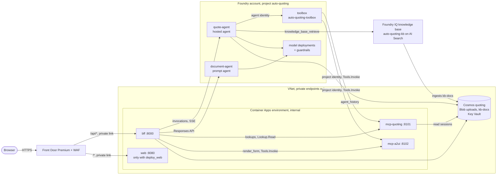
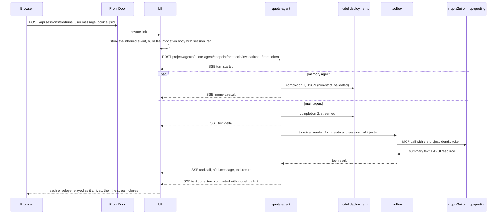

# Architecture on Azure and Foundry

Status: **code and tests; nothing deployed.** This page describes what the code in this folder builds. The design is in `../../architecture.md`; where it and the code differ, the code wins and [`infra/README.md`](../infra/README.md) ("Decisions and deviations") says why.

Read with: [`contracts/interfaces.md`](../contracts/interfaces.md) (ports, HTTP API, invocation body, MCP tool shapes), [hosted-agent.md](hosted-agent.md), [toolbox.md](toolbox.md), [deployment.md](deployment.md), [cicd.md](cicd.md), [patterns.md](patterns.md), [testing.md](testing.md).

## Runtime

- The browser talks to one host: the Front Door endpoint. `/api/*` goes to the BFF (no cache, SSE), `/*` to the web app. The web route exists only when `deploy_web = true`; with the default `false`, nothing serves the web app in Azure (Static Web Apps is not built).
- The BFF is the only caller of the hosted agent and of the document agent. The hosted agent reaches the MCP servers only through the toolbox.
- The BFF, the MCP servers and the hosted agent export logs and traces to Application Insights (workspace-based, one Log Analytics workspace); container console logs go to the same workspace through the Container Apps environment. Resource logs of Cosmos, Search, Key Vault, the registry, Foundry, Front Door and `uploads` go to the same workspace (`diagnostics.tf`).

## Components

Resource names follow `locals.tf`: `<type>-<workload>-<env>-<cc|ce>`, for example `ca-bff-aiq-dev-cc`. Globally unique names (Foundry, Key Vault, Search, registry, Cosmos, storage) add 4 hex characters derived from the subscription.

| Component | Runs as | Built from | Port | Identity | Data it owns |
|---|---|---|---|---|---|
| `web` | Container app, 1–2 replicas (prod 1–5), only with `deploy_web = true` | `web/Dockerfile` (nginx, non-root) | 8080 | `id-web-…` (AcrPull only) | none |
| `bff` | Container app, no session affinity (canary needs multiple revisions), 1–3 replicas (prod 2–20) | `bff/Dockerfile` | 8000 | `id-bff-…` | Cosmos `sessions`, `events`, `state_changes`, `quotes`, `confirmations`, `handoffs`; Blob `uploads` |
| `mcp-quoting` | Container app, **1 replica** (quotes are in memory) | `mcp/quoting/Dockerfile` | 8101 | `id-mcp-quoting-…` | reads Cosmos `sessions`; quote ids and versions in `InMemoryQuoteStore` |
| `mcp-a2ui` | Container app, 1–2 replicas (prod 1–10) | `mcp/a2ui/Dockerfile` | 8102 | `id-mcp-a2ui-…` (AcrPull only) | none (the catalog is in the image) |
| `quote-agent` | Foundry hosted agent, invocations protocol, 1 vCPU / 2 GiB per session | source zip from `agents/quote-agent/deploy/deploy_quote_agent.py` (the Dockerfile is for local and e2e runs only) | 8088 in the hosted runtime | Entra agent identity (`instance_identity`), created by the first deploy | Cosmos `agent_history` |
| `document-agent` | Foundry prompt agent | definition from `agents/document-agent/deploy_document_agent.py` | none | runs in Foundry; the BFF calls it with its own identity | none |
| Toolbox `auto-quoting-toolbox` | Foundry project toolbox: one MCP endpoint over both MCP servers | `deploy/create_toolbox.py` | project endpoint | Foundry project managed identity, through the RemoteTool connections `conn-mcp-quoting`, `conn-mcp-a2ui` | none |
| Knowledge base `auto-quoting-kb` | Foundry IQ on Azure AI Search, source `kb-docs-source` | `deploy/create_knowledge_base.py` | Search endpoint | Search service identity (ingestion) | the index built from Blob `kb-docs` |

Component details: [`bff/README.md`](../bff/README.md), [`mcp/quoting/README.md`](../mcp/quoting/README.md), [`mcp/a2ui/README.md`](../mcp/a2ui/README.md), [`agents/quote-agent/README.md`](../agents/quote-agent/README.md), [`agents/document-agent/README.md`](../agents/document-agent/README.md), [`web/README.md`](../web/README.md).

Platform services (all in one resource group `rg-<workload>-<env>-<cc|ce>`; full list in [`infra/README.md`](../infra/README.md) "What Terraform creates"):

| Service | Settings that matter |
|---|---|
| Foundry account (AIServices) and project `auto-quoting` | Public access off, local auth off, hosted-agent network injection into the `agent-egress` subnet (set at creation, cannot be added later), standard agent setup on a dedicated Cosmos, Storage and the Search service |
| Cosmos DB, app account | Database `quoting`, 7 containers on `/session_id` with TTLs (`cosmos_containers`), continuous backup, optional read region (`cosmos_failover_location`) |
| Cosmos DB, Agent Service account | Created empty; the Agent Service fills it |
| Storage | `kb-docs` (knowledge source), `uploads` (30-day delete, Defender malware scan on upload, result in a blob index tag), one account for the Agent Service. ZRS, shared keys off |
| Azure AI Search | `search_sku` (default `standard2`), `search_replicas` (default 1), semantic ranker, RBAC only, two shared private links (to `kb-docs` and to the Foundry account) |
| Key Vault | RBAC, no public access. Holds `session-ref-key` and `session-cookie-key`, generated by Terraform and never output |
| Container registry | Premium, private, admin off |
| Front Door Premium | WAF (Default 2.1, Bot Manager 1.1, 60 requests per minute per IP on `/api/`), private link origins, 240 s origin timeout |

## Identities and role assignments

No keys: Cosmos, Storage, Search and the Foundry account have local auth off. Every call uses an Entra token. Sources: `infra/terraform/rbac.tf`, `infra/terraform/modules/foundry/main.tf`, `infra/terraform/entra/main.tf`.

| Principal | Target | Role | Defined in |
|---|---|---|---|
| Each app identity | Container registry | AcrPull | `rbac.tf` |
| BFF | Foundry project (`quote-agent`, `document-agent`) | Foundry Agent Consumer | `rbac.tf` |
| BFF | Cosmos `sessions`, `events`, `state_changes`, `quotes`, `confirmations`, `handoffs` | Cosmos DB Built-in Data Contributor, per container | `rbac.tf` |
| BFF | Blob container `uploads` | Storage Blob Data Owner (only Owner can read the Defender scan tag) | `rbac.tf` |
| BFF | Key Vault secrets `session-ref-key`, `session-cookie-key` | Key Vault Secrets User | `rbac.tf` |
| BFF | `mcp-quoting` API / `mcp-a2ui` API | app role `Lookup.Read` / `Tools.Invoke` | `entra/main.tf` |
| mcp-quoting | Cosmos `sessions` | Cosmos DB Built-in Data Reader | `rbac.tf` |
| mcp-quoting | Key Vault secret `session-ref-key` | Key Vault Secrets User | `rbac.tf` |
| Foundry project identity | `mcp-quoting` API, `mcp-a2ui` API | app role `Tools.Invoke` (toolbox calls) | `entra/main.tf` |
| Foundry project identity | Agent Service Cosmos and Storage, Search, Foundry account | Cosmos DB Operator + Data Contributor; Storage Account Contributor + Blob Data Owner; Search Index Data Contributor + Search Service Contributor; Foundry User | `modules/foundry/main.tf` |
| quote-agent identity | Cosmos database `quoting` | Cosmos DB Built-in Data Contributor, database scope (the history provider creates its container if missing) | `rbac.tf`, second apply |
| quote-agent identity | Search service; Foundry project | Search Index Data Reader; Foundry User (inference and toolbox, **[UNVERIFIED]** for the toolbox) | `rbac.tf`, second apply |
| Search service identity | Foundry account; Blob `kb-docs` | Cognitive Services User + Cognitive Services OpenAI User; Storage Blob Data Reader | `rbac.tf` |
| CI/CD principal (`cicd_principal_id`, optional) | Registry, resource group, project, Search, `kb-docs` | AcrPush, Container Apps Contributor, Foundry Project Manager, Search Service Contributor + Search Index Data Contributor, Storage Blob Data Contributor | `rbac.tf` |
| Operators group (`operators_group_id`, optional) | Log Analytics | Log Analytics Reader | `rbac.tf` |

The quote-agent identity exists only after the first agent deploy, so its roles come from a second `terraform apply` with `quote_agent_principal_id` ([deployment.md](deployment.md)).

The MCP servers check every inbound token themselves (`quote_common.auth.wrap_from_env`): audience `api://<tenant-id>/<workload>-<env>-mcp-quoting` or `…-mcp-a2ui`, tenant, allowed callers (the BFF and project identities) and app role. Details and troubleshooting: [toolbox.md](toolbox.md).

`session_ref` ties tool calls to one session: the BFF signs it (HMAC-SHA256, 15 minutes, `SESSION_REF_KEY`), the hosted agent injects it into tool calls, and mcp-quoting verifies it with the same Key Vault secret.

## Network

| Piece | What the code builds |
|---|---|
| VNet | `vnet_cidr` (default `10.40.0.0/16`). Subnets: `aca-infra` /23 and `agent-egress` /24, both delegated to `Microsoft.App/environments`; `private-endpoints` /24. One NSG with Azure's default rules on all three |
| Private endpoints | Both Cosmos accounts, the three storage accounts (blob), Search, Key Vault, registry, Foundry account. 8 private DNS zones linked to the VNet |
| Container Apps | Internal load balancer, public network access disabled, workload profile Consumption. Apps use "external" ingress inside the environment (reachable from the VNet and the private link, not the internet). A private DNS zone for the environment domain resolves `*` to its static IP |
| Front Door | One private link origin per app to the Container Apps environment; the connection is approved by `deploy/post_deploy.sh approve` |
| Hosted agent | Runs injected in `agent-egress`. Egress allow-list (Foundry, Search, app Cosmos, Application Insights) in `quoting-guardrail`, mode `agent_egress_mode` (`Audit`, then `Enforced`) |
| Search ingestion | Shared private links to `kb-docs` (blob) and the Foundry account (`openai_account`), approved by `post_deploy.sh approve` |
| Outbound IP | Optional NAT gateway on `aca-infra` (`enable_nat_gateway`, output `nat_public_ip`) for back-end allow-lists |
| Public | Only the Front Door endpoint, and Application Insights ingestion (no Azure Monitor private link scope) |

A deployment runner needs a network path into this VNet (a self-hosted runner): hosted runners cannot reach the registry, Foundry or Search ([cicd.md](cicd.md)).

## One turn, end to end

1. The BFF checks the `qsid` cookie, writes the inbound event to Cosmos `events`, and posts the invocation body (`interfaces.md` §2: `turn, input, state, phase, open_surfaces, signals, preferences, rule_hits, system_notes, session_ref`) with headers `x-client-session-id`, `x-client-turn-id`, `traceparent`. It retries 424 and 429 up to 3 times.
2. The hosted agent runs the memory agent and the main agent at the same time: 2 model calls. A terminal tool (forms, lookups, suggestions, phase) ends the main loop; see [hosted-agent.md](hosted-agent.md) for the call budget.
3. Each envelope goes through the BFF's `Turn.emit`: written to `events`, then forwarded. `memory.result` is never forwarded: `Bff.commit` turns it into `state.delta`, `confirm.required` and the other commits, runs the end-of-form rules, and may stop the agent's reply.
4. Form-field lookups and document reads do not use the model: the renderer calls `POST /api/sessions/{sid}/a2ui/functions`, and the BFF calls mcp-quoting (lookups) or the document agent directly.

## Decisions in force

| Decision | Where it shows in the code |
|---|---|
| **The models are the GPT-5.6 family, Global Standard, in Canada Central**: `gpt-5.6-terra` (main), `gpt-5.6-luna` (memory, document), `text-embedding-3-large` (knowledge base). Global Standard needs the Law 25 assessment before real customer data. | [`settings.yaml`](../settings.yaml) (`deployments`, `agents`, `knowledge`), read by Terraform and the deploy scripts; the runtime settings `MAIN_MODEL_DEPLOYMENT` and the others are set from it at deploy. The account region is `location`. See [hosted-agent.md](hosted-agent.md#settings-file). |
| **The toolbox calls the internal MCP servers on Container Apps** (confirmed by the team 2026-11-25), as the Foundry project's managed identity holding the app role `Tools.Invoke`. | RemoteTool connections in `infra/terraform/main.tf`, grants in `entra/main.tf`, toolbox version in `deploy/create_toolbox.py`. See [toolbox.md](toolbox.md). |
| **Guardrails sit on the model deployments**, because the hosted and prompt agent definitions have no `rai_config`. | `quoting-guardrail` on the `main` and `memory` deployments, `document-guardrail` on `document` (`modules/foundry/main.tf`). |
| **Azure AI Search defaults to S2** (`search_sku = "standard2"`); the design said S1. | Private ingestion of the knowledge source needs S2 or higher. An S2 unit is billed at several times the S1 rate, and dev pays it too. Set `search_sku` per environment to change it; with S1 or Basic the knowledge source would need a public ingestion path, which `kb-docs` does not offer. |
| **The Foundry IQ knowledge base is created by `deploy/create_knowledge_base.py`**. | Run by `post_deploy.sh knowledge-base`. See [toolbox.md](toolbox.md). |
| **The human hand-off is left unconnected** (README Q7, 2026-11-25). | Below. |

### Hand-off: where a connector would plug in

When the customer sends the end-of-form view, `Bff.send_handoff` (`bff/src/quote_bff/service.py`) writes one row to the Cosmos `handoffs` container and nothing else: `id` and `reference` (`CNS-` plus 6 digits, unique per environment), `session_id`, `rule_id`, `reason`, the edited `summary`, `contact` (first and last name, phone, email), `consent_at`, `advisor_signals`, `status: "new"`, `created_at`. The customer sees the reference and the callback promise from the string table (`handoff_done` in `bff/src/quote_bff/forms.py`).

A future connector to a CRM or work queue has two natural places:

- **Outside the BFF (keeps it unchanged):** a reader of the `handoffs` container, for example on the Cosmos change feed, that sends each `status: "new"` row and updates its status. It needs its own identity with a Cosmos data role on `handoffs`.
- **Inside the BFF:** a call right after the `handoffs` row is written in `send_handoff`, behind an interface with a fake, like the BFF's other adapters ([`bff/README.md`](../bff/README.md) "Adapters").

Neither is built. The promised callback delay is not confirmed with the business (design README Q7). The full code path is in [patterns.md](patterns.md) §5.

## Still open

- Whether the Global Standard processing location passes the Law 25 assessment (NFR-PRV-2), and whether every model and SKU in `settings.yaml` is offered in `canadacentral` ([hosted-agent.md](hosted-agent.md#model-deployments)).
- The hand-off connector (above).
- A persistent `QuoteStore` for mcp-quoting. Until then it runs one replica, and open quotes are lost at each release ([`mcp/quoting/README.md`](../mcp/quoting/README.md) "Quote ids and versions").
- The content of `kb-docs`: nothing in the repository uploads documents to it.

## Not verified

- **Nothing is deployed.** `terraform plan` was never run (no subscription); `validate`, `tflint` and `checkov` ran offline ([`infra/README.md`](../infra/README.md)).
- **The Docker images were not built locally** (no Docker daemon when the components were written); each README says what was run instead.
- The Foundry-specific items are listed in [`infra/README.md`](../infra/README.md) "Verify before build". Verified on the first dev deploy (2026-11-25): the toolbox reaches the internal Container Apps environment, serves tools as `<server_label>___<tool>` and passes the A2UI resources through; the `ProjectManagedIdentity` RemoteTool connection works; Front Door reaches the internal environment over private link once the connection is approved and the routes are re-saved.
