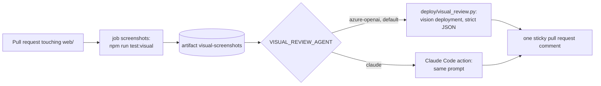

# CI/CD

The workflows in `.github/workflows/` and the composite actions in `.github/actions/` are **suggestions**, checked offline with `actionlint` and `shellcheck`. They live in the **repository root's `.github/`**, one level above `solution/` (the root also holds the design folder), and every job runs in `solution/` (`defaults.run.working-directory`); paths that GitHub resolves from the workspace root (artifacts, path filters, `actions/github-script`) carry the `solution/` prefix. Actions are pinned to commit SHAs (the comment names the release). No workflow holds a secret for Azure: access is OIDC.

Related: [deployment.md](deployment.md) (the steps CD runs), [testing.md](testing.md) (the suites CI runs), [`docs/style-guide.md`](style-guide.md) (the visual review rubric), [`infra/README.md`](../infra/README.md) "CI/CD".

| Workflow | Runs on | Does |
|---|---|---|
| `ci.yml` | every pull request, push to `main`, and as the first job of `cd.yml` (`workflow_call`) | Lint and tests of every component, contracts, Terraform checks, workflow lint, both end-to-end suites |
| `cd.yml` | push to `main`; manual run with `plan-only` | `ci`, then `dev`, then `prod`, each through `deploy-env.yml` |
| `deploy-env.yml` | called by `cd.yml` | One environment end to end, in one job |
| `visual-review.yml` | pull requests that touch `web/**`, `docs/style-guide.md`, `deploy/visual_review.py` or the workflow | Screenshots, then an advisory review by an AI agent |
| `codeql.yml` | push to `main`, pull requests to `main`, Mondays 03:17 UTC | CodeQL for Python and JavaScript/TypeScript (`build-mode: none`). Delete the file to switch it off |

## `ci.yml`

| Job | What it does |
|---|---|
| `python` (matrix of 7) | For `quote_common`, `bff`, `quote-agent`, `document-agent`, `mcp-quoting`, `mcp-a2ui`, `deploy`: `uv venv`, install the component with `quote_common` and its `test` extra, `ruff check`, `pytest`. Python 3.13. `azure`-level tests stay skipped (`RUN_AZURE_TESTS` unset) |
| `web` | Node 22: `npm ci`, `typecheck`, `lint` (biome), `npm test` (vitest), Playwright Chromium, `npm run test:visual`, `npm run test:e2e` (mock BFF). Uploads `web/test-results/` and `web/playwright-report/` (diffs of failed screenshots) |
| `contracts` | `deploy/check_contracts.py`: schemas are valid JSON Schema, `tools.json` is consistent, 6 `quoting` and 4 `a2ui` tools |
| `terraform` | Terraform 1.17.2: `fmt -check -recursive`; `init -backend=false` and `validate` for both stacks; `tflint` v0.66.0 with `.tflint.hcl`; `checkov` 3.4.11 with `.checkov.yaml` |
| `workflows` | `actionlint` 1.7.12 (Docker) and `shellcheck deploy/*.sh` |
| `api-e2e` | API journeys, below |
| `e2e` | Full stack in containers, below |

### End-to-end jobs

Both use the fake model (`QUOTE_AGENT_MODEL=fake`) and no Azure. Details: [`e2e/README.md`](../e2e/README.md).

| Job | How | Artifacts |
|---|---|---|
| `api-e2e` | Creates one venv per service (`bff`, `mcp/quoting`, `mcp/a2ui`, `agents/quote-agent`), then `bff/.venv/bin/python -m pytest -c e2e/pytest.ini e2e`. The fixture starts the four services as local processes with `e2e/stack.py` (ports +20000) and `e2e/test_api_journey.py` drives them over HTTP and SSE | `e2e/.logs/` (one log per service) on failure |
| `e2e` | `docker compose -f e2e/docker-compose.yml up --build --exit-code-from e2e`: builds the `quoting`, `a2ui`, `agent` and `bff` images (the same Dockerfiles as Azure, dev-only keys), then the `e2e` container (`mcr.microsoft.com/playwright:v1.64.1-noble`) runs the browser journeys in `web/e2e-stack` against the `bff` container. Then `down -v` | `e2e/test-results/`, `e2e/playwright-report/` |

## `cd.yml` and `deploy-env.yml`

`cd.yml` runs `ci`, then `dev`, then `prod` (concurrency group `cd`, never cancelled). `prod` waits because its GitHub environment has required reviewers (a GitHub setting, not in the repository). A manual run with `plan-only: true` runs the first Terraform pass as a plan, writes it to the job summary, and skips every other step.

`deploy-env.yml` is one job on purpose, so the reviewers approve each environment once. It runs on `fromJSON(vars.PRIVATE_RUNNER || '["ubuntu-24.04"]')`: a GitHub-hosted runner cannot reach the private registry, Foundry or Search, so set `PRIVATE_RUNNER` to the labels of a runner in (or peered with) the VNet, with `docker`, `az` and `jq`. Timeout 150 minutes. The steps, in order: Terraform, images, Terraform with the apps, revisions, Foundry data plane, agent identity and Terraform again, smoke (plus `CANARY_SMOKE_RUNS=10` extra turns), then promote or roll back. Each step is described in [deployment.md](deployment.md) "Every release".

### Composite actions

| Action | Does |
|---|---|
| `.github/actions/azure-env` | `azure/login` with OIDC (inputs `client-id`, `tenant-id`, `subscription-id`), then exports `ARM_USE_OIDC=true`, `ARM_CLIENT_ID`, `ARM_TENANT_ID`, `ARM_SUBSCRIPTION_ID` for Terraform. The job needs `id-token: write` |
| `.github/actions/terraform` | One pass of `infra/terraform`: writes `backend_override.tf` (`azurerm` backend) and the tfvars from the `tfvars` input, `terraform init` with the state account (container `tfstate`, key `aiq-<env>.tfstate`, Entra auth, OIDC), `plan` (shown in the job summary), `apply` unless `plan-only`, and `terraform output -json` to `$RUNNER_TEMP/tf.json`. Input `apps`: `auto` (keep the apps if the state has them), `true` or `false`; `app-images`; `extra-args` (for example `-var quote_agent_principal_id=<id>`). Before the plan it also passes `-var quote_agent_principal_id=<id>` from the state output of that name, unless the tfvars set it, so a pass never removes the agent's role assignments; `extra-args` comes last and wins |

## Azure access: OIDC federated credentials

| Identity | Federated credential subject | Used by | Needs |
|---|---|---|---|
| Deploy identity, one per environment (the environment's `AZURE_CLIENT_ID`) | `repo:<org>/<repo>:environment:<env>` | `deploy-env.yml` | It is also the Terraform identity: Contributor and Role Based Access Control Administrator on the subscription, and Storage Blob Data Contributor on the state storage account (`backend.tf`). Set `cicd_principal_id` to its object id so Terraform grants it AcrPush, Container Apps Contributor, Foundry Project Manager, Search Service Contributor, Search Index Data Contributor and Storage Blob Data Contributor on `kb-docs` |
| Visual review identity (`VISUAL_REVIEW_CLIENT_ID`) | `repo:<org>/<repo>:pull_request` | `visual-review.yml`, option `azure-openai` | Cognitive Services OpenAI User on the review resource |

The Entra stack (Graph permissions) is not in any workflow: an admin applies it ([deployment.md](deployment.md)).

## GitHub environments, variables and secrets

Names only; no value is in the repository.

| Where | Name | Used for |
|---|---|---|
| Environments `dev`, `prod` (required reviewers on `prod`) | `AZURE_CLIENT_ID`, `AZURE_TENANT_ID`, `AZURE_SUBSCRIPTION_ID` | OIDC sign-in of the deploy identity |
| | `TFVARS` | The content of `environments/<env>.tfvars` (a variable, because it holds ids, not secrets) |
| | `TF_STATE_RESOURCE_GROUP`, `TF_STATE_STORAGE_ACCOUNT` | Remote state |
| Repository variables | `PRIVATE_RUNNER` | JSON runner labels, for example `["self-hosted","aiq-vnet"]` |
| | `VISUAL_REVIEW_AGENT` | `azure-openai` (default when unset) or `claude` |
| | `VISUAL_REVIEW_ENDPOINT`, `VISUAL_REVIEW_MODEL`, `VISUAL_REVIEW_CLIENT_ID`, `AZURE_TENANT_ID`, `AZURE_SUBSCRIPTION_ID` | Option `azure-openai` (the review job has no environment, so it reads repository variables) |
| Repository secret | `ANTHROPIC_API_KEY` | Option `claude` only |

Terraform accepts a `test` environment, but `cd.yml` deploys only `dev` and `prod`.

## Visual review by an agent

**Screenshots.** The `screenshots` job runs the Playwright visual suite (`web/playwright.visual.config.ts`): one screenshot per element of `web/src/visual/list.ts`, 64 elements (each A2UI component in its key states, a form per subject, chips, suggestions, header, steps, rail, transcript, both dossier tabs, the two modal steps, the full form, the whole app with a form open), at 1280 × 900 and, where marked, 390 × 844. Chromium, reduced motion, animations off, `fr-CA`, `America/Toronto`, `maxDiffPixelRatio` 0.002. A failed comparison does not fail this job (`continue-on-error`). It uploads `web/test-results/` (`*-actual`, `*-expected`, `*-diff`) and the baselines as `visual-screenshots` (7 days).

**Review.** The `review` job runs only for pull requests from this repository (forks get no OIDC and no secrets). It downloads the artifact to `shots/`, then:

- **`azure-openai`**: signs in with `VISUAL_REVIEW_CLIENT_ID` and runs `deploy/visual_review.py --images shots --style-guide docs/style-guide.md --out visual-review.md`. The script picks the `*-actual.png` of failed visual tests when there are any, otherwise every screenshot except `-diff` and `-expected`, at most 12 (`--max-images`) in path order. It sends them as data URLs, with the style guide and its prompt, to `POST {VISUAL_REVIEW_ENDPOINT}/openai/v1/responses` (model `VISUAL_REVIEW_MODEL`, strict JSON schema, `store: false`). Use an endpoint that GitHub-hosted runners can reach, not the private quoting account. A `github-script` step writes the result to the job summary and creates or updates the one comment that starts with `<!-- visual-review -->`.
- **`claude`**: `visual_review.py --print-prompt` gives the same prompt (one source) to `anthropics/claude-code-action`, which reads the PNGs, writes `review.md` and posts it with `gh pr comment --edit-last --create-if-none`.

**Rubric.** [`docs/style-guide.md`](style-guide.md) is sent whole. The prompt asks the model to check, only from what it sees: brand tokens (colors, radii, pills, focus ring, light green headings), the 12-column grid, fr-CA copy and typography (vouvoiement, `’`, non-breaking spaces, `1 420 $`, verb-first buttons, no English or field codes), WCAG AA contrast, focus and 44 px targets, and the 390 px phone layout.

**What it posts.** One comment: the marker, a summary, then a table of findings (severity `fail`, `warn` or `info`; area `brand_tokens`, `grid_alignment`, `french_copy`, `contrast`, `phone_layout` or `other`; screenshot file; finding; suggestion), worst first, and a footer saying it never blocks a merge.

**What blocks a merge.** The review never does: both jobs have `continue-on-error`, and `visual_review.py` exits 0 whatever the model says. What can block is `ci.yml`: its `web` job runs `npm run test:visual` without `continue-on-error`, so a moved or missing baseline fails CI. Whether CI is a required check is a branch protection setting, outside the repository. To accept an intended change, update only the elements that changed (`npm run test:visual:update -- -g "<element> @"` in `web/`), review the PNGs in the pull request, and commit them (style guide §10, [`web/README.md`](../web/README.md) "Visual baselines").

**Linux baselines.** Baselines are per platform (`tests/visual/__screenshots__/<platform>/`), and only `darwin/` is committed (92 PNGs from macOS). Fonts come from the system (Roboto is not bundled), so macOS pixels do not match Linux. Until a `linux/` set exists, every visual test fails on the Ubuntu runners: the `web` job of `ci.yml` is red, and the review sees no baseline to compare with. Generate the set once where CI runs them (`ubuntu-24.04` after `npx playwright install --with-deps chromium`) with `npm run test:visual:update` in `web/`, review the images, and commit `tests/visual/__screenshots__/linux/`.

**[UNVERIFIED]** The token scope `https://ai.azure.com/.default` on an Azure OpenAI `/openai/v1/responses` endpoint, and a strict `json_schema` answer from the chosen vision deployment.
