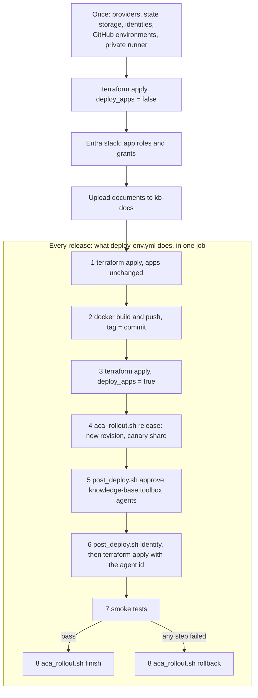

# Deployment

Status: **nothing has been applied or deployed.** Terraform and the scripts were checked offline only: `terraform fmt -check`, `terraform validate` of both stacks with `-backend=false`, `tflint` (azurerm ruleset), `checkov` (59 checks pass, 15 documented skips), `shellcheck`, `actionlint`, and the `deploy/` tests and `--dry-run` runs ([`infra/README.md`](../infra/README.md)). `terraform plan` was never run against a subscription.

This page is the order of operations. What each resource is and why: [architecture.md](architecture.md) and [`infra/README.md`](../infra/README.md). The pipeline that runs these steps: [cicd.md](cicd.md). Model arguments: [hosted-agent.md](hosted-agent.md). Toolbox and knowledge base: [toolbox.md](toolbox.md).

## Two Terraform stacks

| Stack | Path | Creates | Who applies it | State |
|---|---|---|---|---|
| Platform | `infra/terraform/` | Everything in Azure except Microsoft Graph objects | A Terraform identity with Contributor and Role Based Access Control Administrator on the subscription (in CD, the GitHub OIDC identity of the environment) | `backend.tf` is commented out, so state is local until you enable it. CD writes `backend_override.tf` with an `azurerm` backend, container `tfstate`, key `aiq-<env>.tfstate`, Entra auth |
| Entra | `infra/terraform/entra/` | The two MCP app registrations, their app roles, the four grants | Someone with Graph permissions `Application.ReadWrite.OwnedBy` and `AppRoleAssignment.ReadWrite.All`, once per environment | Remote, like the platform stack: `entra/backend.tf` is an `azurerm` block (container `tfstate`, Entra auth); the storage account and the key are supplied at init: the platform stack's account, key `aiq-<env>-entra.tfstate` |

Providers: `azurerm ~> 5.15`, `azapi ~> 2.14`, `random ~> 3.9` (platform); `azuread ~> 3.10`, `random ~> 3.9` (Entra). Terraform `>= 1.9`; CI uses 1.17.2.

| Platform file or folder | Holds |
|---|---|
| `core.tf` | Resource group, Log Analytics, Application Insights, one identity per app, Key Vault and its two secrets, registry, Search and its shared private links |
| `data.tf` | Two Cosmos accounts, database `quoting` and its containers, three storage accounts, `uploads` lifecycle and Defender scanning |
| `apps.tf` | Container Apps environment, its private DNS zone, the apps (one resource over `app_defs`) |
| `private_endpoints.tf`, `diagnostics.tf` | Every private endpoint; resource logs to Log Analytics |
| `rbac.tf` | The role matrix as data ([architecture.md](architecture.md) "Identities") |
| `main.tf` | Module calls and the RemoteTool connections |
| `locals.tf` | Names, role GUIDs, app definitions and their environment variables, egress hosts, the model deployments read from `settings.yaml` |
| `modules/network`, `modules/foundry`, `modules/frontdoor` | VNet and DNS; Foundry account, project, deployments, guardrails, connections, capability hosts; Front Door and WAF |
| `environments/` | `dev.tfvars.example`, `prod.tfvars.example`. Copy to `<env>.tfvars` (git-ignored). In CD the GitHub environment variable `TFVARS` holds the file's content |
| `outputs.tf` | Endpoints, names and ids only, read by `deploy/post_deploy.sh` |

## Variables

Platform stack (`infra/terraform/variables.tf`). Only the first two have no default. The model deployments come from [`settings.yaml`](../settings.yaml) ([hosted-agent.md](hosted-agent.md#settings-file)); the two `model_…` variables below only override it.

| Variable | Default | Set it to |
|---|---|---|
| `subscription_id` | required | One subscription per environment |
| `environment` | required | `dev`, `test` or `prod`. `prod` turns on zone redundancy, Key Vault purge protection, 2–20 BFF replicas and 90-day logs |
| `model_deployments`, `model_roles` | `null` | Leave out: Terraform reads `deployments` and the roles (`agents.*.deployment`, `knowledge.embedding_deployment`) from `settings.yaml`. Set them in a tfvars file only to give one environment other deployments ([hosted-agent.md](hosted-agent.md#model-deployments)) |
| `location` | `canadacentral` | The region of everything, the Foundry account included |
| `workload` | `aiq` | Short code in every name. Must equal the Entra stack's `workload` |
| `tags` | `{}` | Extra tags |
| `vnet_cidr` | `10.40.0.0/16` | A range that does not overlap networks you peer with |
| `enable_nat_gateway` | `false` | `true` for a fixed outbound IP (back-end allow-lists) |
| `agent_egress_mode` | `Audit` | `Enforced` after a clean audit period |
| `cosmos_failover_location` | `null` | A read region, for example `canadaeast` in prod |
| `cosmos_containers` | 7 containers with TTLs | TTLs are proposals pending compliance review |
| `search_sku`, `search_replicas` | `standard2`, `1` | S2 or higher for private ingestion; S2 costs several times S1 ([architecture.md](architecture.md) "Decisions") |
| `deploy_apps` | `false` | `false` on the first apply (empty registry), `true` once the images exist |
| `deploy_web` | `false` | `true` to serve the web app through Front Door |
| `app_images` | `{}` | `<registry>/<app>:<git-sha>` for each deployed app; required when `deploy_apps = true`, used only when an app is created |
| `mcp_client_ids` | `{}` | After the Entra stack: its output `client_ids` (`terraform -chdir=entra output -json client_ids`; keys `mcp-quoting`, `mcp-a2ui`). The MCP servers then also accept the client id as `aud`, which v1 tokens carry |
| `quoting` | `{}` | Real back ends of mcp-quoting ([toolbox.md](toolbox.md)) |
| `cicd_principal_id` | `null` | Object id of the pipeline identity, which then gets its data-plane roles (push, roll revisions, Foundry, Search, `kb-docs`) |
| `operators_group_id` | `null` | Entra group that reads logs |
| `quote_agent_principal_id` | `null` | The quote-agent identity, known after the first agent deploy |

Entra stack (`infra/terraform/entra/main.tf`):

| Variable | Default | Value |
|---|---|---|
| `environment` | required | Same as the platform stack |
| `bff_principal_id` | required | `terraform output -raw bff_principal_id` |
| `project_principal_id` | required | `terraform output -raw project_principal_id` |
| `workload` | `aiq` | Same as the platform stack |

Keep `cicd_principal_id` in the tfvars (or `TFVARS`). `quote_agent_principal_id` does not need to be there: step 6 passes it with `-var`, the state keeps it in the output `quote_agent_principal_id`, and the `terraform` action ([cicd.md](cicd.md)) passes that value on every later pass unless the tfvars set it. Steps 1 and 3 of the next release, and a `plan-only` run, therefore keep the agent's three role assignments (Search, Foundry project, Cosmos). Precedence: the `-var` of step 6, then a value in the tfvars, then the state. An environment whose state has no such output yet (step 6 never ran, or the state predates the output) still applies without the id until step 6 runs. By hand, without the action, pass it yourself after step 6: `-var quote_agent_principal_id=$(terraform output -raw quote_agent_principal_id)`.

## Order



### Once per environment

1. **Register the resource providers**: `Microsoft.KeyVault`, `CognitiveServices`, `Storage`, `MachineLearningServices`, `Search`, `Network`, `App`, `ContainerService`, `ContainerRegistry`, `DocumentDB`, `OperationalInsights`, `Insights`, `ManagedIdentity`, `Cdn`, `Security`.
2. **Prepare state and identities**: the state storage account (the steps are in the comment of `backend.tf`), the Terraform identity, one GitHub OIDC identity per environment, the GitHub environments, and a runner with a network path to the private endpoints ([cicd.md](cicd.md)).
3. **First platform apply**, from a workstation, with `deploy_apps = false`. It creates the network, Foundry, data services and the identities.

   ```bash
   cd infra/terraform
   terraform init -backend-config="key=aiq-<env>.tfstate"     # after you enable backend.tf
   terraform apply -var-file=environments/<env>.tfvars
   ```

4. **Entra stack**, by someone with Graph permissions:

   ```bash
   terraform -chdir=entra init \
     -backend-config="resource_group_name=<state resource group>" \
     -backend-config="storage_account_name=<state storage account>" \
     -backend-config="key=aiq-<env>-entra.tfstate"
   terraform -chdir=entra apply -var environment=<env> \
     -var bff_principal_id=$(terraform output -raw bff_principal_id) \
     -var project_principal_id=$(terraform output -raw project_principal_id)
   ```

   The state is in the platform stack's account and container (`tfstate`), under its own key, `aiq-<env>-entra.tfstate`. The shared keys of that account are off, so the person who applies needs Storage Blob Data Contributor on it.

   Then copy its output `client_ids` into the environment's tfvars (`TFVARS` in CD) as `mcp_client_ids`. The next platform apply sets `ENTRA_AUDIENCE` to `<api:// URI>,<client id>` on both MCP servers.

   The registrations have `requested_access_token_version = 2` (so `aud` is the client id) and identifier URIs that name
   the tenant (`api://<tenant-id>/<workload>-<env>-mcp-*`), which tenants with the default app management policy require.
   Their `owners` include whoever applies: without an owner, a user without a directory role can no longer change or
   delete an app registration (found on the first dev deploy, 2026-11-25).

5. **Upload the knowledge documents** to the `kb-docs` container. Nothing in the repository does this.

### Every release

`.github/workflows/deploy-env.yml` runs these steps in order. To run them by hand, use a machine inside the VNet with `az`, `jq`, `docker`, `uv` and `terraform`, signed in with `az login`.

| Step | What | Command |
|---|---|---|
| 1 | Platform. Apps unchanged (or not created yet) | `terraform apply -var-file=… -var deploy_apps=<false before the apps exist, else true>`. With `true`, `app_images` must still name every app; existing apps ignore it (CD passes placeholders) |
| 2 | Images for `bff`, `mcp-quoting`, `mcp-a2ui` (and `web` with `deploy_web`), from the solution folder | `docker build --platform linux/amd64 -f <component>/Dockerfile -t <registry>/<app>:<git-sha> .` then `docker push` (after `az acr login`) |
| 3 | Container apps exist from here on | `terraform apply … -var deploy_apps=true -var 'app_images={…}'`. Terraform ignores the image of an existing app; step 4 rolls it |
| 4 | New revision per app | `deploy/aca_rollout.sh release -g <rg> <app-name> <image> <percent>`: 10 %, mcp-quoting 100 % (its quotes are in memory) |
| 5 | Foundry data plane | `deploy/post_deploy.sh approve knowledge-base toolbox agents` |
| 6 | Agent identity roles | `deploy/post_deploy.sh identity` prints the principal id; `terraform apply … -var quote_agent_principal_id=<id>` |
| 7 | Smoke | `deploy/post_deploy.sh smoke`; CD then runs `smoke_test.py --checks turn` 10 more times so both revisions answer |
| 8 | Promote or go back | `deploy/aca_rollout.sh finish -g <rg> <app> <new> <previous>`, or `rollback` with the same arguments |

On the very first release, step 3 creates the apps with the new images, so step 4 finds them already on that image and changes nothing.

## Data-plane scripts

Every Python script in `deploy/` shares `common.py`: one HTTP client with an Entra bearer from `DefaultAzureCredential`, and `--dry-run`, which prints each request as a JSON line and sends nothing. Install with `uv sync --extra azure` in `deploy/` (the `test` extra for the tests).

### `deploy/post_deploy.sh`

`post_deploy.sh [--dry-run] [--tf-output FILE] [STEP...]` reads `terraform output -json` (or a saved copy) and runs the steps in this order; with no step it runs all six. It stops if the container apps are not deployed yet (`app_fqdns` empty).

| Step | Runs | Needs |
|---|---|---|
| `approve` | Approves every pending private endpoint connection on the `kb-docs` storage account, the Foundry account and the Container Apps environment (Search shared private links, Front Door) | `az` |
| `knowledge-base` | `create_knowledge_base.py --wait 1800` ([toolbox.md](toolbox.md)); the embedding and planning deployments come from the Terraform outputs | documents in `kb-docs` |
| `toolbox` | `create_toolbox.py --promote` | the Entra stack, the RemoteTool connections |
| `agents` | `deploy_quote_agent.py … --wait` and `deploy_document_agent.py --model <document deployment>`, each with `uv run --extra deploy` in its component. The deployments come from the Terraform outputs; the thinking levels, limits, timeout and output schemas from `settings.yaml` ([hosted-agent.md](hosted-agent.md#settings-file)) | `uv` |
| `identity` | `GET {project}/agents/quote-agent` and prints `instance_identity.principal_id` on stdout | `az`, `curl`, `jq` |
| `smoke` | `smoke_test.py --checks bff,turn`, then `--checks toolbox` | |

Environment: `PYTHON` (interpreter for `deploy/*.py`; default `uv run --project deploy --extra azure python`), `PROMPT_VERSION` (default `main:<short git sha>`). `--dry-run` passes `--dry-run` to the Python scripts and only prints the other commands:

```bash
deploy/post_deploy.sh --dry-run --tf-output deploy/tests/fixtures/tf-output.json
```

### `deploy/smoke_test.py`

| Flag | Environment variable | Default | Meaning |
|---|---|---|---|
| `--bff-url` | `BFF_URL` | required for `bff`, `turn` | `https://<front-door-host>` (`post_deploy.sh` uses output `frontdoor_hostname`) |
| `--project-endpoint` | `FOUNDRY_PROJECT_ENDPOINT` | required for `toolbox` | Foundry project endpoint |
| `--checks` | | `bff,toolbox,turn` | Comma-separated subset |
| `--dry-run` | | off | Print the requests, check nothing |

| Check | Passes when |
|---|---|
| `bff` | `GET /api/health` returns `{"status": "ok"}` and `GET /api/health/sse` sends a `health` event, through Front Door |
| `toolbox` | MCP `initialize` and `tools/list` on the toolbox return 6 `quoting` and 4 `a2ui` tools; it prints the served names |
| `turn` | A new session and one `user.message` ("Bonjour") through the real stack stream `turn.started`, text, and `turn.completed` with `model_calls == 2` |

Exit code 1 if any check fails. `toolbox` needs the private network path; `bff` and `turn` run from anywhere.

### `deploy/aca_rollout.sh`

The apps run in revision mode Multiple, which allows traffic splits.

| Command | Does |
|---|---|
| `release -g RG APP IMAGE [PERCENT]` | Pins traffic on the current revision, creates a revision for `IMAGE` at 0 %, waits up to 10 minutes for it to be healthy (else exits 1 and traffic stays), then gives it `PERCENT` (default 100). Prints `<previous> <new>`. If the app already runs `IMAGE`, prints the same revision twice and does nothing |
| `finish -g RG APP NEW PREVIOUS` | `NEW` takes 100 %, `PREVIOUS` is deactivated |
| `rollback -g RG APP NEW PREVIOUS` | `PREVIOUS` takes 100 %, `NEW` is deactivated |

`--dry-run` before the command prints the `az` calls.

## Rollback

| What | How |
|---|---|
| Container app revisions, during a release | Automatic: when any step after the rollout fails, `deploy-env.yml` runs `aca_rollout.sh rollback` for every app it released |
| Container app revisions, after a finished release | Re-run the CD run of the previous commit (images are tagged by commit and stay in the registry), or `deploy/aca_rollout.sh rollback -g <rg> <app> <new> <previous>`. A deactivated revision stays available until it is deleted: `az containerapp ingress traffic set -n <app> -g <rg> --revision-weight <previous>=100` |
| Toolbox | `deploy/create_toolbox.py --list`, then `--pin <version>`: the default moves at once, nothing is created |
| `quote-agent`, `document-agent` | Versions are immutable. Re-deploy from the previous commit. The automatic rollback does not touch the agents or the toolbox: a version created or promoted in step 5 stays |
| Knowledge base | Re-run `create_knowledge_base.py` from the previous commit (its `PUT`s replace the definitions). The documents are not versioned in the repository; blob soft delete keeps deleted ones 7 days |
| Platform | Revert the commit and apply. Cosmos has 30-day continuous backup; Key Vault soft delete (7 days, 90 with purge protection in prod); blob and container soft delete 7 days. `prevent_destroy` is not set, so dev stays disposable |
| Entra stack | Revert and apply |

Each release (and each rollback) of mcp-quoting loses the open quotes, because they live in memory. The customer asks for the quote again.

## Secrets

Terraform generates `session-ref-key` and `session-cookie-key` (`random_password`) and writes them to Key Vault through ARM; they are never outputs. The container apps read them as Key Vault references with their own identity. To rotate: taint the `random_password` and apply, then restart the BFF and mcp-quoting together (they share `session-ref-key`). Rotation with an overlap window is not built.

## Not verified

- No apply, no plan, no deployment, no script run against Azure. The [`infra/README.md`](../infra/README.md) "Verify before build" list holds every **[UNVERIFIED]** API, schema and role.
- The Docker images were not built locally (no Docker daemon when the components were written).
- `post_deploy.sh identity` assumes `GET {project}/agents/quote-agent` returns `instance_identity.principal_id`, and that this id stays the same across agent versions.

## Lessons from the first dev deploy (2026-11-25)

What the first real deployment (a dev subscription, Canada Central) found, and what is now fixed in the code.

| Symptom | Cause | Fix (in the repository now) |
|---|---|---|
| The chat refuses "Je veux une soumission pour mon auto" with "I'm sorry, but I cannot assist with that request." | Azure's content filter rates Québec "soumission" (a quote) as **sexual, severity high**, on every policy including `Microsoft.DefaultV2` | Decided by the product owner: on the chat deployments, Sexual on the customer's input annotates only; replies stay blocked (`modules/foundry/main.tf`, `local.filters.quoting`). The document model keeps every filter blocking |
| No confirmation popup after "Oui, j'accepte" | The memory agent's strict `response_format` was rejected (400 `invalid_json_schema`): a change's `value` is any JSON, which strict mode cannot express | `prompts.memory_response_format` is non-strict; the runtime still validates every output against the contract |
| Every reply shown twice | The Responses stream ends with `output_text.done`, the whole text again (`merge_mode="replace"`); the turn loop appended it | `Runtime.run_turn` replaces on `merge_mode="replace"`; the fake model now ends its streams the same way, so the e2e suites catch it |
| After the double confirmation, suggestions but no message | The model called `ui.set_phase` and `ui.suggest_replies` without text; those tools end the turn | Main prompt, Turn format: write the reply in the same response as the tool calls |
| The agent says "Voici un court formulaire…" but no form appears | `a2ui.render_form` failed client-side: `Unexpected argument(s) for 'a2ui___render_form': session_ref, state`. The OpenAI Responses client sets `additionalProperties: false` in place on the schema it sends, which was the same dict the agent had edited to hide the injected args, so validation rejected them once re-added | `hide_injected` gives each tool a fresh copy of the hidden schema per call (`turn.py`, test `test_injected_args_still_validate_after_the_openai_client_makes_the_shown_schema_strict`). Every tool failure reason is now logged, redacted. Verified: the toolbox passes the A2UI resources through, and the form opens |
| Tool policy ignored toolbox tools | The toolbox serves `quoting___create_quote` (three underscores) | `tools.logical_name` maps that spelling |
| mcp-quoting exits at start | `aiohttp` missing from its `azure` extra (async credentials) | Added to `mcp/quoting/pyproject.toml` |
| Cosmos accounts fail: "high demand in Canada Central" | The subscription has no Cosmos region access in Canada Central | `cosmos_location = "canadaeast"` (tfvars); a region access request (aka.ms/cosmosdbquota) would allow Canada Central |
| Capability host 409 | Azure creates the account capability host with the network injection | Terraform declares only the project one |
| Container Apps environment rejected | azurerm 5 needs `logs_destination = "log-analytics"` | `apps.tf` |
| Foundry account rejects `1.2.3.4/32` | The account wants bare IPs | `trimsuffix(ip, "/32")` in the Foundry module |
| BFF app rejected: session affinity | ACA sticky sessions need single-revision mode; the canary needs Multiple | BFF affinity off (session state is in Cosmos) |
| App registrations: identifier URI refused, then no owner | Tenant app policy; the azuread provider drops the creator as owner | URIs `api://<tenant-id>/…`, v2 tokens, explicit `owners` (entra stack) |
| Front Door returns its "Page not found" for an hour | The routes did not deploy after the late private link approval | Approve the private endpoint connections, then re-save the routes (`az afd route update … --enabled-state Enabled`); served after about 5 minutes |

`deploy/smoke_test.py --checks turn` only checks the event shape: also run one real conversation (the e2e journey or the browser) after a release.
