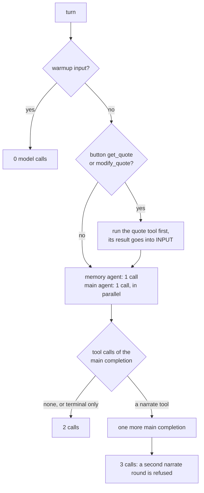

# Models and the hosted agent

Every argument that shapes the models and the agents: the settings file, the hosted agent definition and its deploy flags, the runtime settings, the model deployments, the document agent, how prompts are assembled, the per-turn call budget and the arguments the model never sees.

Component READMEs hold the full detail: [`agents/quote-agent/README.md`](../agents/quote-agent/README.md), [`agents/document-agent/README.md`](../agents/document-agent/README.md). Architecture: [architecture.md](architecture.md). Toolbox and knowledge base: [toolbox.md](toolbox.md).

**Decision in force:** the models are the GPT-5.6 family, all as **Global Standard** deployments in **Canada Central**: `gpt-5.6-terra` for the main agent, `gpt-5.6-luna` for the memory and document agents, `text-embedding-3-large` for the knowledge base embeddings. They are set in [`settings.yaml`](../settings.yaml) (next section) and nothing in the code names a model. Global Standard can be processed outside the region, so the Law 25 assessment (NFR-PRV-2) must clear it before real customer data; `Standard` keeps processing in the region ([Region and processing location](#model-deployments)).

## Two agents in Foundry

| Agent | Kind | Definition | Caller | Model |
|---|---|---|---|---|
| `quote-agent` | Hosted agent (container in Foundry), invocations protocol, SSE | [`agents/quote-agent/agent.yaml`](../agents/quote-agent/agent.yaml), deployed by `deploy/deploy_quote_agent.py` | BFF only | `main` and `memory` deployments, two Agent Framework agents in one process |
| `document-agent` | Prompt agent (no container) | `agents/document-agent/document_agent.py`, deployed by `deploy_document_agent.py` | BFF only (Responses API with the agent reference) | `document` deployment |

## Settings file

[`settings.yaml`](../settings.yaml) at the solution root is the one place to change a model, the thinking level or a structured output. It holds no secret: every call uses a managed identity.

| Key | What it sets | Read by |
|---|---|---|
| `deployments.<key>` | One Foundry model deployment: `model`, `version`, `sku` (`Standard`, `DataZoneStandard` or `GlobalStandard`) and `capacity` (thousands of tokens per minute). The **key is the deployment name** and the role: `main`, `memory`, `document`, `embedding` | Terraform (`infra/terraform/locals.tf`) creates the deployments |
| `agents.main`, `agents.memory` | `deployment` (a key above); `reasoning_effort`, the **thinking** level (`minimal`, `low`, `medium`, `high`); `max_output_tokens`. Memory also has `output_schema`, the **structured output** (a file name in `contracts/`), and `timeout_seconds` | `deploy_quote_agent.py` puts them in the hosted agent's environment: `MAIN_MODEL_DEPLOYMENT`, `MAIN_REASONING_EFFORT`, `MAIN_MAX_OUTPUT_TOKENS`, `MEMORY_…`, `MEMORY_TIMEOUT_SECONDS`, `MEMORY_OUTPUT_SCHEMA`. The running agent reads those variables and never the file |
| `agents.document` | `deployment`, `reasoning_effort`, `output_schema` | `deploy_document_agent.py`: the prompt agent's `model`, `reasoning` and strict `text.format` |
| `knowledge` | `embedding_deployment` and `planning_deployment`, keys of `deployments`; the `model` of that entry is the model name Azure AI Search is given. Remove `planning_deployment` for a knowledge base with no planning model | `create_knowledge_base.py` |

**Precedence:** a flag or an environment variable, then `settings.yaml`, then the default in code. Each deploy script takes `--settings <file>` to read another file, and `--dry-run` prints what it resolved (the hosted agent's environment, the document agent's definition, the knowledge base requests). An empty flag (`--main-reasoning-effort ''`) leaves an option unset even when the file sets it. `deploy/post_deploy.sh` still passes the deployment names it finds in the Terraform output `model_deployments`, which win over the file (so a tfvars override of the deployments reaches the agents too), and nothing else.

| To change | Edit | Then |
|---|---|---|
| A model, its version, SKU or capacity | `deployments.<key>` | Apply Terraform. The agents call a deployment by name, so a new model behind the same key needs no agent redeploy |
| Which deployment an agent or the embeddings use | `agents.<agent>.deployment`, `knowledge.embedding_deployment` | Apply Terraform (the output `model_deployments` follows the file), then redeploy: `deploy/post_deploy.sh agents knowledge-base`. Keep `knowledge.planning_deployment` equal to `agents.memory.deployment`: `post_deploy.sh` plans with the `memory` role (a test checks it) |
| The thinking level, the token limit, the memory timeout | `agents.<agent>.reasoning_effort`, `max_output_tokens`, `timeout_seconds` | Redeploy the agents: `deploy/post_deploy.sh agents` |
| A structured output | `agents.memory.output_schema`, `agents.document.output_schema` | Change the file in `contracts/` first, then redeploy the agents. The BFF validates `memory.result` and document output against `memory-output.schema.json` and `document-output.schema.json` by name, so another file must keep that shape or the BFF changes with it |

Temperature is not in the file: `--main-temperature` and `--memory-temperature` stay flags (empty = the model's default).

## Hosted agent definition (`agent.yaml`)

`deploy_quote_agent.py` replaces each `${NAME}` with the matching flag, drops environment variables whose value is empty, and calls `AIProjectClient.agents.create_version_from_code` with a `HostedAgentDefinition` and a flat zip (`main.py`, `requirements.txt`, `quote_agent/`, `quote_common/`, `contracts/`). Field names follow `azure-ai-projects` 2.11.

| Field | Value |
|---|---|
| `definition.cpu`, `definition.memory` | `--cpu`, `--memory` (per session) |
| `code_configuration` | `runtime: python_3_13`, `entry_point: [python, main.py]`, `dependency_resolution: remote_build` (installs `requirements.txt`) |
| `protocol_versions` | `invocations`, version `--protocol-version` **[UNVERIFIED]** (spike S2) |
| `environment_variables` | The runtime settings below. Fixed values: `QUOTE_AGENT_MODEL=azure`, `PORT=8088`, `PYTHONNOUSERSITE=1`, `ENABLE_SENSITIVE_DATA=false`, `OTEL_INSTRUMENTATION_GENAI_CAPTURE_MESSAGE_CONTENT=false` (no message content in traces) |

No secret is in the definition. The agent authenticates with its Entra agent identity (`DefaultAzureCredential`), which Foundry creates at the first deploy.

## Deploy flags (`deploy_quote_agent.py`)

Eight options (the two deployments, both thinking levels and token limits, the memory timeout and output schema) default from the `agents` entries of [`settings.yaml`](../settings.yaml); for those the precedence is the flag, then the environment variable of the same name (`MAIN_REASONING_EFFORT`, …), then the file, then the default below. Every other value is a flag with its own default. `deploy/post_deploy.sh` (step `agents`) passes the flags in the last column from `terraform output -json`; the rest keep their defaults.

| Flag | Sets (in the agent) | Default | Meaning | Passed by `post_deploy.sh` |
|---|---|---|---|---|
| `--settings` | | the solution root `settings.yaml` | The settings file read for the defaults below | no |
| `--project-endpoint` | `FOUNDRY_PROJECT_ENDPOINT` | required | Foundry project endpoint; also where the version is created | output `foundry_project_endpoint` |
| `--main-model-deployment` | `MAIN_MODEL_DEPLOYMENT` | `agents.main.deployment` | Main agent deployment name (required if the file has none) | output `model_deployments.main.deployment` |
| `--memory-model-deployment` | `MEMORY_MODEL_DEPLOYMENT` | `agents.memory.deployment` | Memory agent deployment name (required if the file has none) | output `model_deployments.memory.deployment` |
| `--main-reasoning-effort` | `MAIN_REASONING_EFFORT` | `agents.main.reasoning_effort`, else empty | The thinking level, passed unchanged (`minimal`, `low`, `medium`, `high` in the file); empty = model default | no |
| `--main-temperature` | `MAIN_TEMPERATURE` | empty | Not in the file. Empty = model default | no |
| `--main-max-output-tokens` | `MAIN_MAX_OUTPUT_TOKENS` | `agents.main.max_output_tokens`, else empty | Empty = model default | no |
| `--memory-reasoning-effort`, `--memory-max-output-tokens` | `MEMORY_…` | `agents.memory.…`, else empty | Same, for the memory agent | no |
| `--memory-temperature` | `MEMORY_TEMPERATURE` | empty | Not in the file | no |
| `--memory-timeout-seconds` | `MEMORY_TIMEOUT_SECONDS` | `agents.memory.timeout_seconds`, else `4` | After this the turn goes on without memory output | no |
| `--memory-output-schema` | `MEMORY_OUTPUT_SCHEMA` | `agents.memory.output_schema`, else `memory-output.schema.json` | The memory agent's structured output, a file in `contracts/` (the script refuses a name that is not one) | no |
| `--prompt-version` | `PROMPT_VERSION` | `v1` | Part of `prompt_cache_key`. A runtime setting set at each deploy, not a constant in code | `PROMPT_VERSION`, default `main:<short git sha>` (CD sets `main:<sha>`), so each release starts new cache keys |
| `--toolbox-mcp-url` | `TOOLBOX_MCP_URL` | empty | Toolbox consumer endpoint | output `toolbox_mcp_url` |
| `--foundry-iq-mcp-url` | `FOUNDRY_IQ_MCP_URL` | empty | Knowledge base MCP endpoint | output `kb_mcp_url` |
| `--foundry-iq-token-scope` | `FOUNDRY_IQ_TOKEN_SCOPE` | `https://search.azure.com/.default` | Entra scope for the knowledge base | no |
| `--cosmos-endpoint` | `COSMOS_ENDPOINT` | empty | History store; empty = in-memory history | output `cosmos_endpoint` |
| `--cosmos-database` | `COSMOS_DATABASE` | `quoting` | | output `cosmos_database` |
| `--cosmos-container` | `COSMOS_CONTAINER` | `agent_history` | Partition key `/session_id` | no |
| `--cpu`, `--memory` | definition | `1`, `2Gi` | Size per session | no |
| `--protocol-version` | definition | `2.0.0` | Invocations protocol version **[UNVERIFIED]** | no |
| `--agent-name` | | `quote-agent` | Foundry agent name | no |
| `--description` | | from `agent.yaml` | Version description | no |
| `--zip-out` | | `dist/quote-agent.zip` | Where the zip is written | no |
| `--wait` | | off | Poll until the version is `active` or `failed` (exit 1 on `failed`) | yes |
| `--dry-run` | | off | Build the zip and print the definition, the resolved environment variables and the settings file used; no Azure call | with `post_deploy.sh --dry-run`, the command is only printed |

A pipeline release takes the thinking levels, limits, timeout and schemas from `settings.yaml`, so `post_deploy.sh` passes none of them. `post_deploy.sh` would also pass `--rai-policy-id` once the script has that flag (it greps the script for it); today neither agent script has it.

## Runtime settings of the hosted agent

Read by `src/quote_agent/config.py` (and by the host and `main.py` for the last rows); never from `settings.yaml`, which only feeds the deploy script. Locally and in tests most are unset.

| Variable | Default | Meaning |
|---|---|---|
| `QUOTE_AGENT_MODEL` | `azure` | `azure` (Foundry models) or `fake` (deterministic clients for tests and e2e) |
| `FOUNDRY_PROJECT_ENDPOINT`, `MAIN_MODEL_DEPLOYMENT`, `MEMORY_MODEL_DEPLOYMENT` | none | Required with `azure`; the app refuses to start without them |
| `MAIN_REASONING_EFFORT`, `MAIN_TEMPERATURE`, `MAIN_MAX_OUTPUT_TOKENS` | unset | Sent as `reasoning.effort`, `temperature`, `max_tokens` |
| `MEMORY_REASONING_EFFORT`, `MEMORY_TEMPERATURE`, `MEMORY_MAX_OUTPUT_TOKENS` | unset | Same, memory agent |
| `MEMORY_TIMEOUT_SECONDS` | `4` | Memory agent time limit |
| `MEMORY_OUTPUT_SCHEMA` | `memory-output.schema.json` | The memory agent's structured output: a file name in `contracts/`, used as the (non-strict) `response_format` and to validate its output |
| `PROMPT_VERSION` | `v1` | In `prompt_cache_key`. Set at deploy by `--prompt-version` |
| `TOOLBOX_MCP_URL` | unset | Azure: the toolbox (`quoting.*`, `a2ui.*`). When set, the two direct URLs below are ignored |
| `MCP_QUOTING_URL`, `MCP_A2UI_URL` | `http://localhost:8101/mcp`, `http://localhost:8102/mcp` | Local and e2e: the MCP servers directly |
| `FOUNDRY_IQ_MCP_URL`, `FOUNDRY_IQ_TOKEN_SCOPE` | unset, `https://search.azure.com/.default` | Azure: the knowledge base. Unset: a local fake knowledge base |
| `COSMOS_ENDPOINT`, `COSMOS_DATABASE`, `COSMOS_CONTAINER` | unset, `quoting`, `agent_history` | Conversation history (`CosmosHistoryProvider`); unset endpoint = in-memory |
| `PORT` | `8088` | Read by the invocations host |
| `LOG_LEVEL` | `INFO` | JSON logs with PII redaction (`quote_common.logs`) |
| `APPLICATIONINSIGHTS_CONNECTION_STRING` | injected by Foundry | Traces and logs |
| `QUOTE_CONTRACTS_DIR` | found by walking up | The zip puts `contracts/` next to `quote_common/`, so it is found without this |

## Model deployments

The `deployments` map of [`settings.yaml`](../settings.yaml) is what Terraform builds: one `Microsoft.CognitiveServices/accounts/deployments` per key, and the key is the deployment name. They are created one at a time (ARM rejects parallel writes on one account). `versionUpgradeOption` is `OnceNewDefaultVersionAvailable`, so a deployment moves to a new default model version by itself. Terraform also builds a role map from the file: `main`, `memory` and `document` take `agents.<role>.deployment`, `embedding` takes `knowledge.embedding_deployment`. It exports the map in the output `model_deployments` as `{ role: { deployment, model } }`, which `deploy/post_deploy.sh` reads. The tfvars variables `model_deployments` and `model_roles` (default `null`) override the file for one environment, and the output, hence `post_deploy.sh`, follows the override.

| Role (deployment today) | Model | Used by | How it gets there | Guardrail |
|---|---|---|---|---|
| `main` | `gpt-5.6-terra` | Main agent | `agents.main.deployment` → `--main-model-deployment` → `MAIN_MODEL_DEPLOYMENT` (`post_deploy.sh` passes the Terraform output) | `quoting-guardrail` |
| `memory` | `gpt-5.6-luna` | Memory agent, and query planning of the knowledge base | `agents.memory.deployment` → `--memory-model-deployment`; `knowledge.planning_deployment` → `create_knowledge_base.py --planning-deployment/--planning-model` (env `PLANNING_DEPLOYMENT`, `PLANNING_MODEL`) | `quoting-guardrail` |
| `document` | `gpt-5.6-luna` | Document agent | `agents.document.deployment` → `deploy_document_agent.py --model` | `document-guardrail` |
| `embedding` | `text-embedding-3-large` | Knowledge source vectors | `knowledge.embedding_deployment` → `create_knowledge_base.py --embedding-deployment/--embedding-model` (env `EMBEDDING_DEPLOYMENT`, `EMBEDDING_MODEL`) | none |

`memory` and `document` run the same model in two deployments, so each has its own capacity and guardrail.

**Region and processing location.** The Foundry account, its agent subnet and the VNet share one region, `location` (default `canadacentral`, Canada Central); there is no per-deployment region. Processing location follows each deployment's `sku`: `Standard` stays in the region, `DataZoneStandard` and `GlobalStandard` are wider. All four deployments are `GlobalStandard`, so prompts and documents can be processed outside Canada: **the Law 25 assessment (NFR-PRV-2) must clear that before real customer data goes through**, and a `Standard` deployment (if the model is offered in the region) is the way back to in-region processing. Whether each model and SKU is offered in Canada Central is **[UNVERIFIED]** until the first apply; if one is not, the options are another SKU, another region for the whole stack, or a second Foundry account; none is built.

The BFF and the MCP servers need no model setting. The CI visual review uses its own vision deployment outside this account ([cicd.md](cicd.md)).

## Guardrails

Foundry agent definitions in `azure-ai-projects` 2.11 have no `rai_config`, so both guardrails are attached to the model deployments (`raiPolicyName`) in `infra/terraform/modules/foundry/main.tf`. Both use mode `Blocking` on base policy `Microsoft.DefaultV2`.

| Guardrail | Content filters | Egress | Attached to |
|---|---|---|---|
| `quoting-guardrail` | Hate, Sexual, Violence, Self-harm at `Medium` on `Prompt`, `PreRun`, `Completion`, `PostRun`; Jailbreak on `Prompt`, `PreRun`; Protected Material Text on `Completion`, `PostRun`; Indirect Attack on `PostToolCall` | Allow-list: Foundry account, Search, app Cosmos, `*.applicationinsights.azure.com`; default Deny; mode `agent_egress_mode` | `main`, `memory` deployments |
| `document-guardrail` | The same, plus Indirect Attack on `Prompt` (the uploaded image is untrusted) | none | `document` deployment |

The agent intervention points (`PreRun`, `PostRun`, `PostToolCall`) act only when the policy is attached to an agent, so the tool-response check is not active yet. Whether the egress rules apply through a deployment attachment is also **[UNVERIFIED]**. The output `guardrail_ids` holds the ARM ids for the day the SDK accepts a guardrail on the agent. Other guardrail layers (prompt rules, the BFF's checks, the tool policy) are in [patterns.md](patterns.md).

## Document agent definition

`build_definition(model, reasoning_effort, output_schema)` in `agents/document-agent/document_agent.py` returns a `PromptAgentDefinition`: kind `prompt`, the model deployment, instructions from `prompts/document-agent.md` (HTML comments stripped), `reasoning.effort` when a thinking level is set, and a strict `text.format` JSON schema `DocumentAgentOutput` derived from the contract file `output_schema` (`contracts/document-output.schema.json`; optional properties become required and nullable; the BFF strips the nulls before validating).

| Flag | Default | Meaning |
|---|---|---|
| `--settings` | the solution root `settings.yaml` | The file read for the defaults below |
| `--project-endpoint` | required | Foundry project endpoint |
| `--model` | `agents.document.deployment` (required if the file has none) | Vision deployment name; `post_deploy.sh` passes the `document` role deployment from the Terraform output |
| `--reasoning-effort` | `agents.document.reasoning_effort`, else empty | The thinking level; empty = model default |
| `--output-schema` | `agents.document.output_schema`, else `document-output.schema.json` | The structured output, a file in `contracts/` |
| `--agent-name` | `document-agent` | Must match the BFF's `DOCUMENT_AGENT_NAME` |
| `--description` | "Reads one insurance document and returns strict JSON fields" | Version description |
| `--dry-run` | off | Print the definition, the settings file and the output schema; no Azure call |

A flag wins over the file; there is no environment variable for this script.

## How prompts are assembled

The prompt sources are `contracts/prompts/main-agent.md`, `memory-agent.md` and `document-agent.md`. Each agent folder holds a copy (`agents/quote-agent/src/quote_agent/prompts/`, `agents/document-agent/prompts/`); edit the contract, copy it, run the tests, and deploy with a new `--prompt-version` (`post_deploy.sh` sets it to the commit). Budget and cache layout: [`contracts/prompts/token-budget.md`](../contracts/prompts/token-budget.md).

The main agent's request is built in this order (`src/quote_agent/prompts.py`, `agent.py`):

1. **Static prefix**, byte-identical across turns and sessions, so it is cached: the system prompt (HTML comment stripped), then `# State keys`, a compact key list generated from `state-catalog.json` (`entity.key:type[codes]`, labels dropped), then the 13 tool definitions from `contracts/tools.json` with the FormSpec schema inlined into `a2ui.render_form`. A unit test fails the build when this prefix reaches 30,000 tokens (`TOKEN_LIMIT`, about 4 characters per token).
2. **History**, append-only, from the history provider (Cosmos `agent_history` in Azure). The BFF's `system_notes` are appended as system messages before the new input. When a request passes 12,000 history tokens plus the prefix, older tool results are compacted (the last two tool-call groups stay); only the request changes, the stored history is never rewritten.
3. **Volatile context**, a system message added by `VolatileContext` and never stored: `STATE` (non-empty fields as `path=value~source/status`), `PHASE`, `OPEN_SURFACES`, `SIGNALS`, `PREFERENCES`, `RULES`.
4. **INPUT**: `INPUT kind=message` and the text, or a one-line summary of a form, button, document or confirmation input, plus `PRE_EXECUTED` with a quote result for button actions.

The memory agent gets its own system prompt plus the key list, a non-strict `response_format` from the contract schema `MEMORY_OUTPUT_SCHEMA` (default `memory-output.schema.json`; strict mode rejects it because a change's `value` is any JSON, found on the first dev deploy), and an input of `LAST_ASSISTANT_MESSAGE`, `INPUT` and `STATE`. It has no tools. Its output is validated against the same schema again before it is emitted.

Both agents send `store: false` and `prompt_cache_key = quote-<agent>:<PROMPT_VERSION>:<session_id>` (per session, so each key stays under the request rate at which cache hits degrade). `turn.completed` reports `usage.cached_input`. Because `post_deploy.sh` sets `PROMPT_VERSION` to the commit, every release starts new cache keys.

## Per-turn call budget

The norm is **2 model calls per turn**: the memory agent and the main agent, in parallel (design decision D3). Two middlewares in `src/quote_agent/turn.py` enforce it, using each tool's `result_mode` from `contracts/tools.json`:

| Result mode | Tools | What happens |
|---|---|---|
| `terminal` | `quoting.identify_address`, `identify_vehicle_type`, `lookup_make_model_year`, `decode_vin`; `a2ui.render_form`, `update_form`, `close_form`, `render_offers`; `ui.suggest_replies`, `ui.set_phase` | The result goes to the UI as events; the model gets a stub (`{"status": "sent_to_ui"}` for lookups, the `{surface_id, status}` summary for forms). The loop ends with no follow-up completion, unless a narrate tool is in the same batch |
| `narrate` | `quoting.create_quote`, `quoting.modify_quote`, `knowledge.knowledge_base_retrieve` | The result goes back to the model for one more completion. A narrate call in a later batch is refused |

- **`tool_policy`** (function middleware): adds the injected arguments (below), emits `tool.call` and `tool.result`, refuses a second narrate round (`only one narrate tool round per turn`), and raises `MiddlewareTermination` after terminal tools once the whole batch has finished (`Turn.settle`). A batch with a failed call (for example an invalid FormSpec) gets one corrective completion per turn instead, so the model can fix it; every failure reason is logged, redacted.
- **`meter`** (chat middleware): counts model calls and token usage (including cached input), records each completion's tool-call batch, and removes the injected arguments from the tool schemas the model sees.

The SLO is at least 85 % of turns at exactly 2 calls; `turn.completed.model_calls` carries the count and the smoke test expects 2 for a greeting. A tool that is not in `tools.json` gets `terminal` by default.

## Injected arguments

`injected_args` in `contracts/tools.json` lists what a caller adds after the model's call. The model never sees these properties: `meter` removes them from the schema, and `tool_policy` writes them over anything the model sent. The MCP servers still declare them as optional, so the MCP client forwards them.

| Tool | Hidden from the model | Hosted agent adds | BFF adds (its own calls) |
|---|---|---|---|
| `quoting.create_quote`, `quoting.modify_quote` | `session_ref` | `session_ref` of the turn | none (the BFF does not call them) |
| `a2ui.render_form` | `state`, `mode`, `session_ref` | `state` and `session_ref` of the turn; `mode` stays unset, so the server uses `new` | `state`, `session_ref`, and `mode: "edit"` for reopened chips |
| `a2ui.render_offers` | `version`, `offers`, `session_ref` | `version` and `offers` from the turn's last `create_quote` or `modify_quote` result, and `session_ref` | none |

So the model cannot choose another session, cannot copy prices, and cannot pass field values to `create_quote`: mcp-quoting reads the committed state through its `StateReader` and accepts only the quote options in `changes`.

## Change things

| To change | Do this |
|---|---|
| A model, the thinking level, a token limit, a structured output | [`settings.yaml`](../settings.yaml) ([Settings file](#settings-file)), or the flags above for one run. No code change |
| A prompt | `contracts/prompts/*.md`, copy into the agent, run the tests (the 30k test included), deploy with a new `--prompt-version` (done by `post_deploy.sh`) |
| A tool's mode or injected argument | `contracts/tools.json`; events per tool live in `Turn._map_result` |
| A guardrail filter | `local.filters` in `infra/terraform/modules/foundry/main.tf` |
| The history store | `--cosmos-*` flags; the container `agent_history` is created by Terraform (`cosmos_containers`) |
