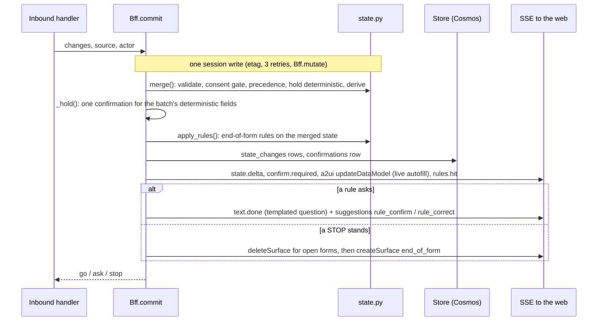
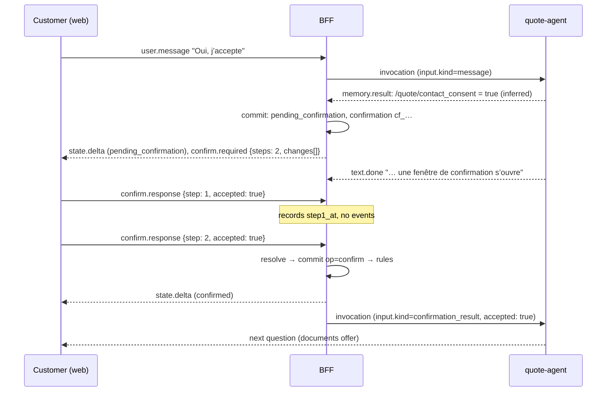
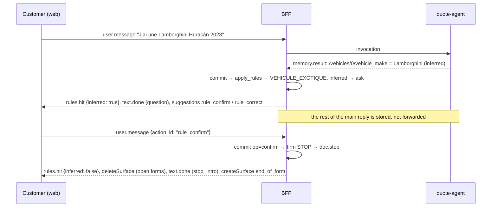
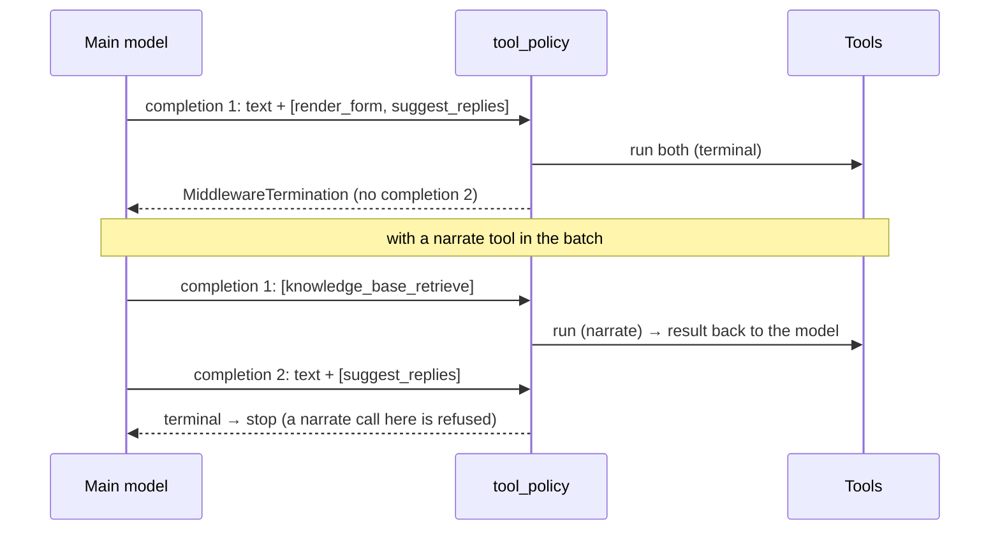

# Conversation patterns

How the quote conversation works under the hood: the mechanisms that decide what is stored, what the customer must
confirm, when the online quote stops, and what the model may see. Read this before you add a rule, a guardrail, a field
or a prompt change. Every pattern has the same parts: what it is, the trigger, the code path, the events on the wire,
how to extend it, and the tests that pin it.

Paths are relative to the solution folder. The code is the source of truth; the contracts it implements are
[`contracts/events.md`](../contracts/events.md) (envelope, events, merge rules) and
[`contracts/interfaces.md`](../contracts/interfaces.md) (HTTP, invocations, MCP). Component details are in each README:
[BFF](../bff/README.md), [quote-agent](../agents/quote-agent/README.md), [mcp-a2ui](../mcp/a2ui/README.md),
[mcp-quoting](../mcp/quoting/README.md), [web](../web/README.md). The big picture is in
[architecture.md](architecture.md); the hosted agent in [hosted-agent.md](hosted-agent.md); the toolbox in
[toolbox.md](toolbox.md). How to run the tests named below: [testing.md](testing.md).

| # | Pattern | Main code | Main tests |
|---|---|---|---|
| 1 | State envelopes, the one commit path, the pricing rule | `bff/src/quote_bff/state.py`, `Bff.commit`, `quote_common.state.is_usable` | `bff/tests/unit/test_state.py` |
| 2 | Deterministic fields and the double confirmation | `state.merge`, `Bff._hold`, `Bff.on_confirm`, `Bff.resolve` | `bff/tests/component/test_journey.py` |
| 3 | Consent gate (FR-INT-2) | `state.merge` (`pii_ok`), `Bff.on_reopen` | `test_personal_data_from_chat_waits_for_the_consent` |
| 4 | End-of-form rules | `bff/src/quote_bff/rules/end_of_form.py`, `state.apply_rules` | `bff/tests/unit/rules/test_end_of_form.py` |
| 5 | Human advisor hand-off | `Bff.end_of_form`, `Bff.send_handoff`, `forms.end_of_form_spec` | `test_lamborghini_inferred_stop_...` |
| 6 | Forms (A2UI), chips, documents | `turn.tool_policy`, `turn.hide_injected`, `mcp_a2ui.compiler`, `Bff.on_action`, `Bff.on_reopen` | `mcp/a2ui/tests/`, `bff/tests/component/test_surfaces.py` |
| 7 | Turn budget, tool modes, suggestions, phases | `turn.tool_policy`, `turn.meter`, `suggestions.filter_suggestions` | `agents/quote-agent/tests/unit/test_policy.py` |
| 8 | Text-only preference, full-form mode, "Continuer sans documents" | `Bff.on_memory`, `forms.full_form_spec`, `web/src/app/session.ts` | `web/e2e/journey.spec.ts` |
| 9 | Where the guardrails live | prompts, `Bff.on_message`, `suggestions.py`, model deployments | see the table |

The last section is the [invariants checklist](#invariants-to-keep).

---

## 1. State envelopes and the pricing rule

**What it is.** The BFF is the only writer of session state. The state is five entities at the root of the session
document (`quote`, `vehicles`, `drivers`, `underwriting`, `household`, see `state.new_session`). Every leaf is a field
envelope built by `state.envelope`:

```json
{ "value": "Honda", "source": "chat", "confidence": 0.9, "status": "inferred", "turn": 4, "updated_at": "...", "evidence": "J'ai une Honda" }
```

`status` is `inferred`, `confirmed` or `pending_confirmation`. `source` is `chat`, `form`, `document`, `lookup` or
`system`. Paths are JSON Pointers that must name a catalog field of the right entity (`state.field_for`), for example
`/vehicles/0/vehicle_make`.

**Which status a value gets** (`state.status_for`, then `state.merge`):

| Source | Who commits it | Status |
|---|---|---|
| `form` | A form submit, an edit-mode or `full_form` save, the `end_of_form` send (`Bff.on_action`, `Bff.send_handoff`) | `confirmed`, confidence 1.0 |
| `document`, reviewed | The submit of a form that has a `document_drop` field (`Bff.on_action`, `reviewed=True`) | `confirmed` |
| `document`, not reviewed | `document.uploaded` outside a DocumentDrop (`Bff.on_document`) | `inferred` |
| `chat` | The memory agent's `state_changes` (`Bff.on_memory`) | always `inferred`, with the model's confidence |
| `system` | Derived fields (`state.derive`) | `confirmed` |
| `lookup` | Ranked in the precedence, but no caller commits with it today: lookup results reach state through the form submit | `confirmed` |

Two overrides: a deterministic field from any source except `system` becomes `pending_confirmation` (pattern 2), and any
change under confidence 0.6 stays `inferred`.

**The merge rules** (`state.merge`, one batch from one source):

1. Validate the path against the catalog and the value against its type, enum, pattern and range (`state.normalize`). A
   bad value is rejected with a fr-CA message from `state.ERRORS` and logged; it is not written.
2. Only the `system` source writes `system` fields and derived fields (`years_licensed`, `years_as_principal_driver`):
   a model or a form that sends one is rejected.
3. A personal-data field is withheld before consent (pattern 3).
4. The same value from a firmer source upgrades the envelope; a value waiting for confirmation is never touched.
5. A lower source never overwrites a `confirmed` value (precedence `system` < `chat` < `lookup` < `document` < `form`,
   `state.PRECEDENCE`). It becomes a conflict: kept in `conflicts` and sent to the agent as a system note.
6. A deterministic field is held as `pending_confirmation` (pattern 2).
7. Then `state.derive` recomputes the derived fields and mirrors the policyholder's name into driver 0.

**The one commit path.** `Bff.commit(t, changes, source, actor, ...)` in `bff/src/quote_bff/service.py` is the only
way state changes. Every caller goes through it: `on_memory` (chat), `on_action` (forms, DocumentDrop, edit-mode and
full-form saves), `send_handoff`, `on_document`, `on_rule_answer` and `resolve` (confirmations). It returns `go`, `ask`
or `stop`, and the caller runs the agent only on `go`.



**The pricing rule.** `quote_common.state.is_usable(envelope, key)` is the one definition of a value that may be
priced. It is true for `confirmed`; true for `inferred` with confidence ≥ 0.6 (`QUOTABLE_MIN_CONFIDENCE`) on a field that
is not deterministic; false for `pending_confirmation`. Empty values (`None`, `""`, `[]`, `{}`) are missing. Two
callers share it:

- the BFF: `state.missing_for_quote`, sent as `missing_fields` with the `get_quote` action (`Bff.on_message`);
- mcp-quoting: `state.missing_fields` and `state.snapshot` in `mcp/quoting/src/mcp_quoting/state.py`.

**`quote_blocked`.** `create_quote` and `modify_quote` read the committed state themselves (never model arguments)
through `tools.guard` in `mcp/quoting/src/mcp_quoting/tools.py`. The guard refuses with `quote_blocked` while a STOP
stands or the rules failed, before it checks `missing_fields`. The flag is `stop or rules_error` on the session
document: the BFF adds it to `GET /internal/sessions/{sid}/state` locally (`app.py`), and `CosmosStateReader.read`
computes it in Azure. The BFF also refuses the `get_quote` action itself with the templated `not_ready` message.

**Extend it.**

- Do not add a second writer, a new source or a new status. If you need new bookkeeping in the same write, pass
  `extra=` to `Bff.commit`.
- To change the 0.6 threshold, change `QUOTABLE_MIN_CONFIDENCE` in `packages/quote_common` with its tests: the BFF and
  mcp-quoting both move.
- A new field: see pattern 2 and the [field checklist](#add-a-field).

**Tests.** `bff/tests/unit/test_state.py` (precedence, conflicts, statuses, rule 3 at 0.6, derived fields, validation,
`test_missing_fields_match_mcp_quoting`); `packages/quote_common/tests/test_quote_common.py::test_is_usable_follows_merge_rule_3`;
`mcp/quoting/tests/unit/test_state.py`; `mcp/quoting/tests/unit/test_tools.py` (`test_a_pending_deterministic_field_blocks_the_quote`,
`test_create_quote_refuses_while_the_session_is_blocked`, `test_the_block_comes_before_the_missing_fields`);
`bff/tests/component/test_journey.py::test_a_chat_contradiction_of_a_form_value_is_a_conflict_for_the_next_turn`.

---

## 2. Deterministic fields and the double confirmation

**What it is.** Some answers never change silently: consent, claims, convictions, refusal or cancellation, licence
number. They are the catalog fields with `"deterministic": true` in `contracts/state-catalog.json`
(`Catalog.deterministic_keys` in `quote_common.catalog`): `contact_consent`, `driver_license_number`, `has_claims`,
`has_convictions_in_past_three_years`, `was_denied_or_cancelled`. A change to one opens a two-step popup, and the value
is committed only after both steps (FR-DET-1 to FR-DET-6).

**Trigger.** In `state.merge`, a change is held when all of these are true:

- the field has `deterministic: true` in the catalog;
- the new value differs from the current one (a clear counts; the same value again is not a change);
- `source != "system"`. So the memory agent (`chat`), a form, a document review and an unreviewed document all trigger
  it, as the catalog's `deterministic_policy` says.

Before consent, `driver_license_number` (also `pii`) is withheld instead (pattern 3).

**Code path.**

1. `state.merge` writes the envelope with `status: "pending_confirmation"` and lists it in `MergeResult.pending`.
2. `Bff._hold` creates one confirmation `cf_<hex>` for all deterministic fields of the batch. It supersedes older
   pending confirmations on the same paths and stores `text_shown`, `source` (the batch's source), `paths`
   (`{path, old, new_value}`) and `created_ts`.
3. `Bff.commit` writes the `confirmations` row and emits `confirm.required`.
4. The web groups the `confirm.required` events of a stream in one modal (`web/src/app/store.ts`) and
   `Session.confirm(step, accepted)` (`web/src/app/session.ts`) sends `confirm.response` for each grouped id.
5. `Bff.on_confirm`: step 1 accepted records `step1_at` and emits nothing; step 2 accepted (with `step1_at` set) calls
   `resolve(c, "accepted")`; `accepted` not `true` at either step calls `resolve(c, "rejected")`; anything else is an
   `error` (`unknown_confirmation`, `confirmation_step_out_of_order`).
6. `Bff.expire_confirmations` runs at the start of every `/turns` request (`Bff.run`): a pending confirmation older than
   `deterministic_policy.pending_ttl_seconds` (900) is resolved as `expired`.
7. `Bff.resolve` commits through `Bff.commit` (source `chat`, actor `customer`): `op="confirm"` (status `confirmed`) on
   acceptance, `op="revert"` (the old envelope, or a cleared one) otherwise. Only paths still pending with the same
   value are touched. The rules run on the result, so a confirmed `was_denied_or_cancelled = true` can stop the quote.

**The agent callback.** After `resolve`, the BFF starts an agent turn with
`input = {kind: "confirmation_result", confirmation_id, accepted, changed_paths}` when:

| Case | Condition in `Bff.resolve` | Agent turn |
|---|---|---|
| Accepted | `status == "accepted"` and the commit returned `go` and `c["source"] == "chat"` | `accepted: true` |
| Accepted, raised by a form or a document | `c["source"]` is `form` or `document` | none: the agent already ran on that `form_submitted` / `document_extracted` input in the same request |
| Rejected | `status == "rejected"` and the commit returned `go` (any source) | `accepted: false` (FR-DET-3) |
| Expired | `status == "expired"` | none |
| A rule asked or stopped | the commit returned `ask` or `stop` | none |

Why `chat` only on acceptance: when the memory agent raised the confirmation, the main agent's reply in that turn was
written while the value was pending (for consent it says a confirmation window opens). The agent waits for the answer to
continue, for example to offer the documents after consent.

**Events on the wire.**



A refusal emits `confirm.rejected {confirmation_id, reason: "rejected" | "expired", paths}` and a `state.delta` with the
restored value. `confirm.required` carries `changes[]` and `confirm.rejected` is forwarded; both are documented as
deviations in the [BFF README](../bff/README.md#deviations-from-the-contracts-and-why).

**Make a new field deterministic.**

1. Set `"deterministic": true` on the field in `contracts/state-catalog.json`. That is the whole runtime change: the BFF
   holds it, `is_usable` refuses it while inferred, mcp-a2ui puts `deterministic: true` on its component and the web
   shows the "confirmé deux fois" badge and "Confirmé deux fois" in the dossier.
2. Update the lists that pin the set: `packages/quote_common/tests/test_quote_common.py::test_catalog_loads_and_knows_deterministic_fields`,
   the parametrization of `bff/tests/unit/test_state.py::test_deterministic_fields_never_commit_directly`, and the
   `DETERMINISTIC` set of the web mock BFF (`web/fixtures/mock-bff.ts`).
3. If a rule should count the value only once confirmed, test `get_status(state, path) == "confirmed"` in the predicate
   (as `refus_ou_resiliation` does).
4. Regenerate mcp-a2ui's golden file and the web fixtures if a golden form uses the field (the badge changes the
   output), then run the visual suite. See [testing.md](testing.md#golden-fixtures).
5. Update FR-DET-1 in the design's `requirements.md`, which lists the fields. The design's `contracts/` copy is
   byte-identical today; keep it that way or note the divergence.

**Tests.** `bff/tests/unit/test_state.py` (`test_deterministic_fields_never_commit_directly`,
`test_confirm_and_revert_close_a_pending_value`, `test_an_inferred_deterministic_value_is_never_quotable`);
`bff/tests/component/test_journey.py` (`test_deterministic_consent_needs_two_confirmation_steps`,
`test_a_refused_confirmation_reverts_and_informs_the_agent`, `test_a_pending_confirmation_expires_after_its_ttl`);
`bff/tests/component/test_documents_functions.py::test_a_licence_upload_holds_the_licence_number_for_double_confirmation`;
the e2e consent step in every journey (`Session.consented` in `e2e/test_api_journey.py`, `consent` in
`web/e2e/helpers.ts`).

---

## 3. Consent gate (FR-INT-2)

**What it is.** No personal data is stored before the customer has confirmed `/quote/contact_consent` (true, status
`confirmed`, so after the double confirmation). Personal data means the catalog fields with `pii: true`: `date_of_birth`,
`email`, `phone_number`, `address_line1`, `driver_date_of_birth`, `driver_license_number`.

**Trigger and code path.** One place, in the commit path: `state.merge(..., pii_ok=...)`. When `state.has_consent(doc)`
is false and `pii_ok` is false, a `set` or `add_entity` with a non-null value on a `pii` field goes to
`MergeResult.withheld` and is not written. `Bff.commit` then:

- produces no `state.delta` and no `state_changes` row for it;
- appends a system note for the next invocation: "Not saved, the contact consent is not confirmed yet (ask again after
  consent): /quote/email".

The rest of the batch is committed as usual (a first name is not `pii`).

**The end-of-form exception.** `Bff.send_handoff` commits the hand-off contact fields with `surface_id=END_OF_FORM`,
and `Bff.commit` passes `pii_ok=surface_id == END_OF_FORM`. The `end_of_form` surface has its own required
`handoff_consent` checkbox, which is the consent for that hand-off. A customer can reach an advisor before giving the
quote consent.

**Full-form mode asks first.** `Bff.on_reopen` with `surface_id == "full_form"` checks the same consent. Without it,
the BFF renders nothing and answers with the templated `consent_first` message and two suggestions, with no agent
call: `sugg_consent_yes` is the BFF action `consent_yes`, `sugg_consent_why` an ordinary reply to the agent.
`Bff.on_message` sends `consent_yes` straight to `Bff.commit` (`/quote/contact_consent = true`, source `chat`) and marks
`after_consent = "full_form"` in the same write. The double confirmation follows (pattern 2); when step 2 is accepted,
`Bff.resolve` opens the full form instead of resuming the agent and clears `after_consent`.

**Also enforced at render.** mcp-a2ui's `compile` (`mcp/a2ui/src/mcp_a2ui/compiler.py`, `_consented`, `_without_pii`)
leaves `pii` fields out of any form (repeaters included) until `/quote/contact_consent` is `true` and `confirmed` in the
state the caller passes, except on `end_of_form`. So the agent cannot show a personal-data field before consent, and
the BFF still withholds such values at commit. The main prompt (`contracts/prompts/main-agent.md`, INTENT phase) tells
the agent to get consent first.

**Extend it.** To make a field personal data, add `"pii": true` in the catalog. Do not add a second check elsewhere.
Log redaction is separate (`quote_common.logs.redact` and its patterns).

**Tests.** `bff/tests/unit/test_state.py` (`test_pii_is_withheld_until_the_contact_consent_is_confirmed`,
`test_the_handoff_contact_fields_carry_their_own_consent`); `bff/tests/component/test_journey.py`
(`test_personal_data_from_chat_waits_for_the_consent`, `test_the_handoff_works_before_the_consent`);
`bff/tests/component/test_surfaces.py::test_full_form_needs_the_confirmed_consent_first`;
`bff/tests/component/test_journey.py::test_the_full_form_consent_question_goes_through_the_commit_path_then_opens_the_form`;
`mcp/a2ui/tests/unit/test_compiler.py::test_personal_data_fields_wait_for_confirmed_consent_except_on_the_end_of_form`;
`e2e/test_api_journey.py::test_personal_data_waits_for_consent`; the full-form journeys in `web/e2e/journey.spec.ts`
and `web/e2e-stack/full-stack.spec.ts`.

---

## 4. End-of-form rules

**What it is.** Small named conditions on the session state that end the online quote (STOP) or leave a note for the
advisor (FLAG). The module is `bff/src/quote_bff/rules/end_of_form.py`, byte-identical to the design folder's
`bff/rules/end_of_form.py`. Its docstring is the full guide; this section is the summary and the solution-specific
parts.

| Rule id | Severity | Matches |
|---|---|---|
| `VEHICULE_EXOTIQUE` | STOP | A `vehicle_make` on the exotic list (Lamborghini, Ferrari, McLaren, Bugatti, Rolls-Royce, Bentley, Aston Martin) |
| `VEHICULE_MODIFIE_PERFORMANCE` | STOP | `modified_for_performance` is `true` on a vehicle |
| `USAGE_AGRICOLE` | STOP | `usage_type` is `farm` |
| `REFUS_OU_RESILIATION` | STOP | `was_denied_or_cancelled` is `true` **and** `confirmed` |
| `JEUNE_CONDUCTEUR_PRINCIPAL` | FLAG | A driver under 25 holds the `principal` role on a vehicle |

**Trigger.** Every commit batch that changed something, whatever the source. `Bff.commit` calls `state.apply_rules`
inside the same session write, before the agent runs (FR-RUL-1). Rules read the whole merged state, so the order in
which facts arrive does not matter.

**Code path** (`state.apply_rules`):

1. `DEFAULT_RULES.check(doc, acknowledged)` gives the new hits, STOP first, firm before inferred.
   `DEFAULT_RULES.check(doc)` gives every active hit, stored in `doc["rule_hits"]` and sent to the agent as RULES.
2. If a predicate raises, the commit stands, `rules_error` is set and pricing is blocked until a later check passes.
3. Every new hit adds a system note "Rule <id>: <severity>".
4. FLAG: one advisor signal per rule id in `advisor_signals`, fingerprint acknowledged, the journey continues (`go`).
5. STOP whose matched values are all `inferred` (`RuleCheckResult.needs_confirmation`): fingerprint acknowledged,
   `rule_question = {rule_id, paths, restore}` stored, outcome `ask`.
6. STOP otherwise: every new hit acknowledged, `doc["stop"] = {rule_id, reason, paths}`, outcome `stop`.
7. A later commit with no firm STOP active clears `doc["stop"]` (the customer corrected the value).

`Bff.commit` then emits one `rules.hit` per new hit (`RuleHit.event_data`: `rule_id`, `severity`, `paths`,
`inferred`, `reason`; never the matched values) and acts on the outcome:

- `ask`: `Bff.ask_rule_confirmation` sends the templated `rule_question` (the first matched path's label and value) with
  two action suggestions, `rule_confirm` ("Oui, c’est bien ça") and `rule_correct` ("Non, je corrige").
- `stop`: `Bff.end_of_form` (pattern 5).
- For form, document and confirmation inputs, the agent runs only on `go`. On the chat path the memory agent runs
  next to the main agent, so the memory result can land after the reply started. `Bff.agent_turn` holds the reply
  (`VISIBLE`: `text.*`, `a2ui.message`, `suggestions`) until `memory.result` arrives; on `ask` or `stop` it stores the
  held and later reply events with `forwarded: false`, otherwise it relays them in order (`Bff.relay`). If no memory
  result comes, the reply goes out before `turn.completed` or `error`. The cost is time to first token on chat turns:
  the reply waits for the memory agent (a small model) when it is slower than the main agent.
  Test: `bff/tests/component/test_journey.py::test_a_reply_that_streams_before_the_memory_result_waits_for_it`.

**"Ask first".** `Bff.on_message` routes the two answers to `Bff.on_rule_answer`:

- `rule_confirm`: commits `op="confirm"` on the paths. The hit is now firm (new fingerprint), the STOP stands, the
  end-of-form opens. No agent call.
- `rule_correct`: reverts the paths to `restore`. On `go`, an agent turn with
  `input = {kind: "action", action_id: "rule_correct", rule_id, changed_paths, text}` so the agent asks for the right
  value.



After a STOP: the agent's new forms are dropped (`Bff.on_agent_surface`), `get_quote` gets `not_ready`, mcp-quoting
refuses with `quote_blocked`, and the agent sees the STOP in RULES (the prompt says to open no forms).

### Add a rule

1. Write the predicate in `bff/src/quote_bff/rules/end_of_form.py`: `def my_rule(state) -> list[str]`, pure, reading
   through `get_value`, `get_status`, `iter_fields`, returning the matched field paths or `[]`.
2. Pick the severity. When unsure, FLAG.
3. Write `reason_fr` (fr-CA) and `reason_en`: one or two plain sentences, no rule id, no jargon. They are shown as written
   on the end-of-form surface, in `rules.hit` and, for a FLAG, in the hand-off summary.
4. Register with `@DEFAULT_RULES.rule(id=..., description=..., severity=..., reason_fr=..., reason_en=...)`. The id is
   UPPER_SNAKE, unique, and never renamed once released (it is stored in events, hand-offs and fingerprints).
5. Tests in `bff/tests/unit/rules/test_end_of_form.py`:
   - a positive and a negative fixture in `FIXTURES` (`FixtureCoverageTest` fails without them);
   - add the rule to `DefaultRegistryTest.test_the_five_example_rules_are_registered_in_order`;
   - a test class: paths and severity on a match, near misses, an empty state, and `inferred` versus `confirmed` when the
     predicate reads `status`.
   - Optional: a component journey in `bff/tests/component/test_journey.py` (see `test_a_firm_stop_from_a_form_...`).
6. Run `cd bff && .venv/bin/python -m pytest tests/unit/rules`, then the whole BFF suite. The docstring's
   `python3 -m unittest` line is the design folder's command; here it is pytest.
7. Keep the design copy in sync (`../bff/rules/end_of_form.py` and its test) or record that they diverge. Update
   FR-RUL-2 if the rule is one of the listed examples. Underwriting owns the list and thresholds (requirements Q8).
8. For an end-to-end journey with the fake model, the fake must produce the matching state from words: see
   [testing.md](testing.md#the-fake-model).

Nothing else changes: `Bff.commit` already runs every registered rule, and a new rule applies to sessions in progress at
their next commit.

**Tests.** `bff/tests/unit/rules/test_end_of_form.py` (95 tests, copied from the design with the imports changed);
`bff/tests/unit/test_state.py` (`test_an_inferred_stop_asks_once_and_records_how_to_revert`,
`test_a_commit_that_clears_the_hit_lifts_the_stop`, `test_a_flag_adds_one_advisor_signal_and_is_acknowledged`,
`test_a_failing_rule_keeps_the_commit_and_blocks_pricing`); `bff/tests/component/test_journey.py`
(`test_lamborghini_inferred_stop_...`, `test_rule_correct_reverts_the_value_and_starts_a_normal_turn`,
`test_a_firm_stop_from_a_form_closes_surfaces_and_does_not_invoke_the_agent`,
`test_a_rule_question_on_the_chat_path_drops_the_in_flight_reply`,
`test_a_young_principal_driver_is_flagged_once_and_the_journey_continues`, `test_an_agent_form_after_a_stop_is_not_relayed`,
`test_editing_the_answer_that_stopped_the_quote_lifts_the_stop`); `e2e/test_api_journey.py::test_lamborghini_stop_rule_asks_first_then_hands_off`;
the Lamborghini journeys in `web/e2e/journey.spec.ts` and `web/e2e-stack/full-stack.spec.ts`.

---

## 5. Human advisor hand-off

**What it is.** When the online quote cannot go on, or the customer asks for a person, the BFF shows the `end_of_form`
surface: the reason, an editable summary, contact fields and a consent box. Sending it records a hand-off with a
reference `CNS-` plus 6 digits.

**Two triggers, one surface.**

| Trigger | Code | Reason shown | `rule_id` |
|---|---|---|---|
| A STOP that stands | `Bff.commit` → `Bff.end_of_form(reason, rule_id)` | The rule's `reason_fr` | the rule id |
| "Parler à un conseiller" (header button or a suggestion with `action_id: "talk_to_advisor"`) | `Bff.on_message` → `Bff.end_of_form` | The standing STOP's reason if there is one, else `customer_request` | the STOP's rule id, or `null` |

Neither calls the agent (FR-RUL-6). After a hand-off was sent, `talk_to_advisor` repeats the reference (`handoff_done`).

**Code path.**

1. `Bff.end_of_form` closes every open surface (chips `closed`), says `stop_intro` when there is a rule, and renders
   `forms.end_of_form_spec(doc, reason, rule_id)` through `Bff.render`: an `info` note "Pourquoi? <reason> (règle <id>)",
   `first_name`, `last_name` and `phone_number` (required), `email`, `handoff_summary` (a textarea prefilled with
   `forms.handoff_summary(doc)`, a template over the committed state and the advisor signals, no model call) and
   `handoff_consent` (required checkbox). Actions: `edit_answers` and `send`. mcp-a2ui prefills the contact fields from
   the state. If mcp-a2ui fails, the BFF says the reason with a `talk_to_advisor` suggestion instead.
2. `send` → `Bff.on_action` → `Bff.send_handoff`: missing name or phone, or the consent box unchecked, come back as
   `updateDataModel` at `/_errors`, and nothing is created. Otherwise the values are committed (`source=form`, consent
   exception of pattern 3), `Bff._new_reference` draws `CNS-` + 6 digits (retries on a collision in `handoffs`), and the
   BFF writes the `handoffs` row: `reference`, `rule_id`, `reason`, `summary` (as edited), `contact` (`first_name`,
   `last_name`, `phone_number`, `email`), `consent_at`, `advisor_signals`, `status: "new"`, `created_at`.
3. It sets `doc["handoff"]`, adds the note "Hand-off <ref> sent to an advisor", emits `handoff.created
   {reference, rule_id}`, says `handoff_done` and closes the surface with chip status `sent`.
4. From then on every chip is locked (`on_reopen` answers `chips_locked`; the web locks them on `handoff.created`) and
   agent forms are dropped.
5. `edit_answers` ("Modifier mes réponses") closes the surface with no agent call. The customer reopens a chip and
   corrects an answer; a commit that clears the hit lifts the STOP.

**Deliberately unconnected.** The `handoffs` row in Cosmos is the record, and nothing reads it yet: no CRM, no work
queue, no e-mail, no notification (requirements Q7, the BFF README's infra notes). The `handoff_done` text in
`forms.STRINGS` promises a call within one business day; until a connector exists, nothing delivers that promise.

**Where a connector plugs in.**

- Preferred (Q7: "the advisor system reads it from there"): a reader of the Cosmos `handoffs` container, for example on
  its change feed, outside the BFF. It updates the row's `status` when the advisor system has taken it. No BFF change.
- If the BFF must push: call the new port in `Bff.send_handoff` right after the `handoffs` write, wired in
  `app.build_bff` with an in-memory fake for the tests, like the other adapters (BFF README, "Adapters and how to swap
  them"). Keep the row as the record, and send only rows that have a consent timestamp (NFR-PRV-5).

**Tests.** `bff/tests/component/test_journey.py` (`test_lamborghini_inferred_stop_...` covers consent required, the
edited summary, the row, `CNS-\d{6}`, chip `sent` and `chips_locked`; `test_talk_to_advisor_opens_the_end_of_form_without_a_rule`;
`test_a_second_advisor_request_after_a_handoff_repeats_the_reference`; `test_the_handoff_works_before_the_consent`);
`bff/tests/unit/test_suggestions_forms.py::test_end_of_form_has_the_reason_the_rule_the_summary_contact_and_consent`;
`e2e/test_api_journey.py::test_lamborghini_stop_rule_asks_first_then_hands_off`; `web/e2e/journey.spec.ts` (Lamborghini,
chips locked); the `form-end-of-form` and `form-end-of-form-sent` visual baselines.

---

## 6. Forms (A2UI)

**What it is.** The agent describes a form at the level of intent (a FormSpec: `contracts/form-spec.schema.json`), the
mcp-a2ui server compiles it into A2UI 1.0 messages, and the web renders them. The model never writes components.

**Trigger.** The main agent calls `a2ui.render_form` with the model-facing arguments `{form_spec}` (`contracts/tools.json`;
the FormSpec schema is inlined into the tool definition by `prompts.tool_definitions`).

**Injected arguments.** `tools.json` lists per tool the `injected_args` the caller adds after the model's call:

| Tool | Injected | Supplied by the hosted agent (`Turn.injected`) |
|---|---|---|
| `a2ui.render_form` | `state`, `mode`, `session_ref` | `state` (the invocation's committed state), `session_ref`; no `mode`, so mcp-a2ui uses `new` |
| `a2ui.render_offers` | `version`, `offers`, `session_ref` | `version` and `offers` from the turn's last quote result, `session_ref` |
| `quoting.create_quote`, `quoting.modify_quote` | `session_ref` | `session_ref` |

- `tool_policy` (function middleware, `agents/quote-agent/src/quote_agent/turn.py`) overwrites the model's values with
  the ones the turn has, and logs only the model-facing arguments (redacted) in `tool.call`.
- `hide_injected`, called by the `meter` chat middleware before every completion, removes the injected properties from
  each MCP tool's schema (properties, `required`, `additionalProperties`). The model never sees them.
- The MCP servers declare them as optional properties, otherwise the MCP client would not forward them (mcp-a2ui
  `INJECTED`).
- The BFF calls `render_form` itself with `state` and `mode` (`Bff.render`) for the surfaces it owns.

**Code path.**

1. mcp-a2ui `render_form` (`mcp/a2ui/src/mcp_a2ui/server.py`): `validate` (FormSpec schema and catalog keys; problems
   come back as an `isError` result the model can read), then `compile(spec, state, mode, lang)`. With `state`, every
   bound path the FormSpec does not prefill is filled from the committed state, with `{source, note}` provenance for
   `chat`, `document` and `lookup` values. `mode: "edit"` relabels the primary button "Enregistrer".
2. The result has a text summary for the model, `{"surface_id", "status": "shown"}`, and an `EmbeddedResource`
   (`application/a2ui+json`, `audience: ["user"]`) with one `createSurface`.
3. The agent's `tools.parse_mcp_result` keeps the audience; `Turn._map_result` emits each user message as
   `a2ui.message`, puts `form_spec` next to `data` on the `createSurface` from `render_form`, and returns only the
   summary to the model. If the model wrote no text, `text.done` falls back to "Voici un court formulaire : <title>."
4. The BFF's `Bff.on_agent_surface` registers the surface (`_register`: title, chip, origin, status `open`, mode,
   FormSpec, bound paths from `forms.bound_paths`) and forwards the message without `form_spec`. After a STOP or a
   hand-off it drops agent forms.
5. Submit: the web sends `a2ui.action` with `context.values`, a flat `{pointer: value}` map. `Bff.on_action` keeps the
   bound paths, validates them (errors go back at `/_errors` and the form stays open), closes the surface
   (`deleteSurface`, chip `submitted`), commits (`form`, or reviewed `document` when the spec has a `document_drop`),
   and on `go` runs the agent with `{kind: "form_submitted", surface_id, changed_paths}` for `submit` and `save`. Other
   button names (for example `select` on the offer cards) go to the agent as
   `{kind: "action", action_id, surface_id, changed_paths, changes, quote_id?}`.
6. Close actions (`dismiss`, `cancel`, `back`, `nodocs`, `edit_answers`, `service.CLOSE_ACTIONS`) never call the
   agent. On an agent form they add the note "Form '<id>' closed by the customer without a submit".

**A2UI messages on the wire** (`a2ui.message` envelopes):

| Message | Sent by | Effect |
|---|---|---|
| `createSurface` | mcp-a2ui via the agent or the BFF | Opens the form (components + data model in one message) and adds a chip "Formulaire : <title>" |
| `updateDataModel` | The BFF (`Bff.autofill` after each commit: the value, then `/_provenance/<escaped pointer>`; `/_errors` on validation errors), or the agent's `a2ui.update_form` | Live autofill and errors on an open form |
| `updateComponents` | mcp-a2ui | Upserts components by id |
| `deleteSurface` | The BFF after a valid submit or a close, or the agent's `a2ui.close_form` | Closes the form; the chip becomes `submitted`, `closed` or `sent` |
| `agentFunctionResponse` | The BFF's `/a2ui/functions` | Answers a renderer lookup or document read |

**Chips and reopening.** A `submitted` or `closed` chip sends `ui.surface_reopen {surface_id}` (`Session.reopen` in
`web/src/app/session.ts`). `Bff.on_reopen` takes the stored FormSpec, builds `forms.edit_spec` (prefills dropped so the
committed values show; DocumentDrop values from the state; Annuler and Enregistrer) and calls `Bff.render(mode="edit")`.
No model call, no turn. Saving commits only the changed paths with `source=form`, runs the rules, adds the note "Form
'<id>' edited outside the chat: <paths>" and says `saved`. Cancel puts the chip back to its previous status.

**`update_form`.** The agent's tool to set values or show errors on an open form (`updateDataModel`). To add or remove
fields it renders the form again. The BFF's own autofill does not use this tool.

**Documents.**

- The renderer path (used by the web): a DocumentDrop tile uploads with `POST /documents`, then reads with
  `callAgentFunction extractDocument` (`web/src/a2ui/components/documents.tsx`). `Bff.agent_function` → `Bff.extract`
  calls the document agent, `check_document` drops nulls, redacts card numbers and validates the schema, and the output
  goes back to the renderer only. The customer reviews the values (confidence pill, amber under 90 %); the submit
  commits them as reviewed `document` values. No agent call until the submit.
- The event path: `document.uploaded` (`Bff.on_document`). On an open DocumentDrop it sends the values for review;
  otherwise it commits them as unreviewed `document` values and runs the agent with `document_extracted`. The current
  web does not send `document.uploaded`; the BFF tests cover it.
- Provenance badges: the web reads `/_provenance/<pointer>` and shows "Tiré de la conversation", "Lu sur votre
  document" or "Trouvé par recherche" (`web/src/a2ui/binding.tsx`).

**Extend it.**

- A new form is usually a prompt change: the model writes FormSpecs at run time from catalog keys. The BFF-owned
  FormSpecs (`full_form`, `end_of_form`, edit mode) are in `bff/src/quote_bff/forms.py`.
- A new widget: [mcp-a2ui README, "How to extend"](../mcp/a2ui/README.md#how-to-extend) and
  [web README, "Adding an A2UI component"](../web/README.md#adding-an-a2ui-component), then golden and visual tests.
- A new injected argument: `injected_args` in `tools.json`, `INJECTED` in mcp-a2ui (or the server's schema), and a
  value in `Turn.injected`.

**Tests.** `mcp/a2ui/tests/unit/test_compiler.py`, `mcp/a2ui/tests/golden/test_golden.py`,
`mcp/a2ui/tests/component/test_server.py`; `agents/quote-agent/tests/unit/test_events.py`
(`test_render_form_forwards_the_user_resource_with_form_spec_and_model_sees_summary_only`,
`test_injected_values_follow_tools_json`); `agents/quote-agent/tests/unit/test_policy.py::test_injected_args_override_the_model_and_are_hidden_from_it`;
`bff/tests/component/test_surfaces.py` (reopen, edit-mode save, full form); `bff/tests/component/test_journey.py::test_a_form_submit_closes_commits_checks_and_invokes_the_agent`;
`bff/tests/component/test_documents_functions.py`; `bff/tests/unit/test_suggestions_forms.py` (`edit_spec`,
`bound_paths`, `values_from_context`); `web/tests/unit/components.test.tsx`; the chip journeys in `web/e2e/journey.spec.ts`
and `e2e/test_api_journey.py::test_reopening_a_chip_renders_it_again_in_edit_mode_without_the_agent`.

---

## 7. Turn budget, tool modes, suggestions and phases

**What it is.** A customer turn costs two model calls: the memory agent and the main agent, run concurrently
(NFR-PERF-3). One extra main completion is allowed after a "narrate" tool; the hard cap is three. `warmup` costs zero.

**Tool modes** (`result_mode` in `contracts/tools.json`, read into `tools.RESULT_MODE`):

| Mode | Tools | What happens to the result |
|---|---|---|
| terminal | `quoting.identify_address`, `quoting.identify_vehicle_type`, `quoting.lookup_make_model_year`, `quoting.decode_vin`, `a2ui.render_form`, `a2ui.update_form`, `a2ui.close_form`, `a2ui.render_offers`, `ui.suggest_replies`, `ui.set_phase` | Goes to the UI as events; the model gets a stub (`{"status": "sent_to_ui"}` for lookups, the `{surface_id, status}` summary for forms). The loop ends with no follow-up completion. |
| narrate | `quoting.create_quote`, `quoting.modify_quote`, `knowledge.knowledge_base_retrieve` | Goes back to the model for one more completion, which writes the text (offers advice, a cited coverage answer). |

**Code path** (`agents/quote-agent/src/quote_agent/turn.py`):

- `meter` (chat middleware) counts every model call and its usage, hides the injected arguments, and records the
  completion's batch of tool calls (`Turn.record`).
- `tool_policy` (function middleware) runs each tool through `Turn.run_tool` (events `tool.call` / `tool.result`). A
  batch decides together (`Turn.settle`): its calls run in parallel, so each finished call waits for the others (30 s
  at most). After the batch it raises `MiddlewareTermination` unless the batch has a narrate tool, or a call failed (an
  `{"error": ...}` result, such as mcp-a2ui refusing an invalid FormSpec) and the turn has not used its **one corrective
  completion**: the model then sees the error and fixes its call. A second failure ends the turn. A narrate tool in a
  later batch is refused with `{"error": "only one narrate tool round per turn"}`. Every failure reason is logged,
  redacted (`tool … failed: …`). Tests: `test_a_failed_form_gets_one_corrective_completion_even_when_suggestions_finish_first`,
  `test_only_one_corrective_completion_per_turn`.
- Button actions do not spend a call: `Runtime.pre_execute` (`agent.py`) runs `get_quote` → `quoting.create_quote` and
  `modify_quote` → `quoting.modify_quote` before the model and puts the result in INPUT as `PRE_EXECUTED`.
- So the model must write its text and all its terminal calls, including `ui.suggest_replies`, in one completion.



`turn.completed` carries `model_calls`, `usage` (`input`, `cached_input`, `output`), `ttft_ms` and `duration_ms`.

**Suggestions.** The model calls `ui.suggest_replies {items: [{label, kind, action_id?}]}`; the agent emits
`suggestions`. The BFF filters them (`suggestions.filter_suggestions`, D15, FR-CHAT-7): at most 4, at most 40
characters, no PII pattern or long number, no vehicle make, no value from the session state, no proper name. Drops are
stored as `suggestions.dropped` (not forwarded) and logged with the reason only. The web filters again
(`keepSuggestions` in `web/src/app/store.ts`). A click sends `user.message {text: label, via: "suggestion"}`, plus
`action_id` for `kind: "action"`. In `Bff.on_message`, `talk_to_advisor` and `rule_confirm` are handled by the BFF
alone; `rule_correct` reverts then runs the agent; `get_quote` is refused while blocked, otherwise it goes to the agent
with `missing_fields`; any other action id goes to the agent as `{kind: "action", action_id, text}`.

**Phases.** `intent`, `gather`, `advise`. The model calls `ui.set_phase`; the agent emits `phase`; the BFF stores
`doc["phase"]` (`Bff.agent_turn`) and sends it in the next invocation, where it becomes the PHASE line of the volatile
context (`prompts.context_message`) and `turn.started {phase}`. The memory agent's `intent.phase_hint` is not used by the
BFF. The customer's step chips are derived by the web from state and surfaces, not from the phase.

**Extend it.**

- A new tool: its entry in `tools.json` with `result_mode` (and `injected_args`), a handler on the MCP server, and the
  counts in `deploy/check_contracts.py` (`TOOLBOX_TOOLS`) and the toolbox scripts ([toolbox.md](toolbox.md)).
- Any change to a prompt or a tool definition: deploy it under a new `PROMPT_VERSION` (part of `prompt_cache_key`; a
  runtime setting passed as `--prompt-version` at each deploy, which `post_deploy.sh` sets to the commit, not a constant in
  code) and keep the static prefix under 30,000 tokens (`test_token_budget_under_30k_and_counts_tools`). See
  [hosted-agent.md](hosted-agent.md).

**Tests.** `agents/quote-agent/tests/unit/test_policy.py` (terminal ends the loop, exactly one narrate follow-up,
terminal plus narrate in one batch, second narrate refused, injected arguments); `agents/quote-agent/tests/component/test_invocations.py`
(two calls per message, three for a knowledge question, warmup with zero, pre-executed `get_quote` and `modify_quote`);
`bff/tests/unit/test_suggestions_forms.py` (the D15 filter); `bff/tests/component/test_journey.py::test_suggestions_are_filtered_before_they_are_relayed`;
`agents/quote-agent/tests/unit/test_fake_main.py::test_suggestions_are_generic_and_within_limits`.

---

## 8. Text-only preference, full-form mode, "Continuer sans documents"

**Text-only preference (D14).** The memory agent returns `session_preferences.answer_mode` (`text` or `forms`) only
when the customer says how they want to answer. `Bff.on_memory` stores a non-null value (the last statement wins, merge
rule 7), emits `session.preferences`, and sends it in each invocation as `preferences`, which becomes the PREFERENCES
line. The main prompt does the rest: `text` means no forms except the assignment board (and the documents form if
accepted), `forms` means subject forms. No code gate enforces it. Tests: `agents/quote-agent/tests/component/test_journey.py::test_text_mode_preference_asks_in_chat`,
`agents/quote-agent/tests/unit/test_rules.py::test_answer_mode_preference`, the text-only journey in
`web/e2e/journey.spec.ts`.

**Full-form mode (D20).** The header toggle sends `ui.surface_reopen {surface_id: "full_form"}`
(`Session.fullForm`). After the consent check (pattern 3), `Bff.on_reopen` renders `forms.full_form_spec(doc)` in edit
mode: one section per entity from the catalog, repeaters for vehicles and drivers, the assignment board, system flags
left out, derived fields read-only. A save commits only the changed paths (`source=form`), runs the rules, adds a
system note, says `saved`, and makes no model call. "Retour à la conversation" sends `back`. Tests:
`bff/tests/component/test_surfaces.py` (`test_full_form_needs_the_confirmed_consent_first`,
`test_full_form_shows_everything_known_and_a_save_commits_only_the_change`, `test_back_closes_the_full_form_without_committing`),
`bff/tests/unit/test_suggestions_forms.py::test_full_form_is_built_from_the_catalog`, the full-form journey in
`web/e2e/journey.spec.ts`.

**"Continuer sans documents" (known, accepted).** The documents form's secondary button is the close action `nodocs`.
The BFF closes the form alone (`deleteSurface`, chip `closed`, the note "Form 'documents' closed by the customer
without a submit") and does not call the agent. The web then sends `user.message "Continuer sans documents"` itself
(`Session.onAction` in `web/src/app/session.ts`), so the conversation goes on as in the prototype: one agent turn that
sees the note and the text. If the BFF ever runs the agent on `nodocs` itself, drop that line in the web.

---

## 9. Where the guardrails live

A guardrail belongs at the cheapest layer that can enforce it. Today:

| Guardrail | Layer | Code |
|---|---|---|
| Content safety (harmful content, jailbreaks) | Model deployments | Foundry guardrail (RAI policy) on the deployments, `infra/terraform/modules/foundry/main.tf` (`deployment_guardrails`); the hosted agent definition has no `rai_config` ([hosted-agent.md](hosted-agent.md#guardrails)) |
| Scope, no invented prices, no card numbers or passwords, citations for coverage answers | Main prompt | `contracts/prompts/main-agent.md` "Scope and guardrails" |
| Off-topic | Memory agent + BFF | `intent.off_topic` → one `guardrail` event per turn, emitted by the hosted agent (`run_memory`) and relayed by the BFF; the BFF counts the streak (`offtopic_streak`) and, after three off-topic turns in a row, `Bff.on_message` answers the next message with the templated `off_topic` text and no agent call |
| Consent before personal data | BFF commit | Pattern 3 |
| Protected answers confirmed twice | BFF commit | Pattern 2 |
| The model cannot pick the session or the prices | Hosted agent | Pattern 6 (injected arguments); mcp-quoting reads state itself and verifies `session_ref` |
| Suggested replies without PII | BFF + web | Pattern 7 |
| PII out of logs and traces | All services | `quote_common.logs.redact`; `tool.call` carries redacted model arguments |
| Document output | BFF | `service.check_document`: schema, nulls dropped, card numbers redacted |
| Input limits | BFF | `MAX_MESSAGE_CHARS` (2,000), uploads: type sniffed, 10 MB |

To add one: prefer a deployment filter or a deterministic BFF check over a prompt sentence; put BFF checks in the
inbound handler or the commit path, never in a second state writer; give the customer a templated fr-CA message from
`forms.STRINGS`; emit an event the trace can show; and add a component test in `bff/tests/component/`.

---

## Invariants to keep

Check every change against this list. Each line names where the invariant lives and the test that fails if you break it.

- [ ] **One state writer, one commit path.** Every state change goes through `Bff.commit`; nothing else writes
      `sessions` state, `state_changes` or `state.delta`. (`bff/tests/component/test_journey.py`)
- [ ] **One definition of "priceable".** `quote_common.state.is_usable`, shared by the BFF and mcp-quoting; quote tools
      read committed state, never model arguments. (`test_missing_fields_match_mcp_quoting`)
- [ ] **Every deterministic field is confirmed twice by the customer** before it is `confirmed`, whatever the source;
      no model commits one. (`test_deterministic_fields_never_commit_directly`)
- [ ] **No personal data is stored before the contact consent is confirmed**, except the hand-off contact fields under
      their own consent box. (`test_pii_is_withheld_until_the_contact_consent_is_confirmed`)
- [ ] **Rules run after every commit batch, before the agent**, ask once before an inferred STOP, and never put matched
      values in events. (`bff/tests/unit/rules/`, `test_a_rule_question_on_the_chat_path_drops_the_in_flight_reply`)
- [ ] **After a STOP or a hand-off**: no agent form, no quote, chips locked after the hand-off.
      (`test_an_agent_form_after_a_stop_is_not_relayed`, `test_create_quote_refuses_while_the_session_is_blocked`)
- [ ] **A hand-off needs the consent box** and is only stored in Cosmos `handoffs` until a connector exists.
- [ ] **The model never sees injected arguments** (`session_ref`, `state`, `mode`, `version`, `offers`), and the
      values the turn has overwrite whatever the model sent. (`test_injected_args_override_the_model_and_are_hidden_from_it`)
- [ ] **Two model calls per turn, three at most**: terminal tools end the loop, one narrate round or one corrective completion after a failed call, button actions
      pre-executed. (`test_policy.py`, `test_message_turn_streams_the_expected_sequence_with_two_model_calls`)
- [ ] **The static prefix stays under 30,000 tokens and byte-identical across turns**; deploy any prompt or tool change
      under a new `PROMPT_VERSION` (a runtime setting, set at deploy). (`test_prompts.py`)
- [ ] **BFF-only actions make no model call**: reopen, edit-mode and full-form saves, close actions, rule answers,
      the hand-off. (`bff/tests/component/test_surfaces.py`)
- [ ] **Customer text is fr-CA from the catalog (`label_fr`, `help_fr`, `enum_fr`) or a string table** (`forms.STRINGS`
      in the BFF, the web's components); code, logs and the trace stay English. One exception today: the agent's
      fallback sentence "Voici un court formulaire : <title>." is hard-coded in `Turn._map_result`.
- [ ] **Suggestions are generic**: ≤ 4 items, ≤ 40 characters, no PII, names or values. (`test_suggestions_forms.py`)
- [ ] **Contracts first**: change `contracts/` (and its design copy), then code, then tests, then docs.

### Add a field

1. Add it to `contracts/state-catalog.json` with `entity`, `type`, `label`/`label_fr`, `help_fr`, `enum`/`enum_fr`,
   ranges, and the flags it needs: `required_for_quote` (priced, listed in `missing_fields`), `deterministic`
   (pattern 2), `pii` (pattern 3), `system` (models may not write it).
2. Nothing else is needed for the BFF validation, the memory agent's key list, the compiler, the full form, the dossier
   or pricing input: they read the catalog. The rating engine adapter must know the new input (mcp-quoting README).
3. The main prompt's static prefix grows (the key list is generated): run the token budget test and deploy under a new
   `PROMPT_VERSION` (`post_deploy.sh` sets one per commit).
4. If a document can fill it, add it to `field_map` in `contracts/document-output.schema.json`.
5. Regenerate the golden file and the web fixtures if a golden form uses it, and run every level
   ([testing.md](testing.md#before-you-merge)).
