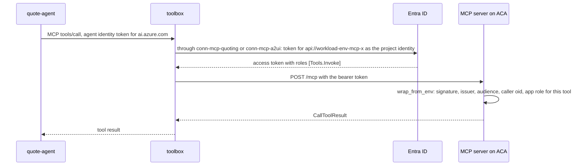

# Toolbox, MCP servers and Foundry IQ

How the hosted agent reaches its tools in Azure: the Foundry toolbox over the two MCP servers on Azure Container Apps, the Entra app registrations that protect them, the Foundry IQ knowledge base, and how to connect the insurer's real systems or another MCP server.

Read with: [`contracts/tools.json`](../contracts/tools.json) (the tool list), [`contracts/interfaces.md`](../contracts/interfaces.md) §3, [`mcp/quoting/README.md`](../mcp/quoting/README.md), [`mcp/a2ui/README.md`](../mcp/a2ui/README.md), [architecture.md](architecture.md), [hosted-agent.md](hosted-agent.md).

## Decision in force

The Foundry toolbox `auto-quoting-toolbox` calls the **internal MCP servers on Azure Container Apps**, `mcp-quoting` and `mcp-a2ui` (confirmed by the team on 2026-11-25). It authenticates as the **Foundry project's managed identity**, which holds the Entra app role **`Tools.Invoke`** on both servers. The BFF calls the same servers with its own identity: `Lookup.Read` on mcp-quoting (field lookups) and `Tools.Invoke` on mcp-a2ui (the forms it renders itself). The servers validate every token with `quote_common.auth.wrap_from_env`.



## Which tools go where

`contracts/tools.json` is the one tool list. The MCP servers read their names, descriptions and input schemas from it at startup and refuse to start if a tool has no handler, so the contract cannot drift. The hosted agent reads `result_mode` and `injected_args` from it.

| Tools (`tools.json` `server`) | Served by | How the hosted agent reaches them | How the BFF reaches them |
|---|---|---|---|
| 6 `quoting.*` | mcp-quoting, server-local names (`identify_address`, `create_quote`, …) | Toolbox entry `quoting` | Lookups only, directly (`QUOTING_MCP_URL`, `QUOTING_MCP_SCOPE`) |
| 4 `a2ui.*` | mcp-a2ui (`render_form`, `update_form`, `close_form`, `render_offers`) | Toolbox entry `a2ui` | `render_form`, directly (`A2UI_MCP_URL`, `A2UI_MCP_SCOPE`) |
| `knowledge.knowledge_base_retrieve` | Foundry IQ knowledge base `auto-quoting-kb` | Directly, not through the toolbox (`FOUNDRY_IQ_MCP_URL`) | not used |
| `ui.suggest_replies`, `ui.set_phase` | the hosted agent itself (local function tools) | in process | not used |

The toolbox namespaces each server's tools with its `server_label`. Verified on the first dev deploy (2026-11-25): the served name is `<server_label>___<tool>` with three underscores (`quoting___create_quote`), and the toolbox reaches the internal Container Apps environment through the account's agent subnet with `ProjectManagedIdentity` tokens (v2, `aud` = the client id). `tools.logical_name` in the agent maps that spelling (and the others) to `quoting.create_quote`, and `deploy/smoke_test.py --checks toolbox` prints the names the toolbox serves. It expects exactly 6 `quoting` and 4 `a2ui` tools; `deploy/check_contracts.py` checks the same counts in CI.

## `deploy/create_toolbox.py`

Creates an immutable version of the toolbox, then promotes or pins it. It uses `deploy/common.py`: one HTTP client with an Entra token for `https://ai.azure.com/.default` (`DefaultAzureCredential`), and `--dry-run`, which prints each request as one JSON line and sends nothing.

| Flag | Environment variable | Default | Meaning |
|---|---|---|---|
| `--project-endpoint` | `FOUNDRY_PROJECT_ENDPOINT` | required | Foundry project endpoint |
| `--name` | | `auto-quoting-toolbox` | Toolbox name |
| `--quoting-url` | `MCP_QUOTING_URL` | required to create | `https://<mcp-quoting fqdn>/mcp` |
| `--a2ui-url` | `MCP_A2UI_URL` | required to create | `https://<mcp-a2ui fqdn>/mcp` |
| `--quoting-connection` | | `conn-mcp-quoting` | RemoteTool connection of the `quoting` entry |
| `--a2ui-connection` | | `conn-mcp-a2ui` | RemoteTool connection of the `a2ui` entry |
| `--promote` | | off | Make the new version the default |
| `--pin VERSION` | | | Make an existing version the default; creates nothing (rollback) |
| `--list` | | | List the versions; creates nothing |
| `--dry-run` | | off | Print the requests; send nothing |

`--promote`, `--pin` and `--list` are mutually exclusive. The first version becomes the default by itself.

What it sends (`api-version=v1`):

1. `POST {project}/toolboxes/auto-quoting-toolbox/versions` with two entries, each `{type: "mcp", server_label, server_url, require_approval: "never", project_connection_id, description}`: `quoting` over `conn-mcp-quoting`, `a2ui` over `conn-mcp-a2ui`.
2. With `--promote`: `PATCH {project}/toolboxes/auto-quoting-toolbox` with `{"default_version": "<n>"}`.

The agent's consumer endpoint is the output `toolbox_mcp_url`: `{project}/toolboxes/auto-quoting-toolbox/mcp?api-version=v1`. `deploy/post_deploy.sh toolbox` runs `create_toolbox.py --promote` with the URLs taken from `terraform output -json`.

## RemoteTool connections (`infra/terraform/main.tf`)

The toolbox entries point at project connections that Terraform creates (`azapi_resource.remote_tool`): category `RemoteTool`, `authType = "ProjectManagedIdentity"`, `isSharedToAll = true`.

| Connection | Target | Audience | Created |
|---|---|---|---|
| `conn-mcp-quoting` | `https://<mcp-quoting fqdn>/mcp` | `api://<tenant-id>/<workload>-<env>-mcp-quoting` | when `deploy_apps = true` (it needs the FQDN) |
| `conn-mcp-a2ui` | `https://<mcp-a2ui fqdn>/mcp` | `api://<tenant-id>/<workload>-<env>-mcp-a2ui` | when `deploy_apps = true` |
| `conn-foundry-iq` | `https://<search>.search.windows.net/knowledgebases/auto-quoting-kb/mcp?api-version=2026-11-01-preview` | `https://search.azure.com/` | always. No script or agent setting uses it today: the agent calls the knowledge base directly |

**[UNVERIFIED]** `ProjectManagedIdentity` with an `audience` is absent from the published ARM schema. If ARM rejects it, create the connections with the `azd ai connection create --kind remote-tool --auth-type project-managed-identity --audience ...` command and remove `azapi_resource.remote_tool` ([`infra/README.md`](../infra/README.md) "Verify before build").

## Entra app registrations and app roles (`infra/terraform/entra/`)

A separate stack, because it needs Microsoft Graph permissions (`Application.ReadWrite.OwnedBy`, `AppRoleAssignment.ReadWrite.All`) that the platform pipeline should not hold. Apply it once per environment, after the main stack and before the toolbox step ([deployment.md](deployment.md)).

| App registration | Identifier URI (audience) | App roles (`allowed_member_types = Application`) |
|---|---|---|
| `<workload>-<env>-mcp-quoting` | `api://<tenant-id>/<workload>-<env>-mcp-quoting` | `Tools.Invoke`, `Lookup.Read` |
| `<workload>-<env>-mcp-a2ui` | `api://<tenant-id>/<workload>-<env>-mcp-a2ui` | `Tools.Invoke` |

| Grant | Principal (variable) | App | Role |
|---|---|---|---|
| `quoting-project-tools` | Foundry project identity (`project_principal_id`) | mcp-quoting | `Tools.Invoke` |
| `a2ui-project-tools` | Foundry project identity | mcp-a2ui | `Tools.Invoke` |
| `quoting-bff-lookup` | BFF identity (`bff_principal_id`) | mcp-quoting | `Lookup.Read` |
| `a2ui-bff-tools` | BFF identity | mcp-a2ui | `Tools.Invoke` |

Each service principal has `app_role_assignment_required = true`: Entra issues a token for the API only to an identity that holds one of its roles. The stack's `workload` variable (default `aiq`) must equal the main stack's, because the main stack builds the same audience strings for the apps and the connections. The output `audiences` lists them.

The quote-agent's own identity holds no app role: its tool calls reach the servers as the project identity, through the toolbox.

## Inbound check on the MCP servers

Both servers wrap their ASGI app with `quote_common.auth.wrap_from_env` in `create_app()`. The check is **off unless `ENTRA_AUDIENCE` is set**, so local runs and tests need no Azure. The `auth` extra (`PyJWT`) is installed by the `azure` extra in both images.

| Variable | Set by Terraform (`locals.tf`, `mcp_env`) | Meaning |
|---|---|---|
| `ENTRA_AUDIENCE` | `api://<tenant-id>/<workload>-<env>-mcp-quoting` or `…-mcp-a2ui`, then `,<client id>` once `mcp_client_ids` is set | Comma-separated accepted `aud` values: the `api://` URI and/or the app's client id. Unset: no check |
| `ENTRA_TENANT_ID` | the tenant of the Terraform caller | Accepted issuers (v1 and v2) and the signing keys (`https://login.microsoftonline.com/<tenant>/discovery/v2.0/keys`). Required when the check is on: without it the server does not start |
| `ENTRA_ALLOWED_PRINCIPAL_IDS` | the BFF identity and the Foundry project identity | Comma-separated caller object ids (`oid`). Empty: any caller of the tenant with a role |

The check, in order, on every request except `GET /healthz`: a bearer token; RS256 signature from the tenant's keys; issuer; audience; caller `oid` in the allow-list; an app role. The role depends on the JSON-RPC body: for `tools/call`, the tool's roles; for anything else (`initialize`, `tools/list`), the server's default roles.

| Server | `create_quote`, `modify_quote` | Any other request |
|---|---|---|
| mcp-quoting | `Tools.Invoke` | `Tools.Invoke` or `Lookup.Read` |
| mcp-a2ui | | `Tools.Invoke` |

A failure answers `401` (`{"error": "unauthorized", "message": ...}`) for a missing or invalid token, and `403` (`"forbidden"`) for a caller not in the list or a missing role. The `message` names the cause (see Troubleshooting). `session_ref` is checked after this, by mcp-quoting itself, on every quote call.

Other settings of the servers (state reader, adapters, timeouts, `SESSION_REF_KEY`) are in each README. Terraform sets all of them from `app_defs` in `locals.tf`.

## Foundry IQ knowledge base

`deploy/create_knowledge_base.py` creates the knowledge source and the knowledge base with the Azure AI Search REST API (`2026-10-01`, Entra token for `https://search.azure.com/.default`; Search has local auth off).

| Flag | Environment variable | Default | Meaning |
|---|---|---|---|
| `--search-endpoint` | `SEARCH_ENDPOINT` | required | `https://<search>.search.windows.net` (output `search_endpoint`) |
| `--storage-id` | `KB_STORAGE_ID` | required | ARM id of the `kb-docs` storage account (output `kb_storage_id`) |
| `--container` | | `kb-docs` | Blob container with the documents |
| `--openai-endpoint` | `OPENAI_ENDPOINT` | required | `https://<account>.openai.azure.com`; `post_deploy.sh` derives it from the project endpoint |
| `--settings` | | the solution root `settings.yaml` | Where the two deployment defaults below come from |
| `--embedding-deployment`, `--embedding-model` | `EMBEDDING_DEPLOYMENT`, `EMBEDDING_MODEL` | `knowledge.embedding_deployment`, and that deployment's `model` in `deployments` (required if neither gives them) | The `embedding` role deployment and its model name |
| `--planning-deployment`, `--planning-model` | `PLANNING_DEPLOYMENT`, `PLANNING_MODEL` | `knowledge.planning_deployment`, and its `model` in `deployments`; optional (the model is required with the deployment) | Small chat model for query planning (the `memory` role). Remove `planning_deployment` from `settings.yaml` for a model-free knowledge base |
| `--api-version` | | `2026-10-01` | Search REST version |
| `--wait SECONDS` | | `0` | Poll the first ingestion; fails on failed items or timeout. `post_deploy.sh` uses 1800 |
| `--dry-run` | | off | Print the requests |

A flag wins over the environment variable, which wins over `settings.yaml`. The model name defaults from the file only when the deployment is a key of `deployments`; a deployment named by a flag that is not one needs its `--…-model`. `post_deploy.sh` exports the deployments and models of the Terraform output `model_deployments` as the environment variables.

It sends two `PUT`s:

- Knowledge source `kb-docs-source`: kind `azureBlob` over the container, keyless (`ResourceId=<storage id>`; the Search identity reads the blobs), private ingestion through the shared private links, the embedding model, minimal content extraction, no ingestion schedule.
- Knowledge base `auto-quoting-kb`: that source, the planning model if given (`retrievalReasoningEffort` `low`, else `minimal`), and `outputMode: extractiveData`: it returns passages, and the main agent writes the answer.

**How it is attached to the agent.** Not through the toolbox. The hosted agent opens its own MCP connection to `FOUNDRY_IQ_MCP_URL` (output `kb_mcp_url`), limited to the tool `knowledge_base_retrieve` and namespaced `knowledge`, with a token for `FOUNDRY_IQ_TOKEN_SCOPE` from the agent identity. That identity gets Search Index Data Reader in the second `terraform apply`. The tool is a narrate tool; passages with a title and a reference become `citations` on `text.done`.

**Before you run it.** Upload the documents to `kb-docs`: nothing in the repository does. The pipeline identity has Storage Blob Data Contributor on that container (`cicd_principal_id`). The shared private links must be approved (`post_deploy.sh approve`). How to re-ingest after the first synchronization is not settled in the code. The Foundry IQ result shape and token scope are **[UNVERIFIED]** (spike S8).

## Connect a new or real MCP server

### A. Replace the stub quoting engine with the insurer's systems

This changes no tool and no toolbox entry: only mcp-quoting's adapters. The full guide, with the default wire formats, is [`mcp/quoting/README.md`](../mcp/quoting/README.md) "How to connect the real quoting system".

| Interface (`adapters/base.py`) | Stub | HTTP adapter (`adapters/http.py`) | Selected by | Real back end needs |
|---|---|---|---|---|
| `RatingEngine.price(snapshot, offer_types)` | `StubRatingEngine` | `HttpRatingEngine`: `POST /rate`, mapping functions `to_payload`, `to_offers` | `RATING_ENGINE=http` | `RATING_BASE_URL`, optional `RATING_SCOPE` |
| `VehicleCatalog.years/makes/models/vehicle_type` | `StubVehicleCatalog` | `HttpVehicleCatalog`: `to_names`, `to_type` | `VEHICLE_CATALOG=http` | `CATALOG_BASE_URL`, `CATALOG_SCOPE` |
| `AddressService.candidates(query, postal_code)` | `StubAddressService` | `HttpAddressService`: `to_candidates` | `ADDRESS_SERVICE=http` | `ADDRESS_BASE_URL`, `ADDRESS_SCOPE` |
| `VinDecoder.decode(vin)` | `StubVinDecoder` | `HttpVinDecoder`: `to_vehicle` | `VIN_DECODER=http` | `VIN_BASE_URL`, `VIN_SCOPE` |
| `QuoteStore.latest/save` | `InMemoryQuoteStore` | none yet | replaced in `from_env` | a database, then more than one replica |

Steps:

1. **Map the wire format.** If the system speaks JSON over HTTP, write the mapping functions and pass them where `from_env` (`adapters/__init__.py`) builds the adapter, for example `HttpRatingEngine(api("RATING"), to_payload=..., to_offers=...)`. Mapped offers must validate as `Offer`. For another protocol, write a class with the same `async` method and add it as an option of `_choose(...)` in `from_env`.
2. **Configure it in Terraform.** The variable `quoting` turns each adapter on and writes its variables into the container app:

   ```hcl
   quoting = {
     backends = {
       rating = { base_url = "https://<rating-api>", scope = "api://<rating-app-id>/.default" }
     }
     http_timeout_seconds = 2 # NFR-PERF-5: create_quote under 3 s at p95
     http_retries         = 1
   }
   ```

   A back end left out stays on its stub. With `scope`, every call carries a token of the mcp-quoting identity (`id-mcp-quoting-…`, `AZURE_CLIENT_ID`).
3. **Grant access and a network path.** Give the mcp-quoting identity access to the insurer's API (its own app role or policy; outside this repository). Outbound traffic leaves the `aca-infra` subnet; `enable_nat_gateway = true` gives a fixed IP for allow-lists (output `nat_public_ip`). A private link or peering to the insurer is not built.
4. **Decide the replicas.** With the in-memory `QuoteStore`, keep mcp-quoting at one replica (`app_defs` in `locals.tf`). Implement `latest` and `save` on a database first to scale out.
5. **Test** as the README says: wire-format unit tests with `httpx.MockTransport`, and `azure`-level tests (skipped unless `RUN_AZURE_TESTS=1`). See [testing.md](testing.md).
6. **Release** through CD, then run `deploy/smoke_test.py` ([deployment.md](deployment.md)).

### B. Add another MCP server behind the toolbox

Every place below is a list or map in the code today; add one entry to each.

1. **Contract.** Add the tools to `contracts/tools.json`: `name` (`<label>.<tool>`), `server`, `wire_name`, `description`, `inputSchema`, `result_mode`, `injected_args`. A tool without an entry is treated as `terminal` by the hosted agent (its result goes to the UI, the model gets a stub). Update `TOOLBOX_TOOLS` in `deploy/check_contracts.py` and `EXPECTED_TOOLS` in `deploy/smoke_test.py`. The 30k static-prefix test counts the new definitions.
2. **Server.** Streamable HTTP at `/mcp` and an open `GET /healthz`, schemas served from `tools.json`, the ASGI app wrapped with `wrap_from_env(app, default_roles=..., tool_roles=...)`. Copy `create_app()` from `mcp/a2ui/src/mcp_a2ui/server.py`.
3. **Entra.** Add the app and its roles to `local.apps` in `entra/main.tf`, and a `Tools.Invoke` grant for `project_principal_id` (and the BFF if it calls the server) to `local.grants`. Apply the Entra stack.
4. **Container app.** In `locals.tf`: the app key in `app_keys`, its audience in `mcp_audience`, and an `app_defs` entry (port, health path, replicas, `merge(local.mcp_env, { ENTRA_AUDIENCE = ... })`). In `.github/workflows/deploy-env.yml`: its Dockerfile in the `dockerfile` map and the `apps` list.
5. **Connection.** Add the app key to the list that builds `remote_tools` in `main.tf` (connection `conn-<app>`).
6. **Toolbox.** Add an entry to `build_version_body` in `deploy/create_toolbox.py` (URL and connection flags), and export its URL in `deploy/post_deploy.sh`.
7. **Check.** After the release, `smoke_test.py --checks toolbox` lists the served names.

For a server the insurer already runs elsewhere, skip steps 2 and 4: point the connection's `target` at its URL and its `audience` at its own app registration, which must grant a role to the project identity. This code builds only `ProjectManagedIdentity` connections, and network reach from the toolbox to a server outside the VNet is not verified.

## Troubleshooting

Look at the HTTP status and the `message` in the server's answer (or the error the BFF or the toolbox reports). The `invalid token: <Name>` message carries the PyJWT exception name.

| Symptom | Likely cause | Fix |
|---|---|---|
| `401`, `missing bearer token` | The caller sent no token: the BFF's `*_MCP_SCOPE` is empty, or the toolbox entry has no working connection | Set the scope (Terraform sets `api://…/.default`); check `conn-mcp-*` exists and the toolbox version names it |
| `401`, `invalid token: InvalidAudienceError` | Wrong audience: the token was asked for another resource, or it carries the app's client id while `ENTRA_AUDIENCE` holds only the `api://` URI (`mcp_client_ids` not set yet) | Request `api://<tenant-id>/<workload>-<env>-<app>/.default`; or set `mcp_client_ids` from the Entra stack's output `client_ids` and apply the platform stack |
| `401`, `invalid token: InvalidIssuerError` | Token from another tenant, or `ENTRA_TENANT_ID` is wrong | Use the tenant that holds the app registrations |
| `401`, `invalid token: ExpiredSignatureError` | Expired token | The caller must refresh it |
| `401`, `invalid token: PyJWKClientConnectionError` or `PyJWKClientError` | The server cannot fetch the tenant's signing keys, or the token's key id is not among them | Allow outbound HTTPS from the Container Apps subnet to `login.microsoftonline.com` |
| `403`, `caller not allowed` | The caller's `oid` is not in `ENTRA_ALLOWED_PRINCIPAL_IDS`: for example the agent identity calling directly, or a project or BFF identity that was re-created | Re-apply Terraform so `mcp_env` has the current principal ids, or route the call through the toolbox |
| `403`, `missing app role` | The token has no role for this call: the BFF (only `Lookup.Read`) called `create_quote` or `modify_quote`, or the role was granted after the token was issued | Grant the role in `entra/main.tf`; get a new token (managed identity tokens are cached, so a restart or a wait may be needed) |
| The caller cannot get a token at all | `app_role_assignment_required = true` and the caller holds no role on that API | Apply the Entra stack with the right `bff_principal_id` and `project_principal_id` |
| The server does not start: its log has `configuration error: ENTRA_TENANT_ID is required when ENTRA_AUDIENCE is set` and the process exits with code 1 | Half of the settings are present | Set both, or neither for a local run |
| The server does not start: `ModuleNotFoundError` for `jwt` | Image built without the `azure` extra | Build with the component's Dockerfile |
| Tool result `invalid_session_ref` (HTTP 200, `isError`) | `session_ref` missing, expired (15 minutes) or signed with another key | Same `SESSION_REF_KEY` (Key Vault `session-ref-key`) for the BFF and mcp-quoting; the hosted agent injects it into `create_quote` and `modify_quote` |
| Smoke test: `expected {'quoting': 6, 'a2ui': 4}, the toolbox serves …` | The toolbox version is stale, an entry failed to list its tools, or the names use an unexpected separator | `create_toolbox.py --list`; check the connections; read the printed names |
| The model never sees a new tool's result | The tool has no `result_mode` in `tools.json`, so it is `terminal` | Add it to the contract |
